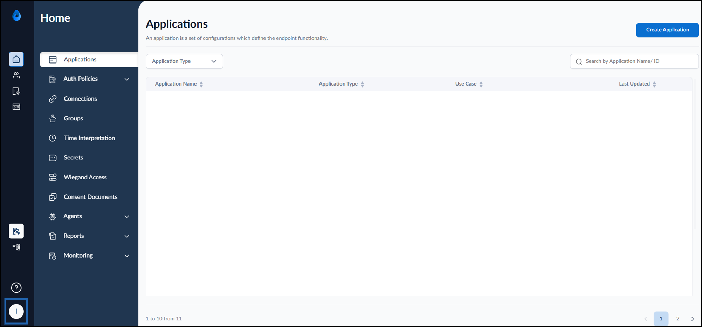
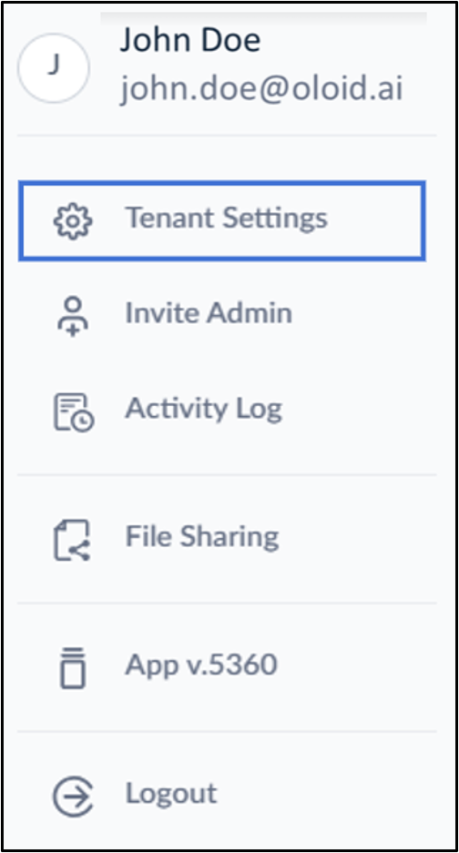
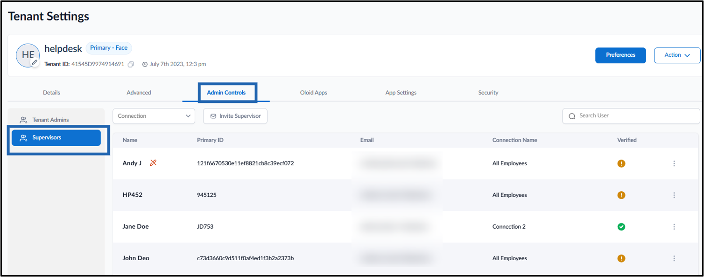
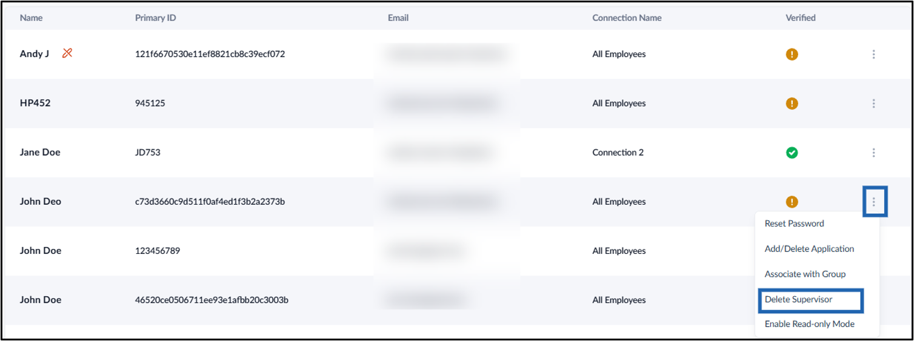
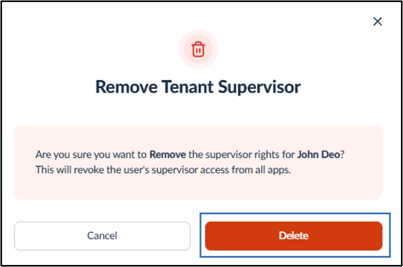
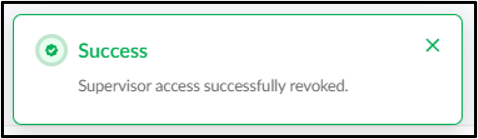

{/* Source: Intercom article 8231496 - https://oloid.help/en/articles/8231496-tenant-admin-portal-how-to-remove-a-user-from-a-supervisor */}
{/* Generated by intercom_to_mintlify.py - re-running overwrites this file. */}

## Introduction

This document provides instructions to remove a user's Supervisor access in the Tenant Admin Portal.

## Prerequisite

You must have admin access to the Tenant Admin Portal.

## Steps to Remove a User as a Supervisor

1. Log in to the **Tenant Admin Portal**.
2. On the home page, click the **user profile icon** on the bottom left.

   

   The user profile menu is displayed.
3. Click **Tenant Settings**.

   

   The **Tenant Settings** page is displayed.
4. Go to **Admin Controls** > **Supervisors**.

   

5. Click **kebab menu** (three vertical dots) for the applicable Supervisor and select **Delete Supervisor**.

   

   The **Remove Tenant Supervisor** pop-up box is displayed.
6. Click **Delete**.

   

   The user's Supervisor access is successfully revoked.

   
