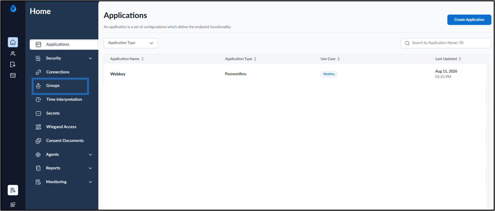
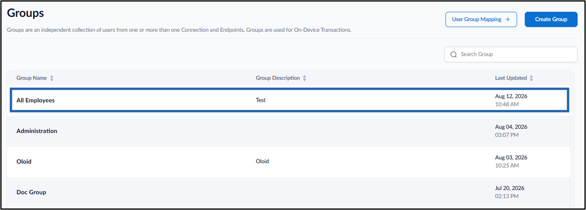
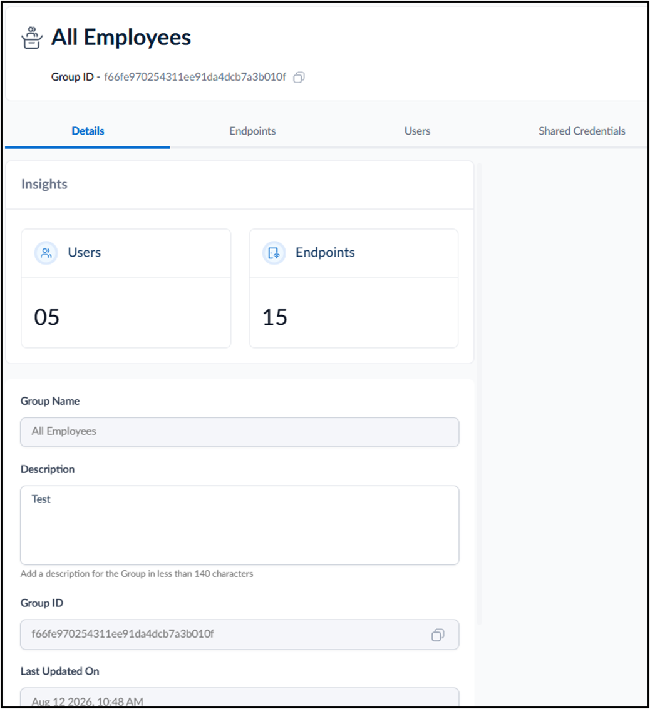
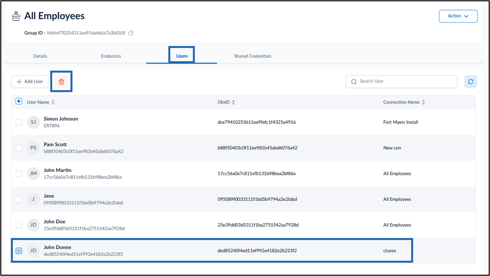
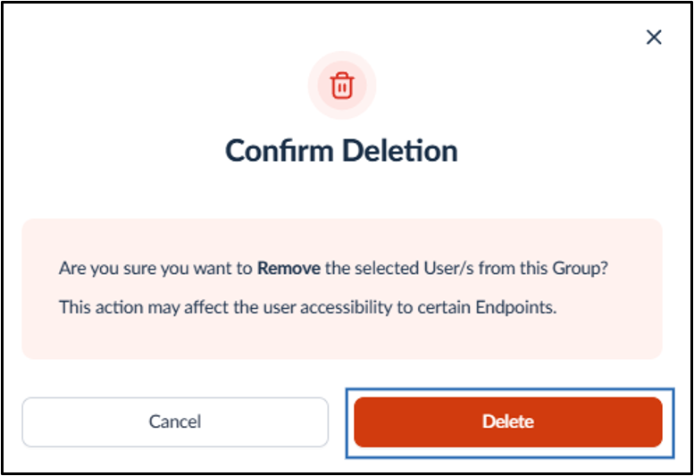
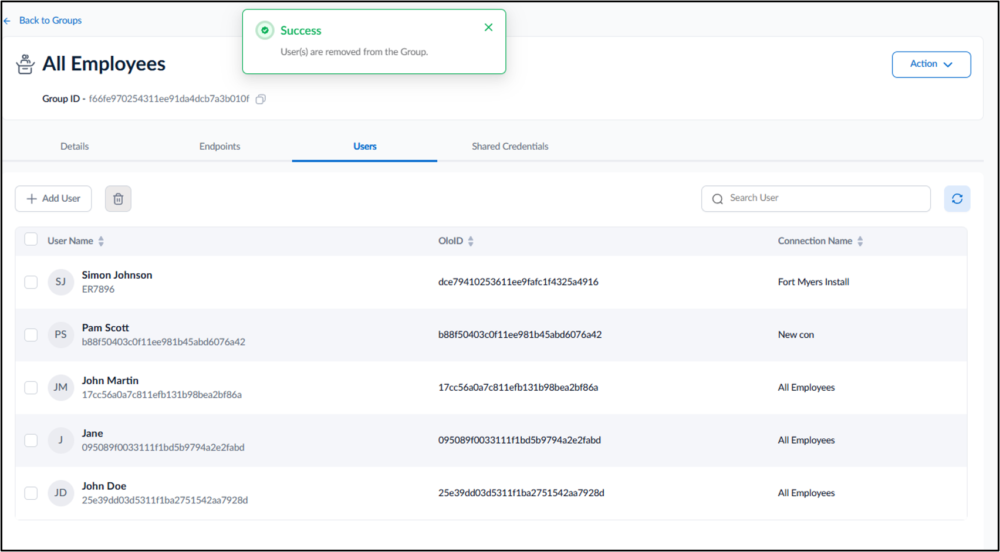

{/* Source: Intercom article 8311847 - https://oloid.help/en/articles/8311847-tenant-admin-portal-how-to-remove-a-user-from-group */}
{/* Generated by intercom_to_mintlify.py - re-running overwrites this file. */}

## Introduction

This document provides instructions to remove one or more users from a group in the Tenant Admin Portal.

## Prerequisite

You must have admin access to the Tenant Admin Portal.

## Steps to Remove User from Group

1. Log in to the **Tenant Admin Portal**.
2. On the home page, click **Groups** on the left panel menu.

   

   The **Groups** page is displayed.
3. Click the preferred group.

   

   The **Group Details** page is displayed.

   

4. Click **Users** tab and do the following:
   1. Select the preferred user(s).

      <Note>
        **Note:** If needed, you can select multiple users to delete from the group.
      </Note>

   2. Click **Delete** icon.

      

      The **Confirm Deletion** pop-up box is displayed.
   3. Click **Delete**.

      

      The selected user is successfully removed from the group.

      
