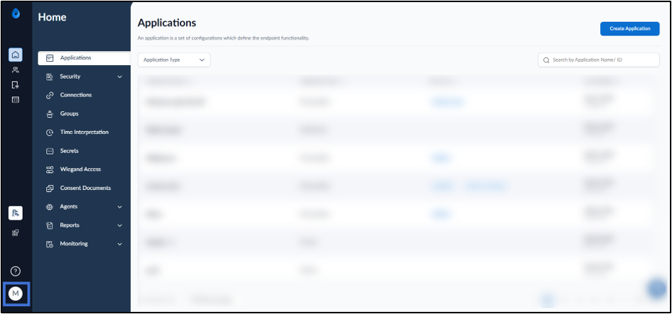
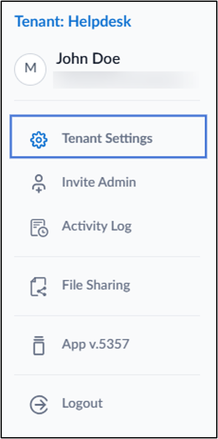
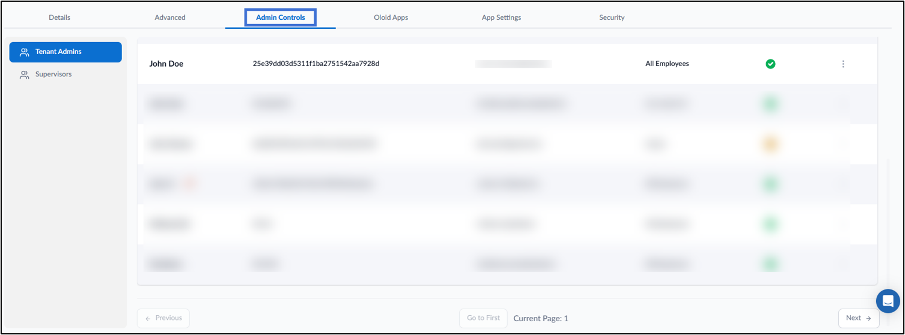
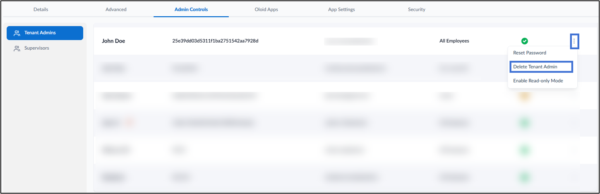
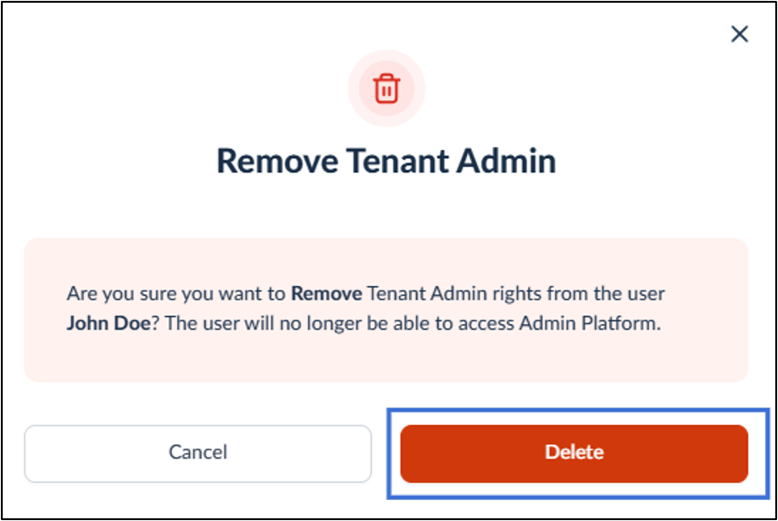

{/* Source: Intercom article 8237885 - https://oloid.help/en/articles/8237885-tenant-admin-portal-how-to-remove-user-from-tenant-admin-role */}
{/* Generated by intercom_to_mintlify.py - re-running overwrites this file. */}

## Introduction

This document provides step-by-step instructions to remove the Tenant Admin role from a user in the Tenant Admin Portal. Removing the role revokes the user's Tenant Admin access to the Tenant Admin Portal.

### Prerequisites

- You must have Tenant Admin access to the **Tenant Admin Portal**.
- The user must be an existing Tenant Admin.

## Steps to remove user from Tenant Admin role

1. Log in to the **Tenant Admin Portal**.
2. On the homepage of the portal, click **user profile icon** on the bottom left corner of the menu panel.

   

   The user profile menu is displayed.
3. Click **Tenant Settings**.

   

   The **Tenant Settings** page is displayed.
4. Go to **Admin Controls** tab.

   

5. In the **Tenant Admins** tab, click **kebab menu** (three vertical dots) and select **Delete Tenant Admin** for a particular tenant admin.

   

   The **Remove Tenant Admin** pop-up box is displayed.
6. Select **Delete**.

   

   The Tenant Admin is deleted successfully. The user's Tenant Admin rights are removed, and they can no longer access the Tenant Admin Portal.

   
