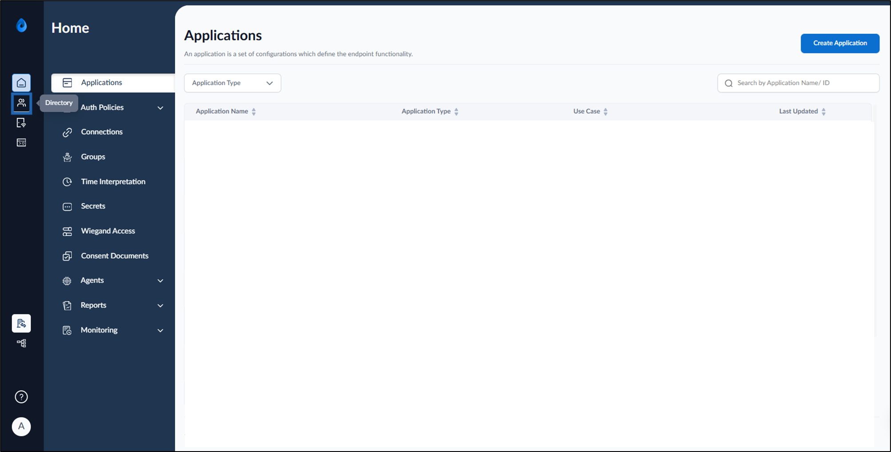
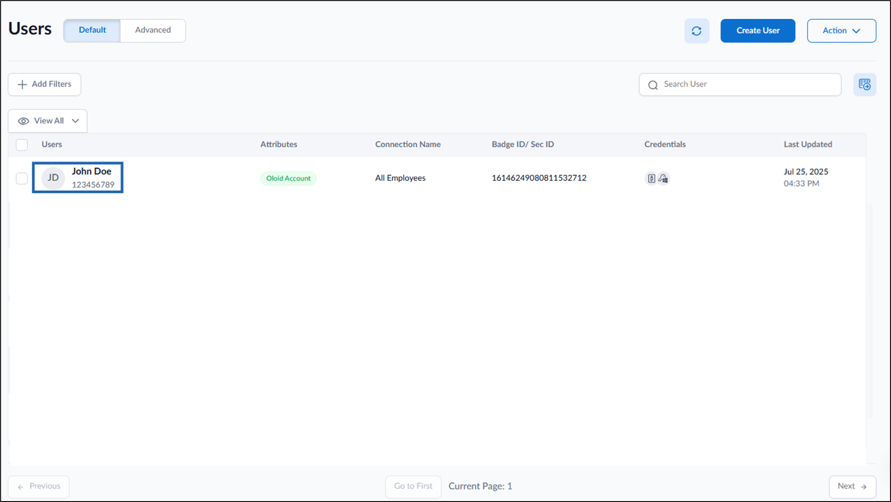
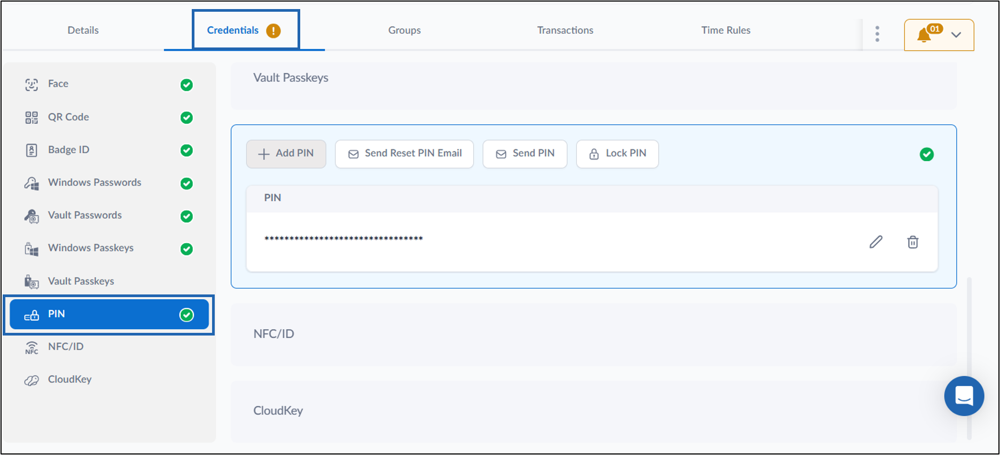
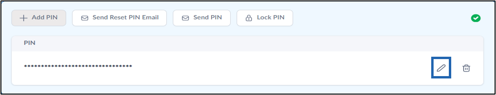
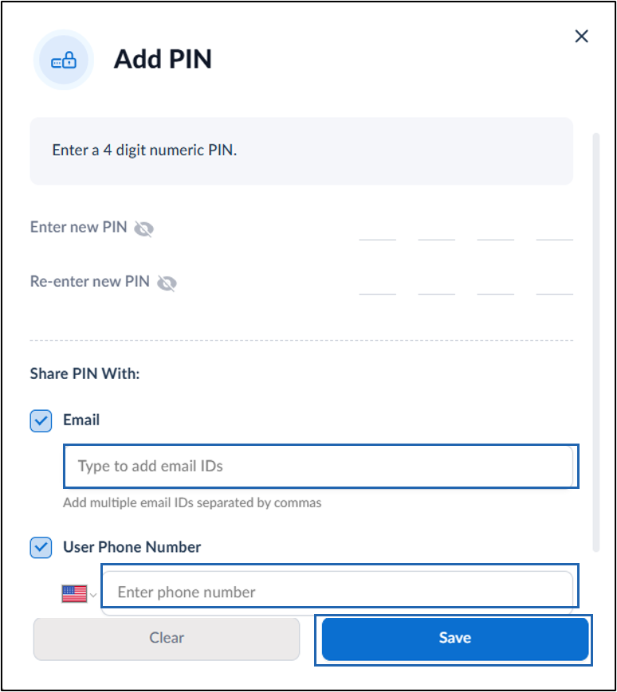
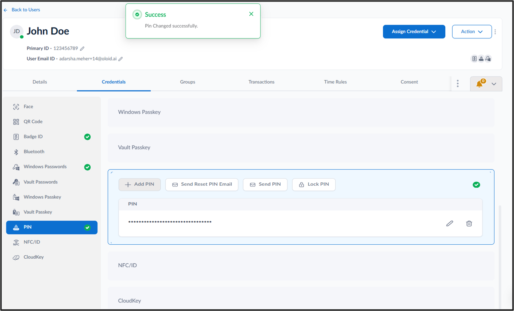
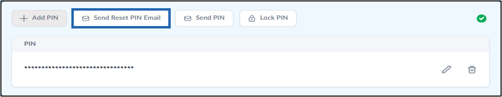
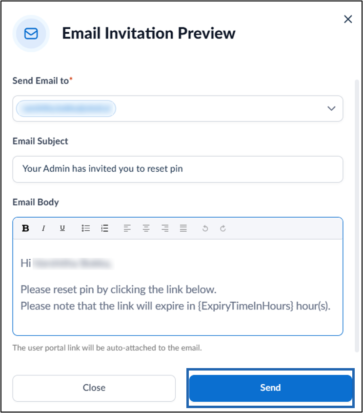
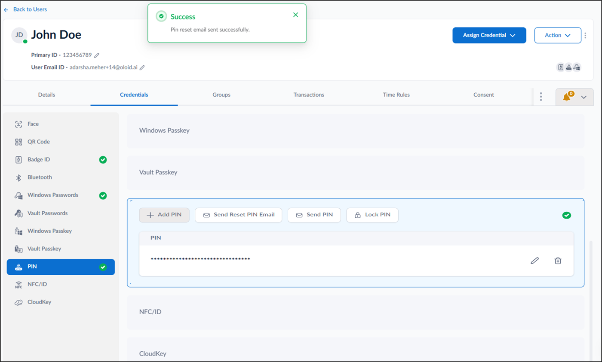
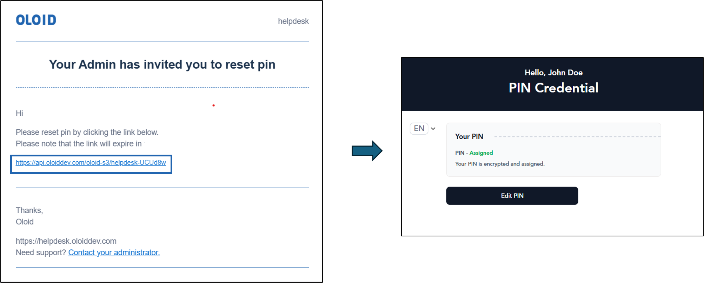

{/* Source: Intercom article 11928944 - https://oloid.help/en/articles/11928944-tenant-admin-portal-how-to-reset-pin-for-a-user */}
{/* Generated by intercom_to_mintlify.py - re-running overwrites this file. */}

## Introduction

This document provides instructions to reset PIN for a user in the Tenant Admin Portal.

## Prerequisites

- You must have admin access to the Tenant Admin Portal.
- The user must be created in the Tenant Admin Portal. For more, refer to [Tenant Admin Portal - How to Create User](/platform/tenant-admin-portal/tenant-admin-portal-how-to-create-user)
- You must have PIN credential. For more, refer to [Tenant Admin Portal - How to Add PIN Credential for User](/platform/tenant-admin-portal/tenant-admin-portal-how-to-add-pin-credential-for-user)

## Steps to Reset PIN

1. Log in to the **Tenant Admin Portal**.
2. On the homepage of the portal, click **Directory** on the left menu panel.

   

   The **Users** page is displayed.
3. Click preferred **Username** to edit.

   

   The **User Details** page is displayed.
4. Go to **Credentials tab** > **PIN**.

   

5. Do one of the following:
   a. **[Edit PIN](#edit-pin)**
   OR
   b. **Send reset PIN email**

### Edit PIN

The **Edit PIN** option allows you to set a new PIN for the user directly and optionally share it through email or phone.

1. Click **Edit** icon.

   

   The **Add PIN** pop-up box is displayed.
2. Do the following:
   1. Enter **new PIN**.
   2. Re-enter **new PIN**.
   3. Enter email address. (Optional)

      <Note>
        **Note:** You can add multiple email IDs separated with commas.
      </Note>

   4. Enter the user's phone number in the **Enter Phone Number** field. (Optional)

      <Note>
        **Note:** Click the country icon to change the country code.
      </Note>

   5. Click **Save**.

      

      The PIN is reset successfully.

      

### Send reset PIN via Email

The **Send Reset PIN Email** option allows you to send an email to the user with a link to reset their PIN through the Oloid User Portal.

<Note>
  **Note:** The **Send Reset PIN Email** button is available only when PIN is enabled in the Oloid User Portal settings. To enable PIN, click [here](/platform/tenant-admin-portal/oloid-user-portal-how-to-configure-oloid-user-portal-in-tenant-admin)
</Note>

1. Click **Send Reset PIN Email**.

   

   The **Email Invitation Preview** pop-up box is displayed.
2. On the pop-up box, do the following:
   1. Enter email address.

      <Note>
        **Note:** The registered email ID will appear as the default.
      </Note>

   2. Edit **Email Subject**. (Optional)
   3. Edit message in the **Email Body**. (Optional)
   4. Click **Save**.

      <Note>
        **Note:** The user portal link will be auto attached to the email.
      </Note>

      

      The PIN reset email is **sent** successfully.

      

      The user can follow the on-screen instructions in the email to reset the pin.For more, refer to [Oloid User Portal - How to reset PIN using invite link](/platform/user-portal/oloid-user-portal-how-to-reset-pin-using-invite-link)

      
