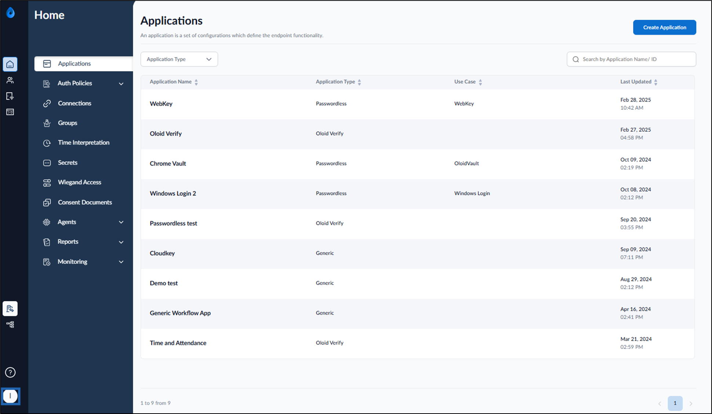
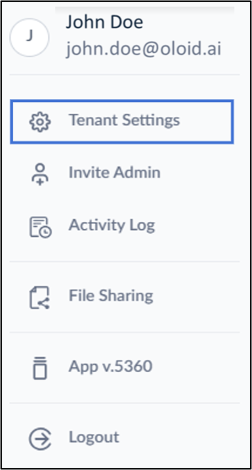
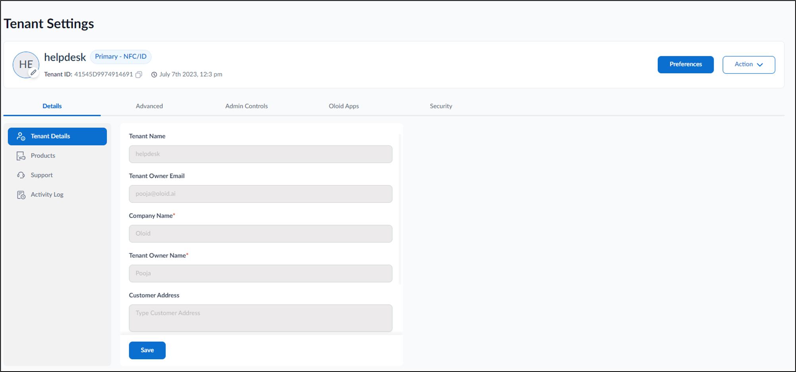
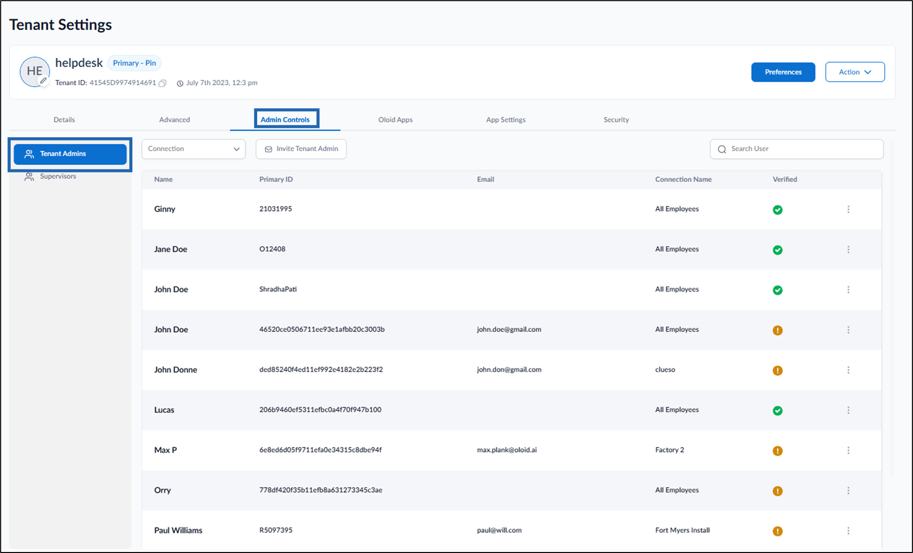
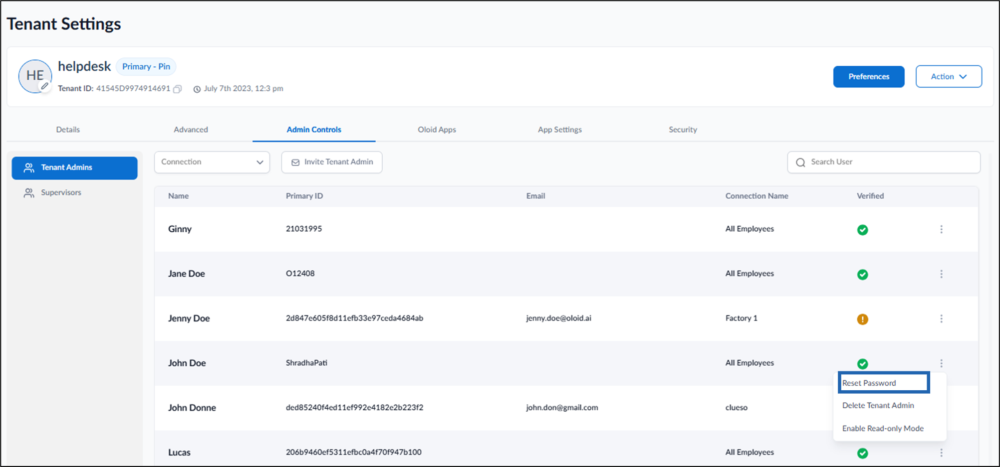
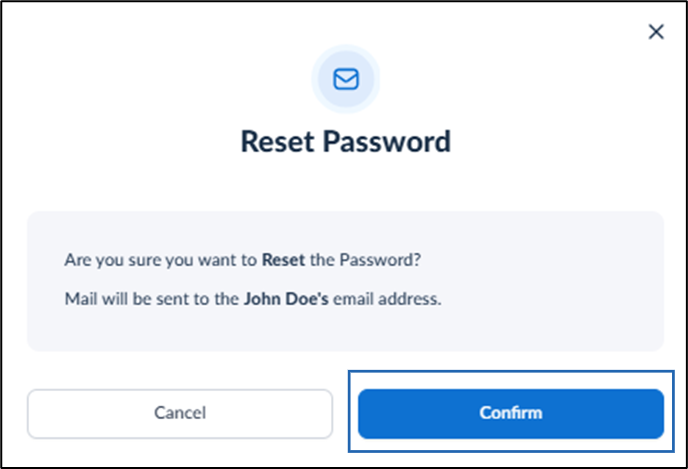
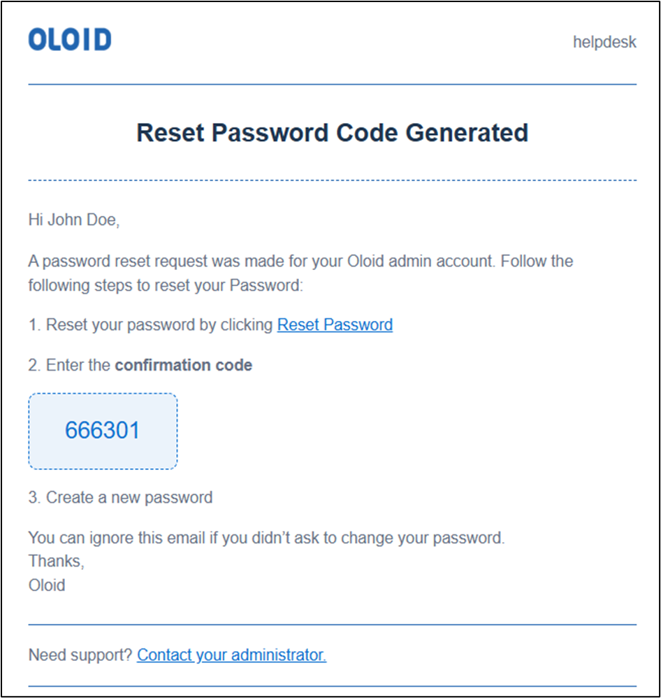

{/* Source: Intercom article 8237046 - https://oloid.help/en/articles/8237046-tenant-admin-portal-how-to-send-a-password-reset-link-to-a-tenant-admin */}
{/* Generated by intercom_to_mintlify.py - re-running overwrites this file. */}

## Introduction

This document provides instructions to reset the password for a Tenant Admin from the Tenant Admin Portal. When you reset the password, a password reset link is sent to the Tenant Admin's registered email address.

## Prerequisite

You must have admin access to the Tenant Admin Portal.

## Steps to reset password for Tenant Admin

1. Log in to the **Tenant Admin Portal**.
2. On the homepage of the portal, click **user profile icon** on the bottom left of the menu panel.

   

   The user profile menu is displayed.
3. Click **Tenant Settings**.

   

   The **Tenant Settings** page is displayed.

   

4. Go to **Admin Controls** > **Tenant Admin.**

   

5. Locate the Tenant Admin, and then select the **kebab menu** (three vertical dots) > **Reset Password**.

   

   The **Reset password** pop-up box is displayed.
6. Click **Confirm**.

   

   The user reset password link is successfully sent to the Tenant Admin's email ID.

   
