{/* Source: Intercom article 14750432 - https://oloid.help/en/articles/14750432-tenant-admin-portal-how-to-send-pin-via-email-sms-to-user */}
{/* Generated by intercom_to_mintlify.py - re-running overwrites this file. */}

## Introduction

This document provides step-by-step instructions for sending a user's **PIN credential** via email or SMS from the Tenant Admin Portal. Admin can securely share the PIN with users via email or SMS, allowing them to use it for authentication without manual setup.

## Prerequisites

- You must have admin access to the Tenant Admin Portal.
- User must be created in the tenant admin portal. For more information, refer to[Tenant Admin Portal - How to Create User](/platform/tenant-admin-portal/tenant-admin-portal-how-to-create-user)
- You must have a PIN credential. For more information, refer to [Tenant Admin Portal - How to Add PIN Credential for User](/platform/tenant-admin-portal/tenant-admin-portal-how-to-add-pin-credential-for-user)

## Steps to Send Pin to a User

1. Log in to the **Tenant Admin Portal**.
2. On the homepage, click **Directory**, from the left menu panel.

   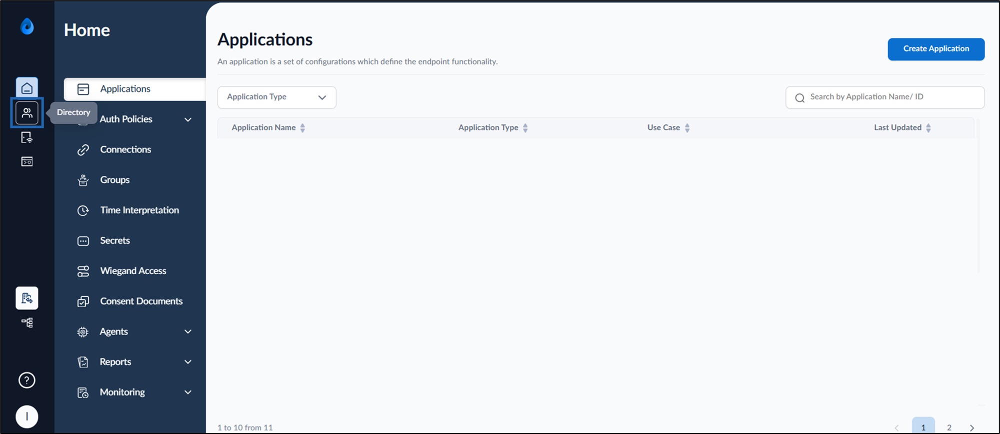

   The **Users** page is displayed.
3. Click **username** to edit.

   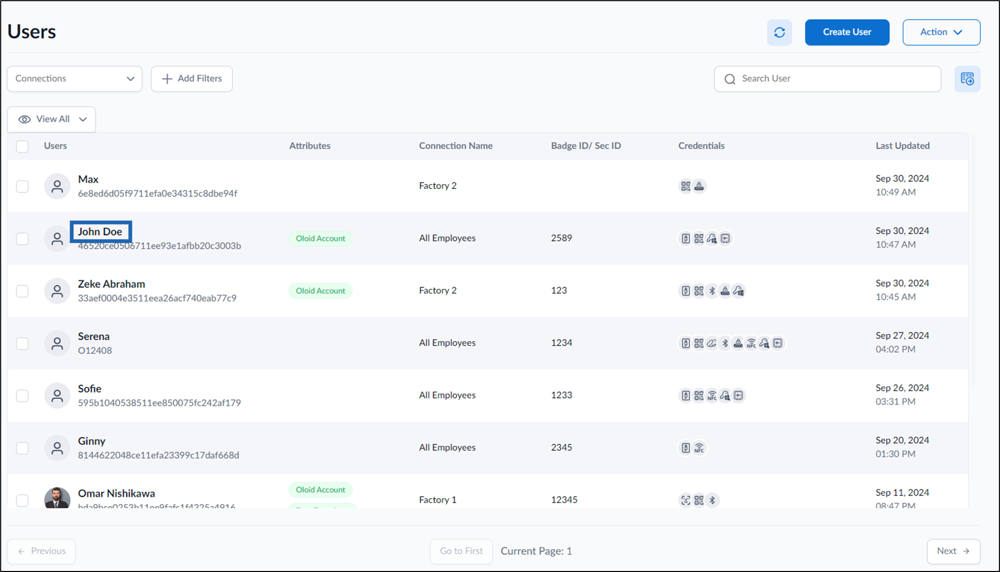

   The **user details** page is displayed.

   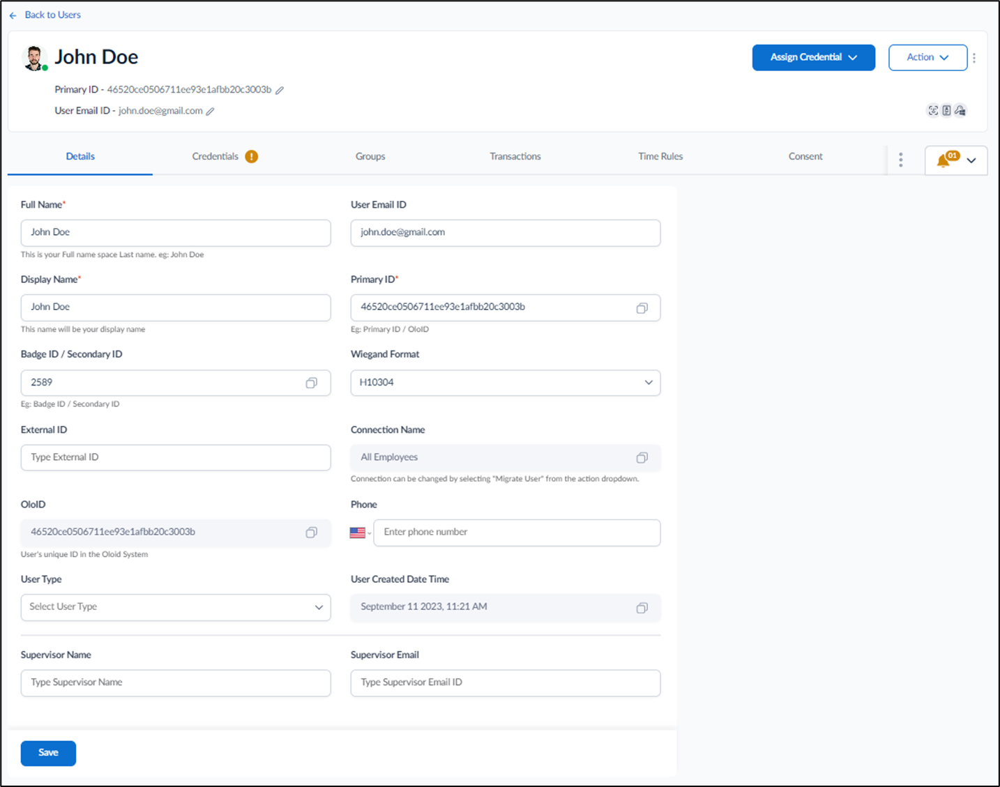

4. Go to **Credentials** tab > **PIN** > **Send PIN**.

   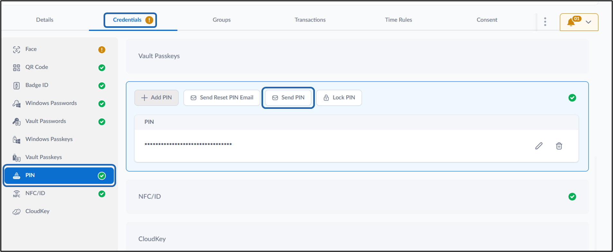

5. Do one of the following.
   1. [Send Pin via Email.](#send-pin-via-email)
      OR
   2. [Send Pin via SMS.](#send-pin-via-sms)

### Send Pin Via Email

This section explains how to send a user's PIN through email.

1. Click **Send PIN** > select **Via Email**.

   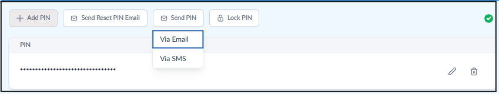

   The Send Pin via Email pop-up is displayed.
2. Do the following
   1. Enter the email ID(s) in the **Send Email to** field, or select the email ID(s) from the dropdown list.
   2. Click **Send**.

      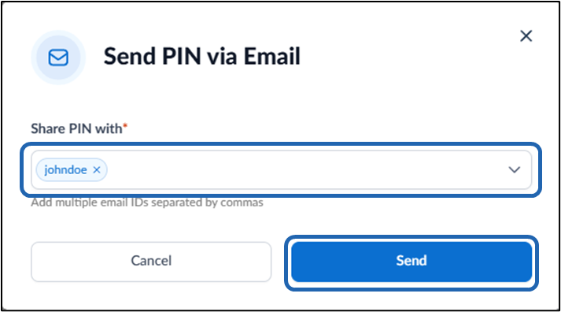

      The PIN is sent to user via email ID(s) successfully.

      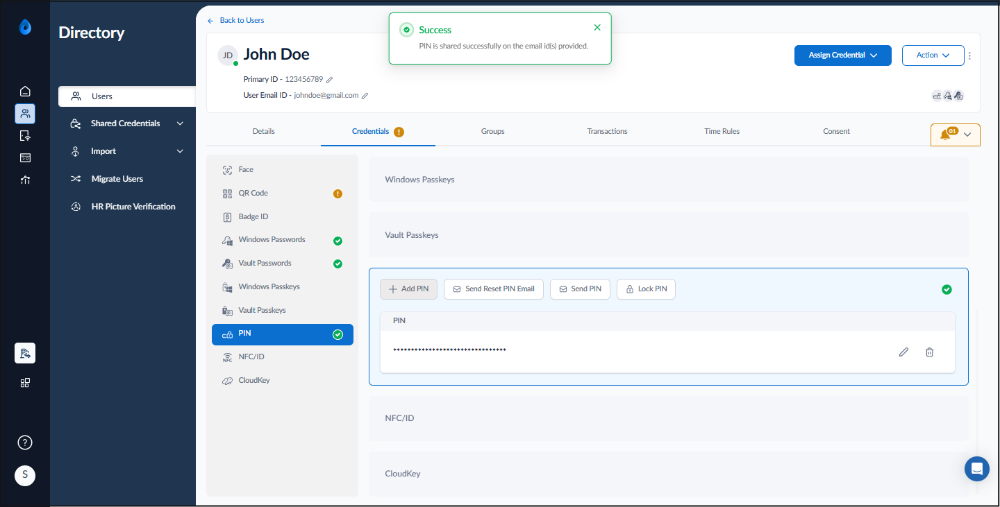

      The PIN is sent to the users email address.

      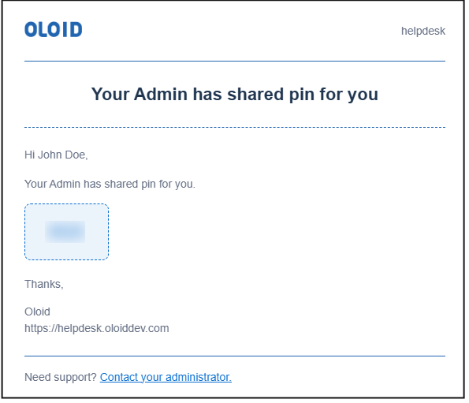

### Send Pin Via SMS

This section explains how to send a user's PIN through SMS.

1. Click **Send PIN** > select **Via SMS.**

   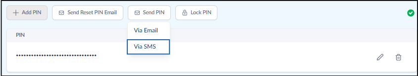

   The **Send PIN via Phone Number** pop-up box is displayed.
2. Do the following
   1. Enter the user's phone number in the **Enter Phone Number** field.

      <Note>
        **Note:** Click the country icon to change the country code.
      </Note>

   2. Click **Send**.

      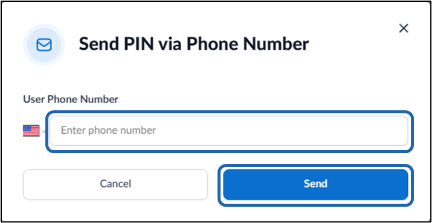

      The PIN is sent to user via SMS successfully.

      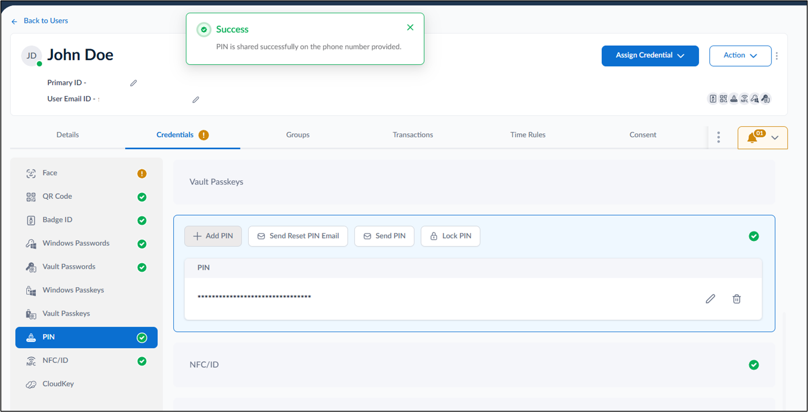

      The PIN is sent to the user's phone number via SMS.

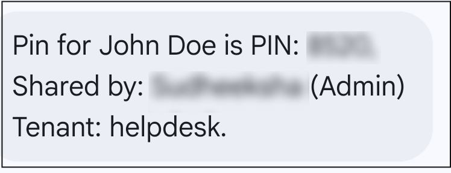
