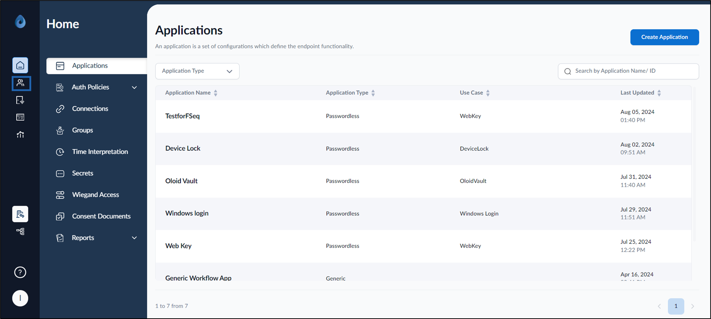
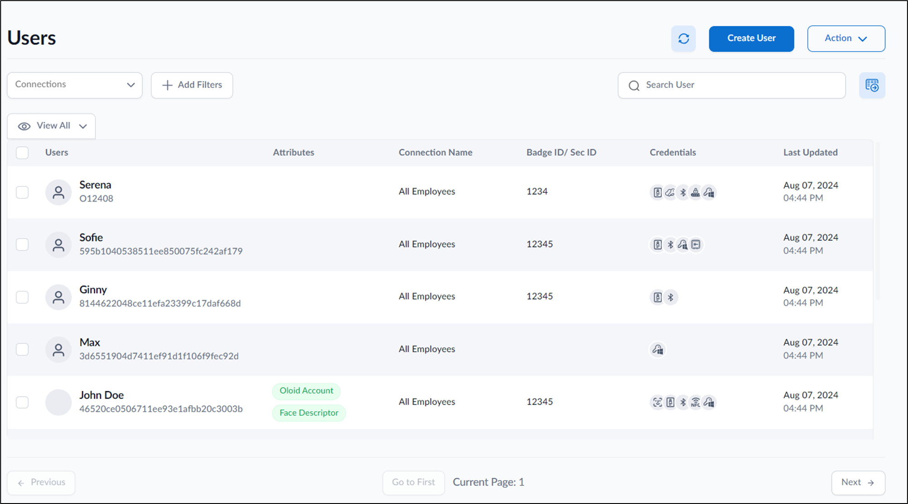
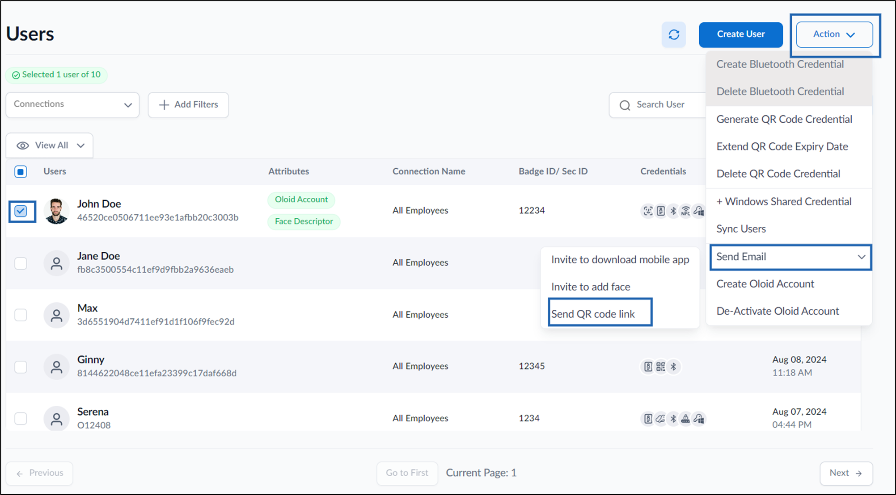
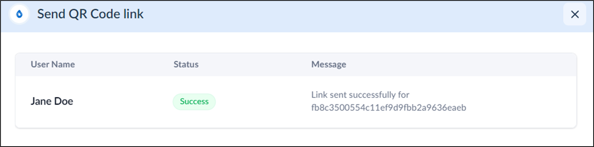
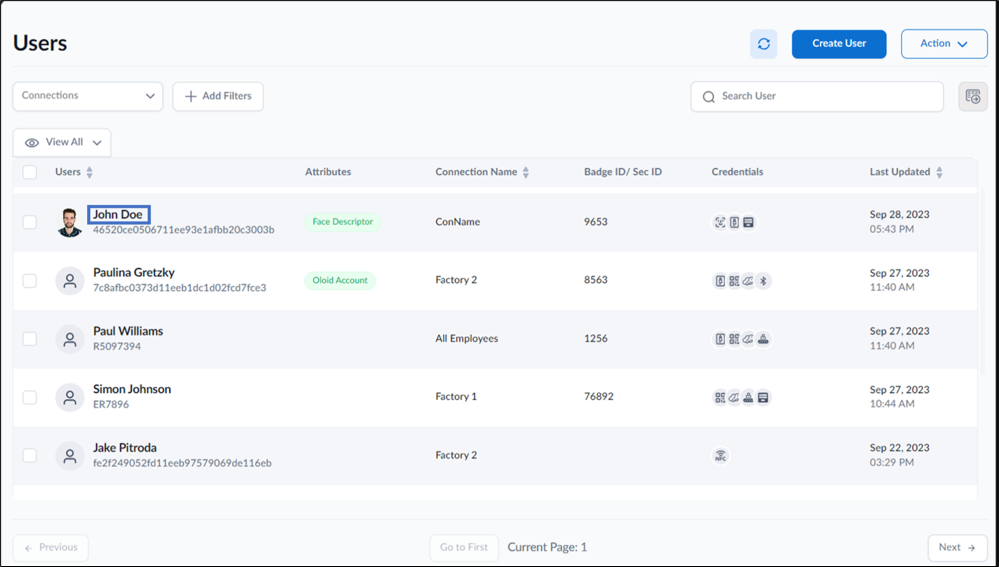
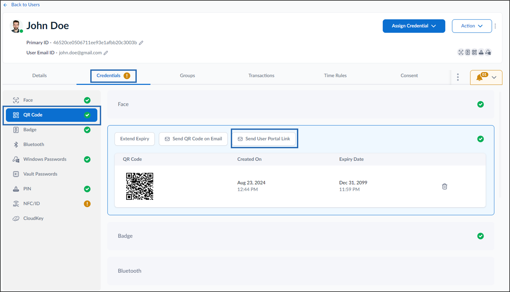
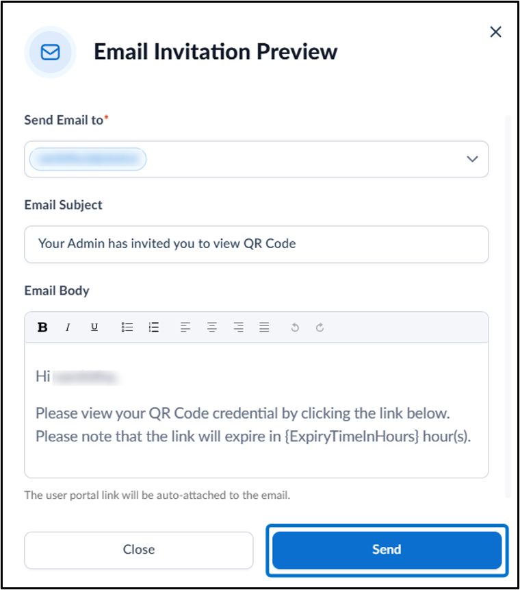
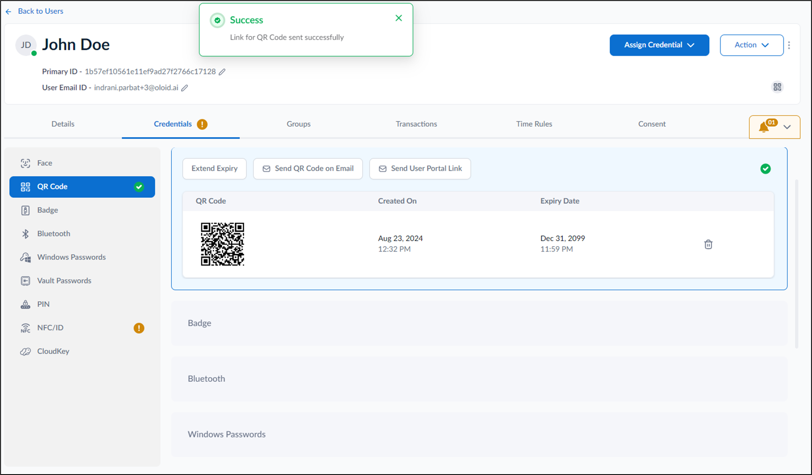
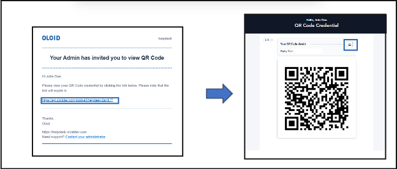

{/* Source: Intercom article 9716724 - https://oloid.help/en/articles/9716724-tenant-admin-portal-how-to-send-qr-code-link-to-users */}
{/* Generated by intercom_to_mintlify.py - re-running overwrites this file. */}

## Introduction

This document provides instructions to send a QR Code link to a user on email in the Tenant Admin Portal.

## Prerequisites

- You must have admin access to the Tenant Admin Portal.
- The user must be created. For more, refer to [Tenant Admin Portal - How to Create User](/platform/tenant-admin-portal/tenant-admin-portal-how-to-create-user)
- A QR Code must be generated for the user. For more, refer to [Tenant Admin Portal - How to Generate QR Code for Users in a Connection](/platform/tenant-admin-portal/tenant-admin-portal-how-to-generate-qr-code-for-users-in-a-connection)

## Steps to Send a QR Code Link to Users

1. Log in to Tenant Admin Portal.
2. On the homepage, click **Directory** from the left menu panel.

   

   The **Users** page is displayed.

   

3. Do one of the following:
   1. Select preferred user(s) and then click **Action** > **Send Email** > **Send QR code link.**

      

      The QR code link is **sent** successfully.

      

      OR
   2. Click the preferred **Username** to edit.

      

      The User details page is displayed.
   3. Do the following:
      1. Go to **Credentials tab** > **QR Code** > select **Send User Portal Link**.

         

         An **Email Invitation Preview** pop-up box is displayed.
      2. Click **Send**.

         

         The Link for QR code is sent to Email successfully.

         

         <Note>
           **Note:** Please view and download your QR code within the time mentioned in this email. After that, the link will expire.
         </Note>

         
