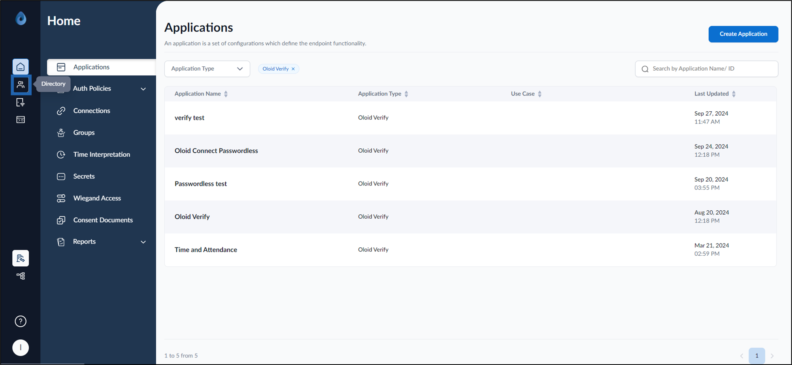
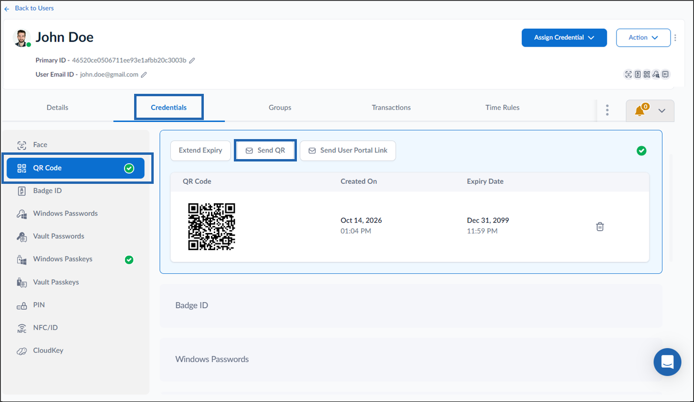
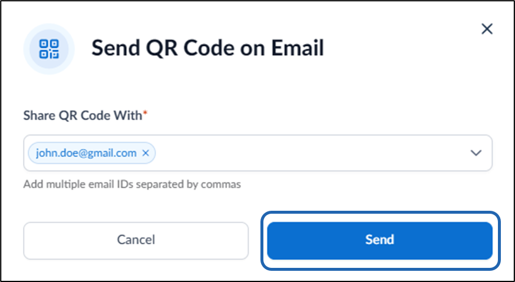
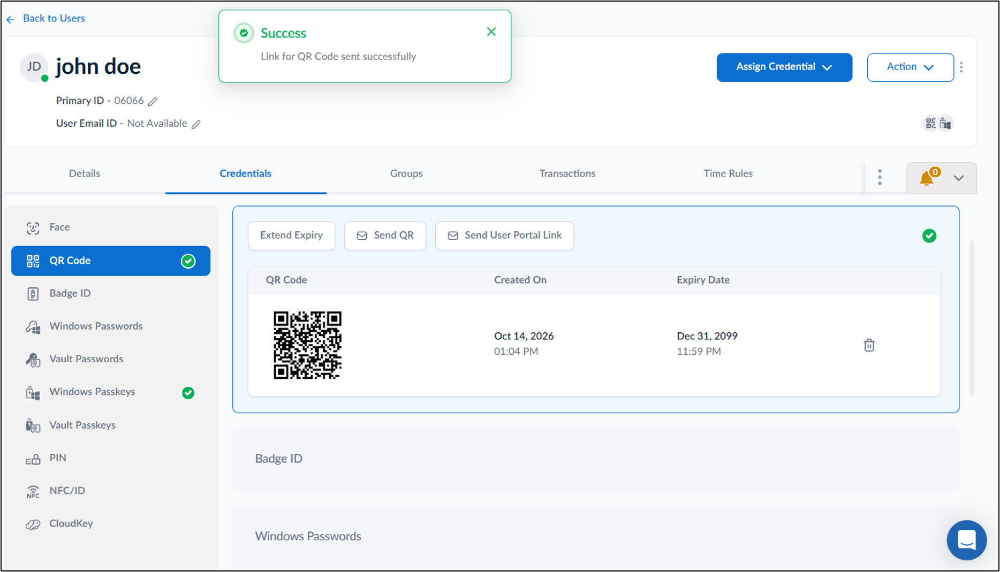
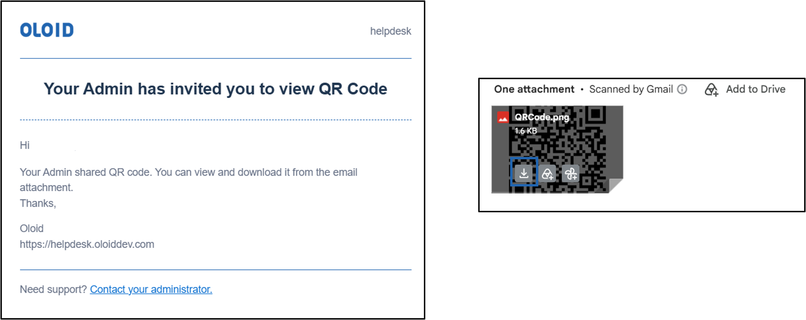

{/* Source: Intercom article 9794751 - https://oloid.help/en/articles/9794751-tenant-admin-portal-how-to-send-qr-code-to-a-user-on-email */}
{/* Generated by intercom_to_mintlify.py - re-running overwrites this file. */}

## Introduction

This document provides instructions to send a QR Code to a user on email in the Tenant Admin Portal.

## Prerequisites

- You must have admin access to the Tenant Admin Portal.
- The user must be created. For more, refer to [Tenant Admin Portal - How to Create User](/platform/tenant-admin-portal/tenant-admin-portal-how-to-create-user)
- A QR Code must be generated for the user. For more, refer to [Tenant Admin Portal - How to Generate QR Code for Users in a Connection](/platform/tenant-admin-portal/tenant-admin-portal-how-to-generate-qr-code-for-users-in-a-connection)

## Steps to Send QR Code on Email

1. Log in to the **Tenant Admin Portal**.
2. On the homepage, click **Directory** from the left menu panel.

   

   The **Users** page is Displayed.
3. Click preferred **Username** to edit.

   

   The **User details** page is displayed.

   

4. Go to **Credentials** tab > **QR Code** > **Send QR.**

   

   The **Send QR Code on Email** pop-up box is displayed.
5. Do the following:
   1. Enter/Select Email ID from the dropdown list to whom you want to **Share QR Code With**.

      <Note>
        **Note:** (Optional) You can add multiple email IDs separated by commas, if required.
      </Note>

   2. Click **Send**.

      

      The QR Code is sent successfully to the email ID.

      

      The user will receive an email with the QR code attached. They can view and download it from the email.

      
