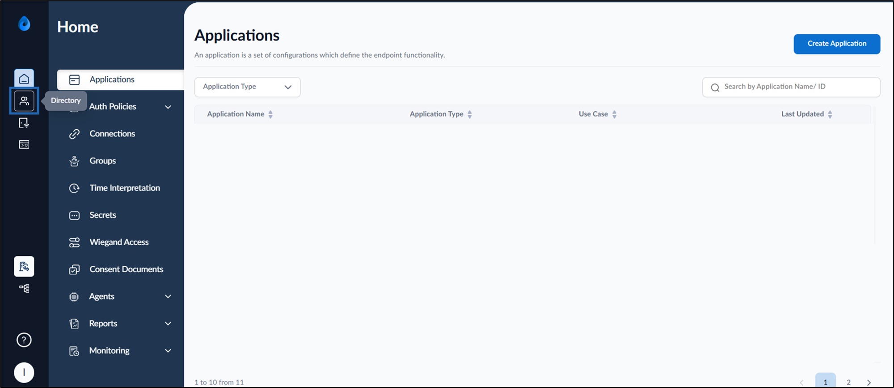
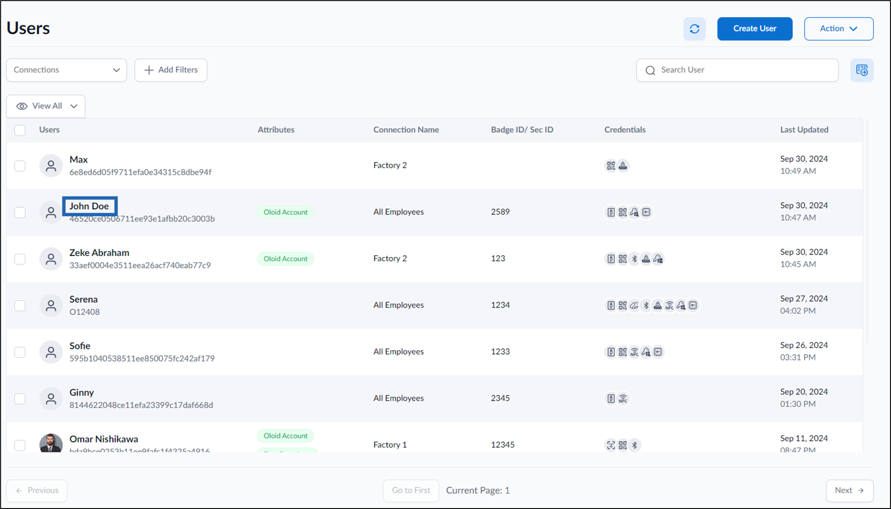
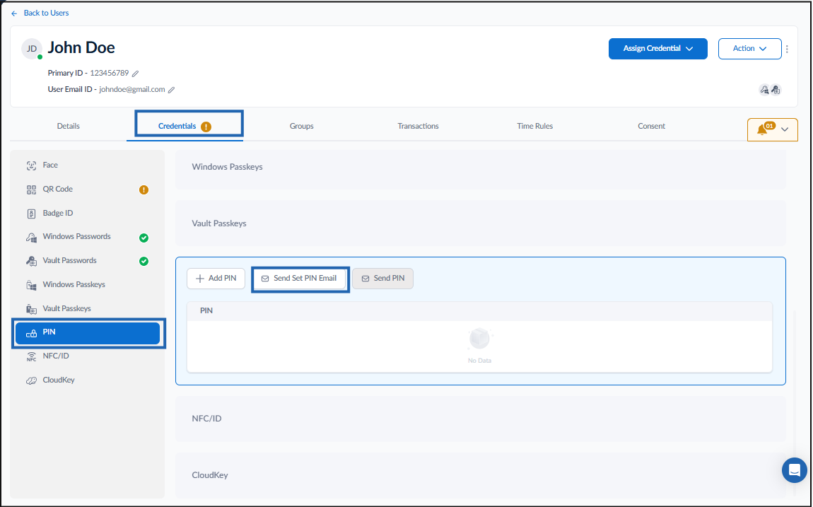
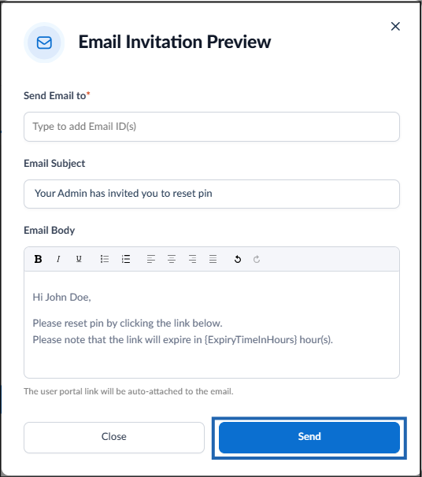
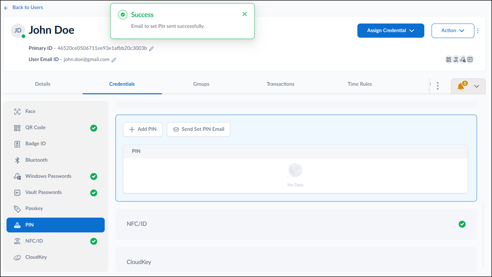
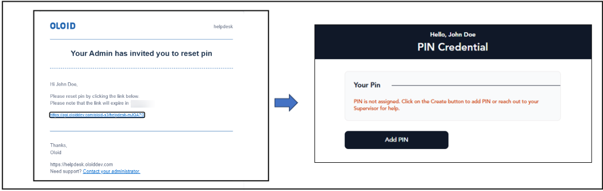

{/* Source: Intercom article 9937001 - https://oloid.help/en/articles/9937001-tenant-admin-portal-how-to-send-set-pin-email-to-a-user */}
{/* Generated by intercom_to_mintlify.py - re-running overwrites this file. */}

## Introduction

This document provides step-by-step instructions to send a Set PIN email invitation to a user from the Tenant Admin Portal.

## Prerequisites

- You must have admin access to the Tenant Admin Portal.
- The user must be created in the Tenant Admin Portal. For more information, refer to [Tenant Admin Portal - How to Create a User](/platform/tenant-admin-portal/tenant-admin-portal-how-to-create-user).
- The user must have a valid email address added to their profile in the Tenant Admin Portal.
- PIN must be enabled in the Oloid User Portal setting for the **Send Set PIN Email** button to be available. For more information, refer to [Customize Settings Tab](/platform/tenant-admin-portal/oloid-user-portal-how-to-configure-oloid-user-portal-in-tenant-admin).

## Steps to Send Set PIN Email to a User

1. Log in to the **Tenant Admin Portal**.
2. On the home page of the portal, click **Directory** on the left menu panel.

   

   The **Users** page is displayed.
3. Click the required username.

   

   The **user details** page is displayed.

   

4. Go to **Credentials** tab > **PIN** > **Send Set PIN Email**.

   <Note>
     **Note:** If the user has not set a PIN yet, the button is displayed as **Send Set PIN Email**. If the user has already set a PIN, the button is displayed as **Send Reset PIN Email**.
   </Note>

   

   The **Email Invitation Preview** pop-up box is displayed.
5. Do the following:
   1. Enter the recipient's email ID(s) in the **Send Email to** field.
   2. Edit **Email Subject** field. (Optional)
   3. Edit **Email Body** field. (Optional)
   4. Click **Send**.

      

The Set PIN email is sent to the user successfully.

<Note>
  **Note:** The Set PIN link expires after the period mentioned in the email. If the link expires, repeat these steps to send a new email.
</Note>

The user can set their PIN using the link in the email. To know more, refer to **[Oloid User Portal - How to Create PIN using invite link](/platform/user-portal/oloid-user-portal-how-to-create-pin-using-invite-link).**
