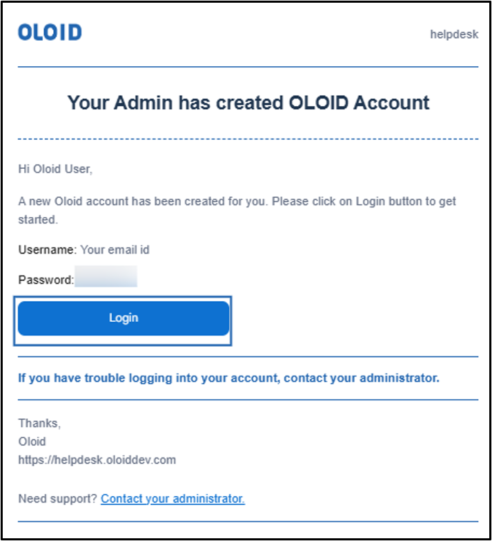
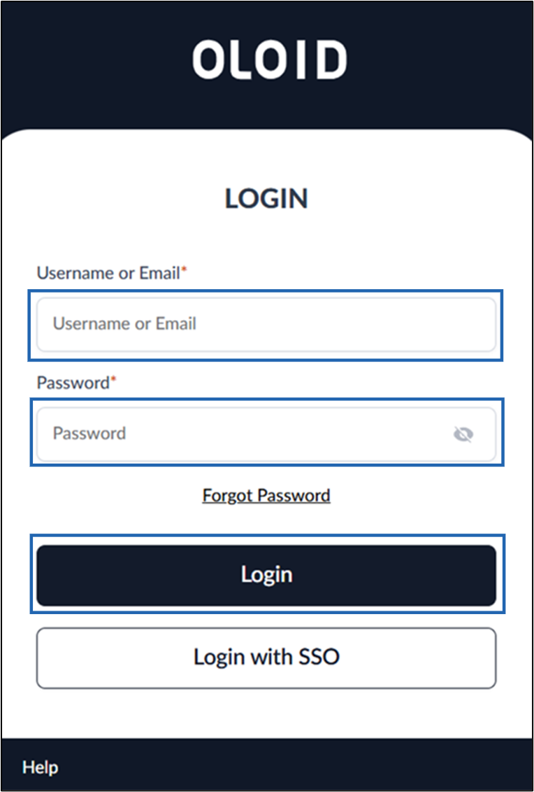
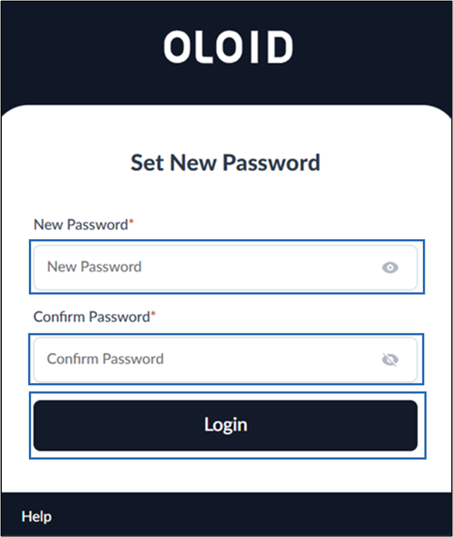
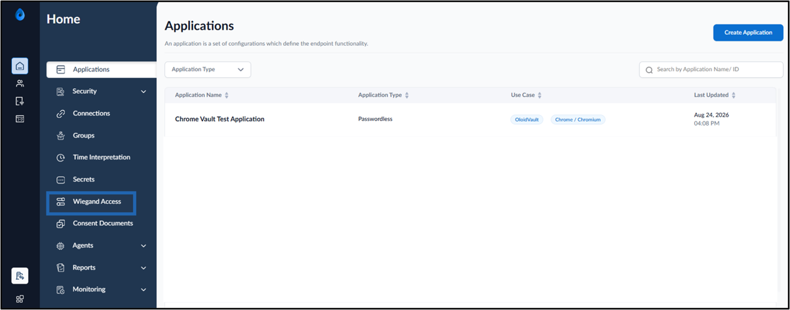

{/* Source: Intercom article 8462736 - https://oloid.help/en/articles/8462736-tenant-admin-portal-how-to-set-a-password-during-first-time-login */}
{/* Generated by intercom_to_mintlify.py - re-running overwrites this file. */}

## Introduction

This document provides instructions to set a new password when logging in to the Tenant Admin Portal for the first time.

## Prerequisite

Ensure that you have received the login email with your login credentials.

## Steps to Set a New Password

1. Open the login email and click **Login**.

   

   The **LOGIN** page is displayed.
2. Do thew following:
   1. Enter your email address.
   2. Enter the **Password**.

      <Note>
        **Note:** Enter the one-time password received in the email in the **Password** field.
      </Note>

   3. Click **Login**.

      

      The **Set New Password** screen is displayed.
3. Do the following:
   1. Enter a new password in the **New Password** field.

      <Note>
        **Note:** The password must contain at least one uppercase letter, one lowercase letter, and one number. It must not contain consecutive or sequential characters or any part of your username.
      </Note>

   2. Re-enter the new password in the **Confirm Password** field.
   3. Click **Login**.

      

      The password is set successfully, and the Tenant Admin Portal is displayed.

      
