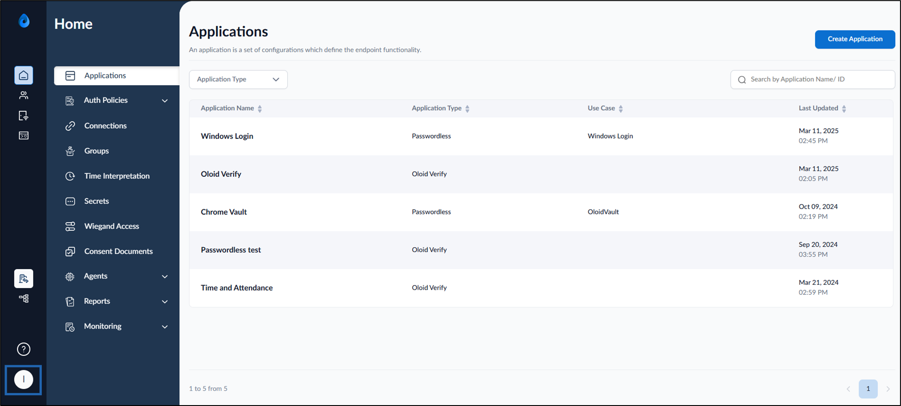
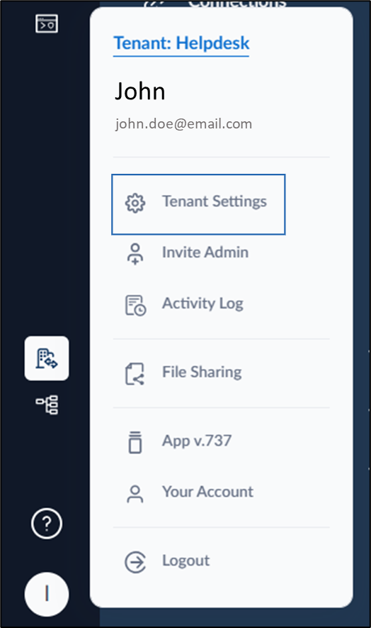
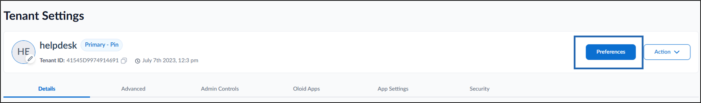
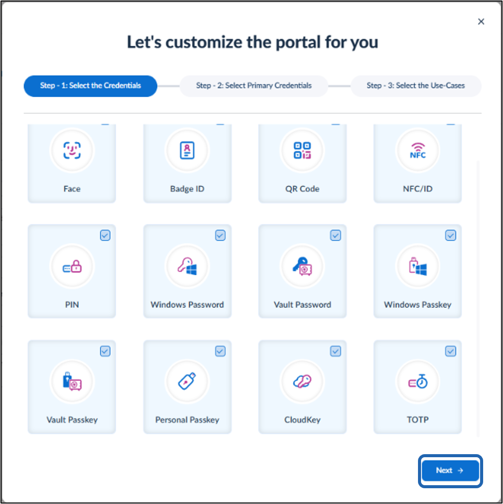
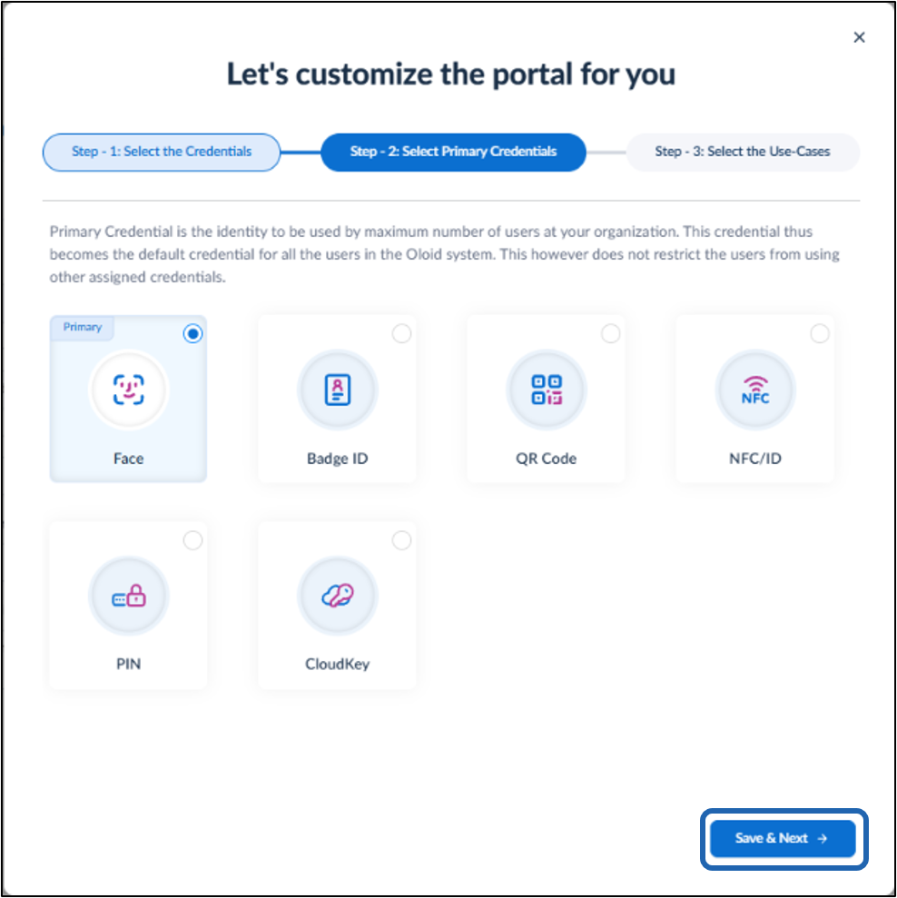
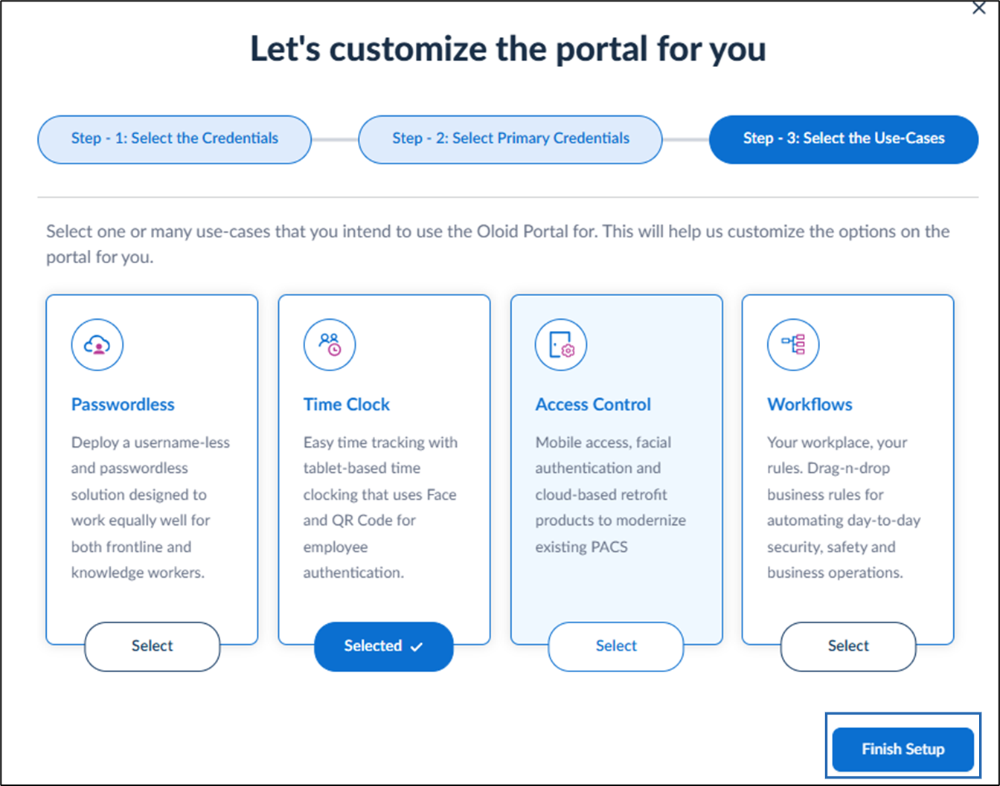

{/* Source: Intercom article 10765097 - https://oloid.help/en/articles/10765097-tenant-admin-portal-how-to-set-credential-preferences-in-tenant-admin-portal */}
{/* Generated by intercom_to_mintlify.py - re-running overwrites this file. */}

## Introduction

In the Tenant Admin Portal, Tenant Admin can set preferred and primary credentials for specific use cases. After setup, the selected credentials will appear in the specified scenarios.

## Prerequiste

- You must have a admin access to Tenant Admin Portal.

## Steps to set credential preferences

1. Log in to the **Oloid Portal**.
2. On the homepage of the portal, click **user profile icon** on the bottom left corner of the menu panel.

   

   The user profile menu is displayed.
3. Select **Tenant Settings**.

   

   The **Tenant Settings** page is displayed.
4. Select **Preferences**.

   

   The **Let's customize the portal for you** pop-up box is displayed.
5. Do the following:
   1. Select the preferred **Credentials** you want to use.
   2. Click **Next**.

      

   3. Select the **Primary Credentials**.

      <Note>
        **Note:** PIN and TOTP cannot be set as primary credentials.
      </Note>

   4. Click **Save & Next**.

      

   5. Select the **Use-cases** for which you intend to use the Oloid Portal.
   6. Click **Finish Setup**.

      

      The selected credentials are visible in the respective use cases.
