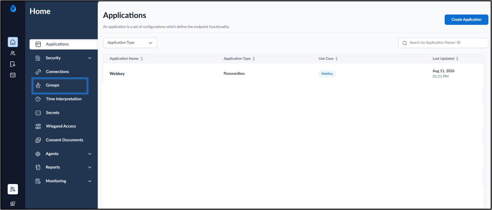
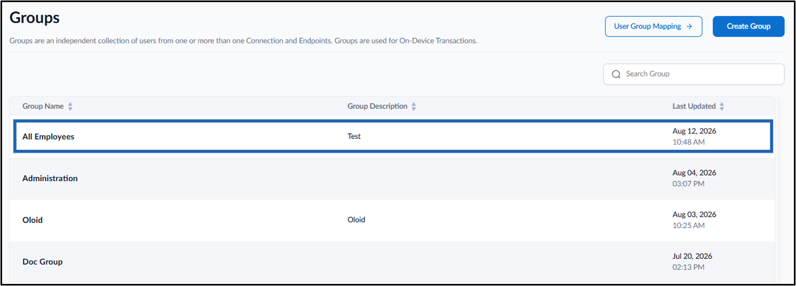
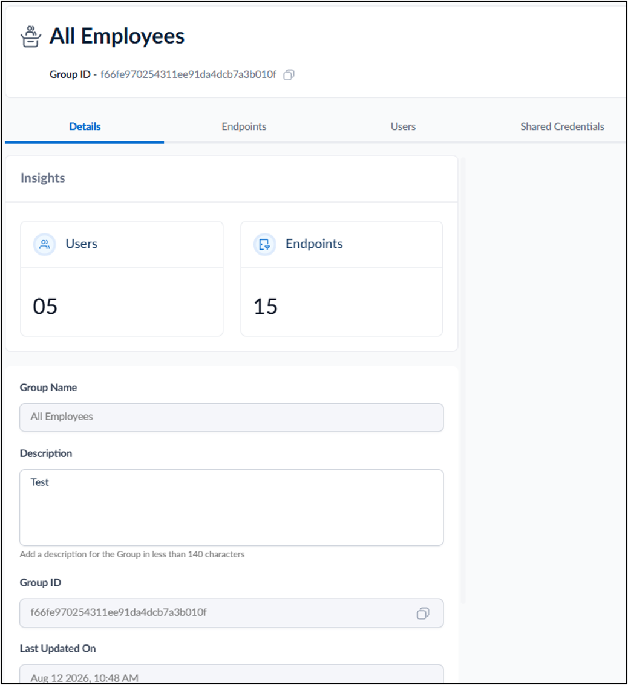
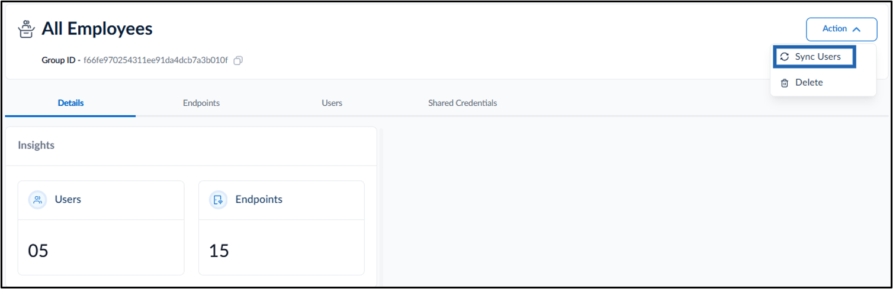
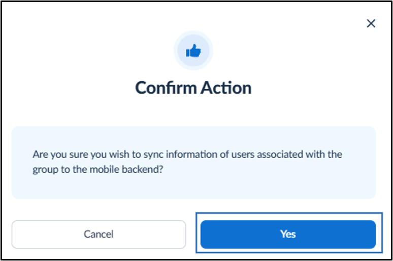
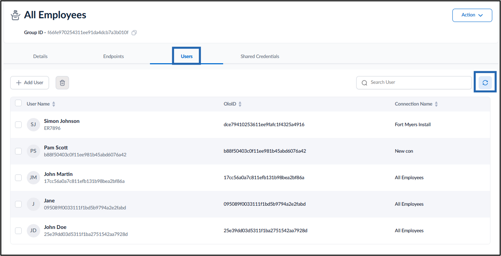
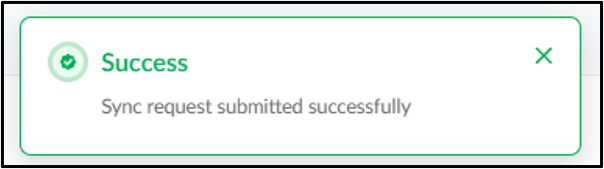

{/* Source: Intercom article 8462702 - https://oloid.help/en/articles/8462702-tenant-admin-portal-how-to-sync-users-in-a-group */}
{/* Generated by intercom_to_mintlify.py - re-running overwrites this file. */}

## Introduction

This document provides instructions to sync users from a group to the associated endpoint devices in the Tenant Admin Portal.

## Prerequisite

You must have admin access to the Tenant Admin Portal.

## Steps to Sync User

1. Log in to the **Tenant Admin Portal**.
2. On the home page, click **Groups** on the left panel menu.

   

   The **Groups** page is displayed.
3. Click the preferred **Group Name**.

   

   The **Group Details** page is displayed.

   

4. Do one of the following:
   1. Go to **Action** > click **Sync Users**.

      

      The **Confirm Action** pop-up box is displayed.
   2. Click **Yes**.

      

      The users in the group are synced to the associated device(s) successfully.

      

      OR
   3. Go to **Users** tab > click **Sync** icon.

      

      The users in the group are synced to the associated endpoint device(s) successfully.

      
