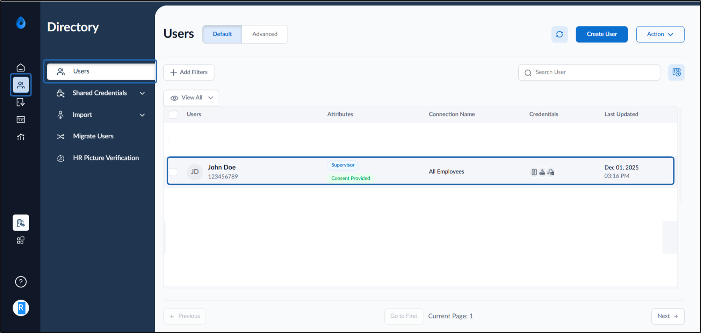
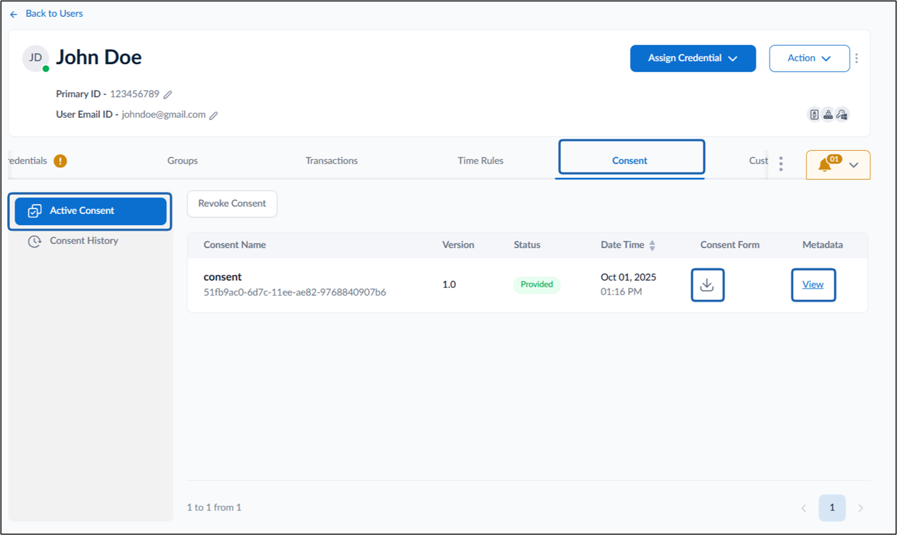

{/* Source: Intercom article 12990356 - https://oloid.help/en/articles/12990356-tenant-admin-portal-how-to-view-and-download-active-consent-of-a-user */}
{/* Generated by intercom_to_mintlify.py - re-running overwrites this file. */}

## Introduction

The Active Consent feature in the Oloid Tenant Admin Portal allows administrators to quickly access and manage user consent records. This ensures that consent-related information is easily accessible and securely maintained within the platform.

## Prerequisites

- You must have a tenant admin account.
- User must be part of the connection.
- Consent should already be accepted by the User to view active consent.

## Steps to View and Download Active Consent of a User

1. Log in to the **Tenant Admin Portal**.
2. On the homepage, select **Directory** from the left menu panel.

   

   The **Users** page is displayed.
3. Click the user name to edit.
   The User details page is displayed.
4. Click the **Consent Tab** > **Active Consent**.

   

   The **Consent** page is displayed.
5. Do the following:
   1. Click **download icon** to download the active consent of the user.
      The active consent is successfully saved to the device.
   2. Click **View** to view the active consent metadata.

<Note>
  **Note:** Consent Status are as follows:
</Note>

- Provided: The user has given consent to add their face data.
- Denied: The user has rejected the consent request.
- Pending: The user has received the consent request, and their action is pending.
- Re-consent Pending: The user had previously provided consent, but a new consent request was issued and their action is pending.
