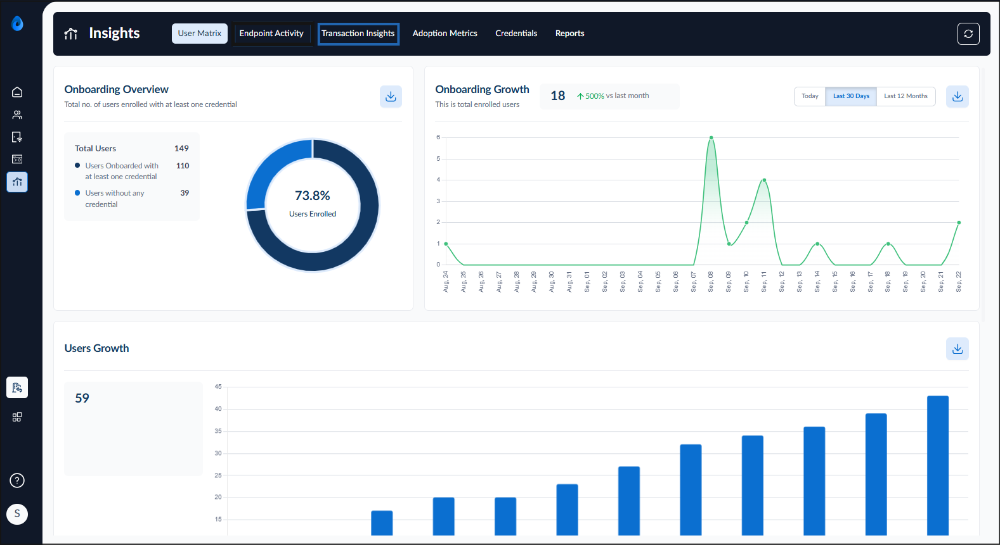
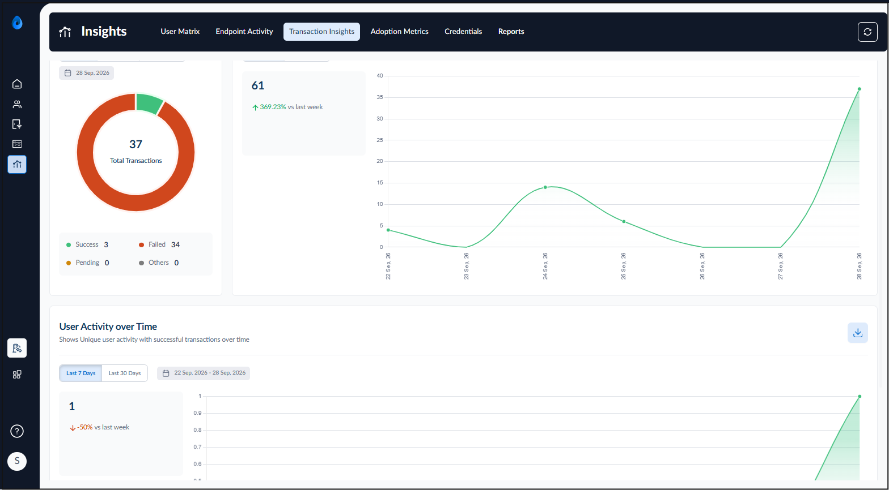
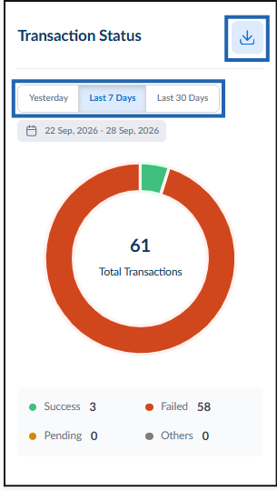
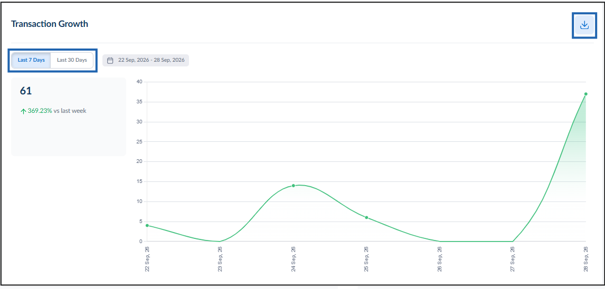
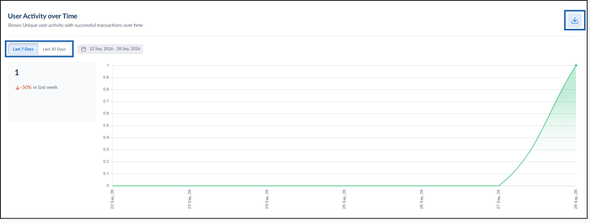

{/* Source: Intercom article 13228776 - https://oloid.help/en/articles/13228776-tenant-admin-portal-how-to-view-and-download-transaction-insights-reports-from-the-insights-dashboard */}
{/* Generated by intercom_to_mintlify.py - re-running overwrites this file. */}

## Introduction

This document provides instructions on how to view and download **Transaction Insights** reports from the Insights section of the Tenant Admin Portal. The Transaction Insight section provides administrators with a consolidated view of authentication transactions, transaction trends, and user activity across the organization.

## Prerequisite

You must have admin access to the Tenant Admin Portal.

## Steps to View and Download Transaction Insights Reports

1. Log in to the **Tenant Admin Portal**.
2. From the left navigation menu, click **Insights** icon.

   

   The Insights dashboard screen is displayed.
3. Select the **Transaction Insights** tab.

   

   The Transaction Insights dashboard is displayed.
4. Do the Following:
   1. [Transaction Status.](#transaction-status)
   2. [Transaction Growth.](#transaction-growth)
   3. [User Activity Over Time.](#user-activity-over-time)

      

### Transaction Status

The Transaction Status section displays the status of transactions for the selected time period.

Transaction Status is categorized into the following statuses:

- **Success**: Transactions completed successfully.
- **Failed**: Transactions that did not complete successfully.
- **Pending**: Transactions that are currently in progress.
- **Others**: Transactions that do not fall into the above categories.

<Note>
  **Note:**

  - Available time filters:
    - Yesterday
    - Last 7 Days
    - Last 30 Days
  - If no transactions are available for the selected time range, the "No data to show yet" message is displayed.
    **Do the following:**
    1. Select a **time range** to view transaction status data.
    2. View the Transaction Status chart to analyze the distribution of transactions across different statuses.
    3. Click the **Download** icon and select **CSV or Excel**.
</Note>

     <Note>
       **Note:** You can download the Transaction Status report in CSV or Excel format.
     </Note>

The Transaction Status report is downloaded successfully.

### Transaction Growth

The Transaction Growth section displays transaction trends over a selected time period.

<Note>
  **Note:**

  - The growth percentage is compared with the previous corresponding period.
  - If no data is available for the selected time range, the "No data to show yet" message is displayed.
  - Available time filters:
    - Last 7 Days
    - Last 30 Days
</Note>

**Do the following:**

1. Select a **time** range to view the Transaction Growth.
2. View the Transaction Growth chart to analyze transaction trends.
3. Click the **Download** icon and select **CSV or Excel**.

   <Note>
     **Note:** You can download the Transaction Growth report in CSV or Excel format.
   </Note>

The Transaction Growth report is downloaded successfully.

### User Activity Over Time

The User Activity Over Time section displays unique user activity based on successful transactions over a selected time period.

Available time filters:

- Last 7 Days
- Last 30 Days

**Do the following:**

1. Select a **time** range to view user activity data.
2. View the User Activity Over Time chart to analyze user engagement trends.
3. Click the **Download** icon and select **CSV or Excel**.

   <Note>
     **Note:** You can download the User Activity Over Time report in CSV or Excel format.
   </Note>

The User Activity over Time report is downloaded successfully.
