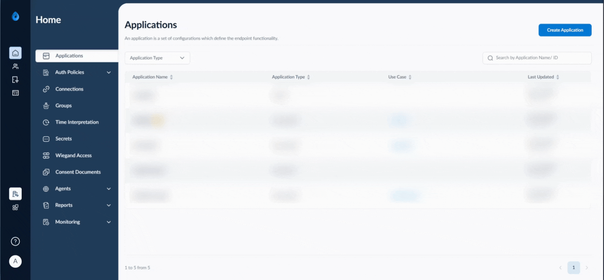
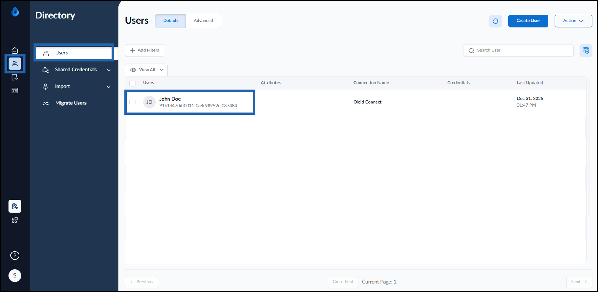
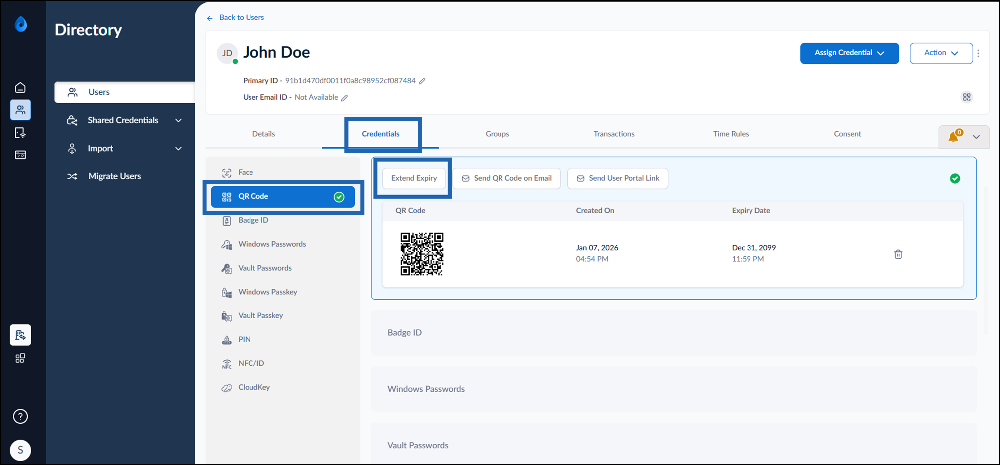
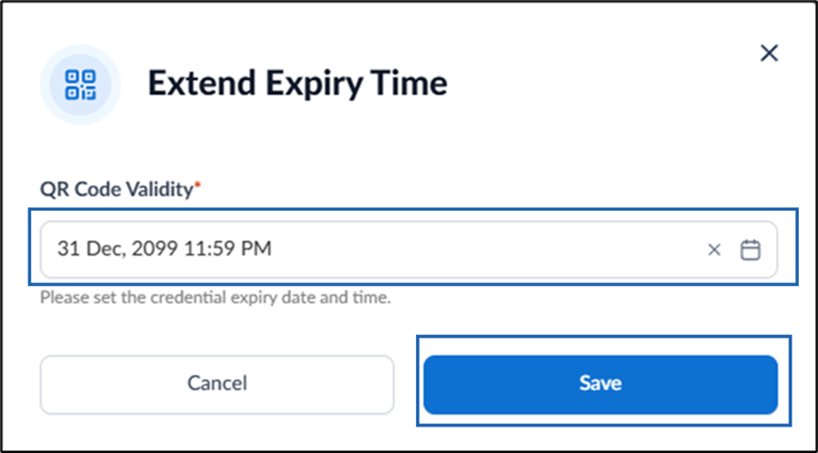

{/* Source: Intercom article 13333301 - https://oloid.help/en/articles/13333301-tenant-admin-portal-qrg-how-to-extend-qr-code-expiry-date */}
{/* Generated by intercom_to_mintlify.py - re-running overwrites this file. */}

## Steps to Extend QR Code Expiry Date

1. Log in to the **Tenant Admin Portal**.
2. Go to **Directory > Users >** click **preferred user.**

   

   The user detail page is displayed.
3. Click **Credentials > QR Code > Extend Expiry.**

   

   The QR code page is displayed.
4. Do the following:
   1. Select **QR Code Validity**.
   2. Click **Save.**

      

      The **QR code validity** is extended successfully.

---

**Keywords**
