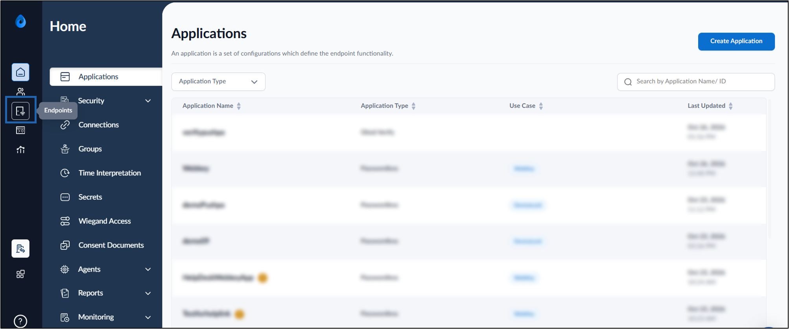
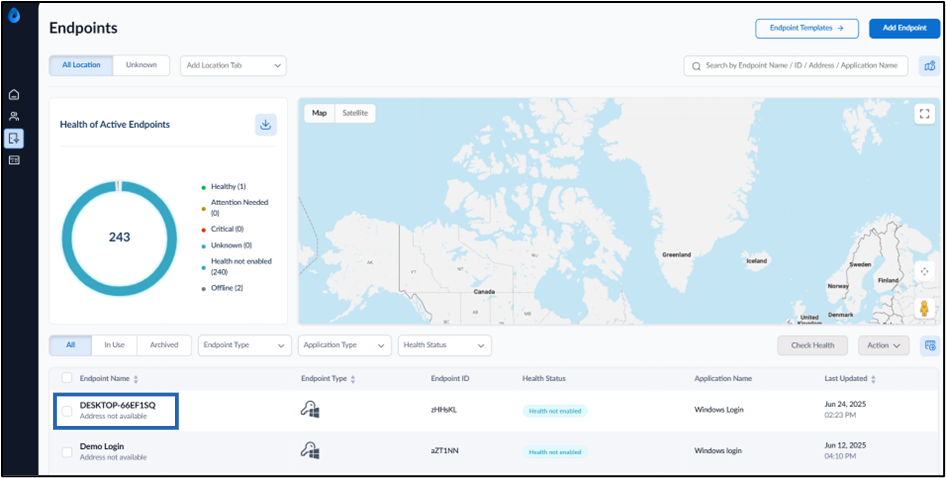
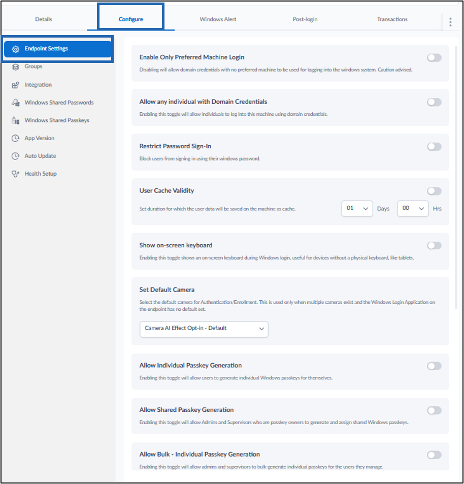
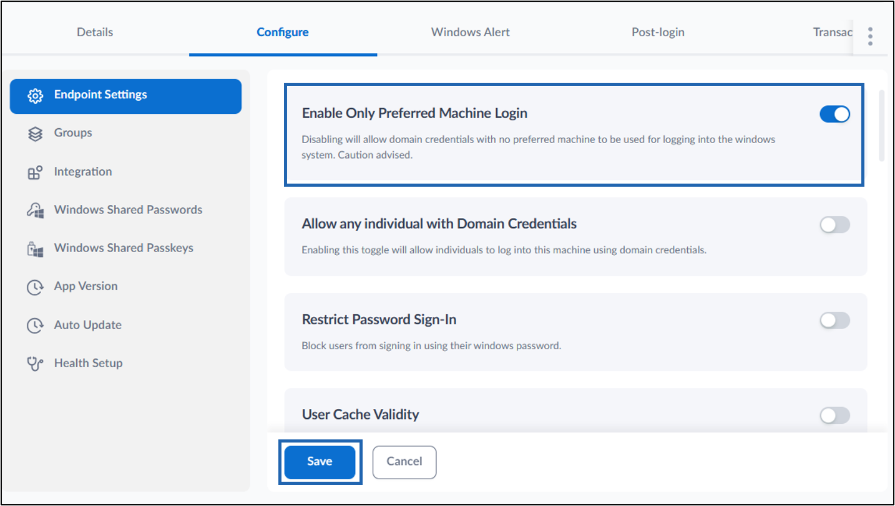
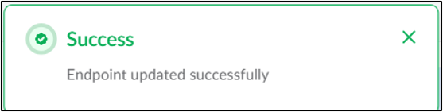

{/* Source: Intercom article 8906511 - https://oloid.help/en/articles/8906511-windows-login-how-to-enable-preferred-machine-users-in-shared-credentials */}
{/* Generated by intercom_to_mintlify.py - re-running overwrites this file. */}

## Introduction

This document provides instructions to enable Preferred Machine Login for a Windows Login endpoint using the Tenant Admin Portal.

## Prerequisites

- You must have admin access to the Tenant Admin Portal.
- The endpoint must be paired with the Windows Login application.
- A shared credential with the credential type **Domain User** must be created. For more, refer to [Supervisor Portal - How to create shared credentials for Windows login](/platform/supervisor-portal/supervisor-portal-how-to-create-shared-credentials-for-windows-login)

## Steps to Enable Preferred Machine Login

1. Log in to the **Tenant Admin Portal**.
2. On the home page of the portal, click **Endpoints** on the left panel menu.

   

   The Endpoints page is displayed.
3. Select **Endpoint name** from the listed endpoints.

   

   The endpoint detail page is displayed.
4. Go to **Configure** > **Endpoint Settings**.

   

5. Turn on **Enable only Preferred Machine Login**.
6. Click **Save**.

   

   Now, you can successfully log in to your Windows system.

   
