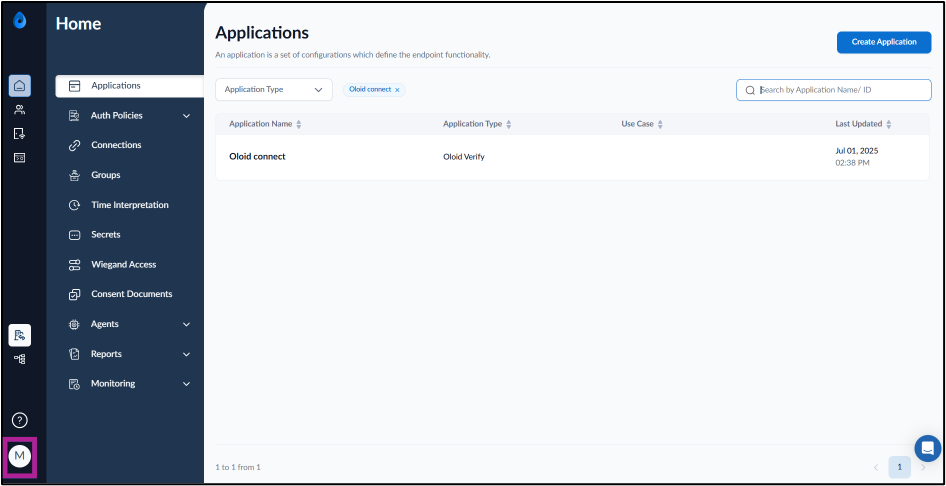
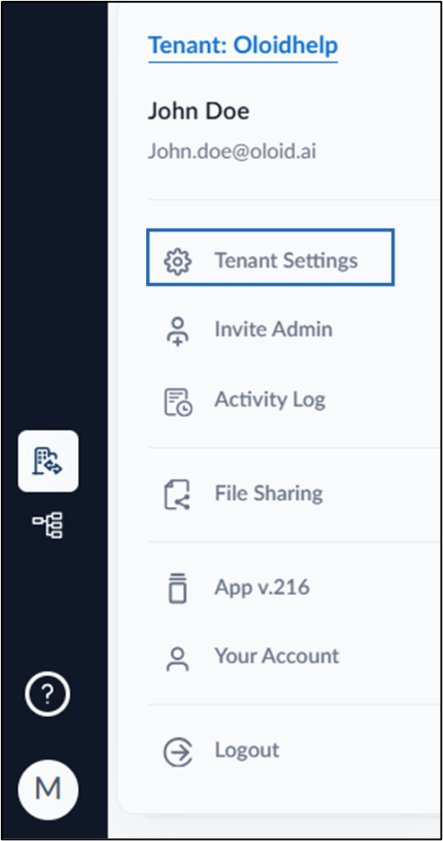
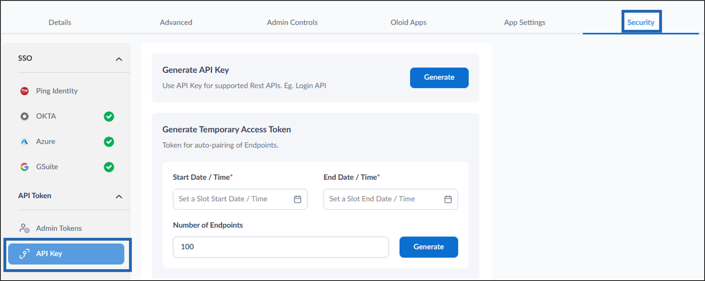
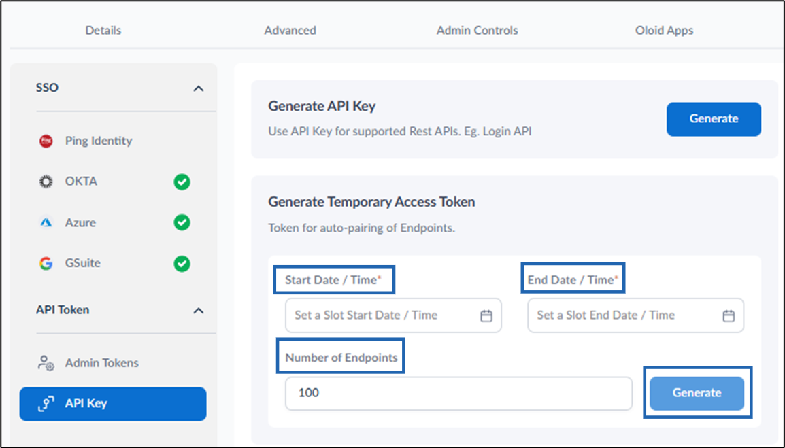
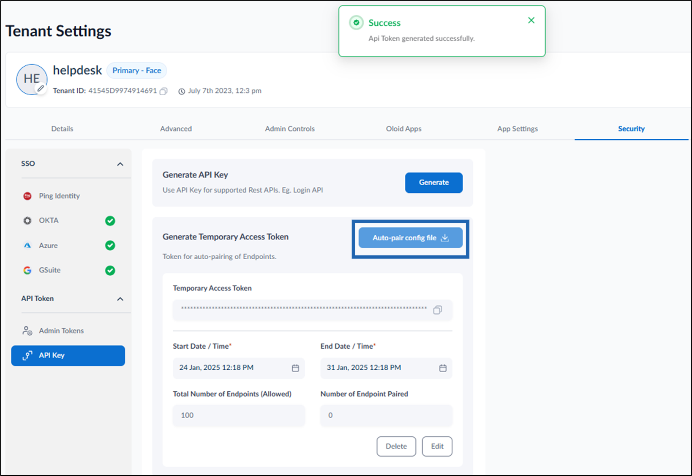
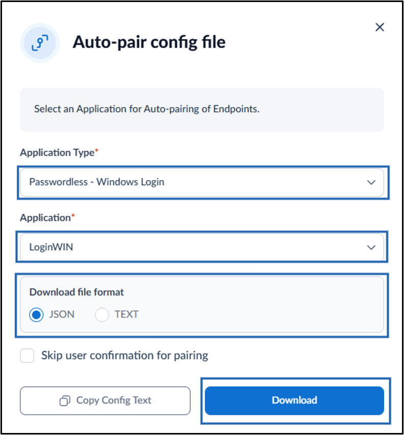

{/* Source: Intercom article 10441578 - https://oloid.help/en/articles/10441578-windows-login-how-to-generate-and-download-auto-pair-config-file-for-windows-login-in-tenant-admin-portal */}
{/* Generated by intercom_to_mintlify.py - re-running overwrites this file. */}

## Introduction

The **Auto-Pair Config File** allows the Tenant Admin to streamline the process of pairing Windows endpoints with a configured application. By generating this file from the Tenant Admin Portal, admins can automatically connect multiple endpoints.

## Prerequisites

- You must have admin access to a Tenant Admin Portal.
- Ensure that a **Windows Login** application is already created in the Tenant Admin Portal. Refer: Windows Login - [How to create and configure Windows Login application in the Tenant Admin Portal](/platforms/windows/windows-login/windows-login-how-to-create-and-configure-windows-login-application)

## Steps to Generate Auto-Pair Config file

1. Log in to the **Tenant Admin Portal**.
2. On the homepage of the portal, click **user profile icon** on the bottom left corner of the menu panel.

   

   The user profile menu is displayed.
3. Click **Tenant Settings**.

   

   The **Tenant Settings** page is displayed.
4. Go to **Security** tab > **API Token** > **API Key**.

   

5. In the **Generate Temporary Access Token** section, do the following:
   1. In the **Generate Temporary Access Token** section, select the **Start Date/Time** field.
      - To set the start date and time, click the date picker or select **Now**.
   2. Select the **End Date/Time** field.
      - Click the date picker, choose when the token will expire, and then click **OK**.
   3. Specify **Number of Endpoints** that can be created using the endpoint. (Optional)
   4. Click **Generate**.

      

      The auto-pair config file is generated.
6. Click **Auto-pair config file**.

   

   The Auto-pair config file pop-up box is displayed.
7. Do the following:
   1. Select **Application Type** as **Passwordless - Windows Login** from dropdown.
   2. From the **Select Application** drop-down list, select the application that you want the endpoints to pair with.

      <Note>
        **Note:** Select **Skip user confirmation for pairing** to pair the endpoint without requiring user confirmation.
      </Note>

   3. Under **Download file format**, select one of the following options:
      - **JSON:** Select this option to download the Auto-pair config file when pairing the Windows Login app **after installation**.
      - **TEXT:** Select this option to generate the Auto-pair configuration text when pairing the Windows Login app **during installation**.
   4. Click **Download**.

The Auto-pair config file is downloaded to the local device.

---

## Video Tutorial

[Windows Login - How to generate Auto-Pair config file for Windows Login in Tenant Admin Portal - Video Tutorial](/platforms/windows/videos/windows-login-how-to-generate-auto-pair-config-file-for-windows-login)
