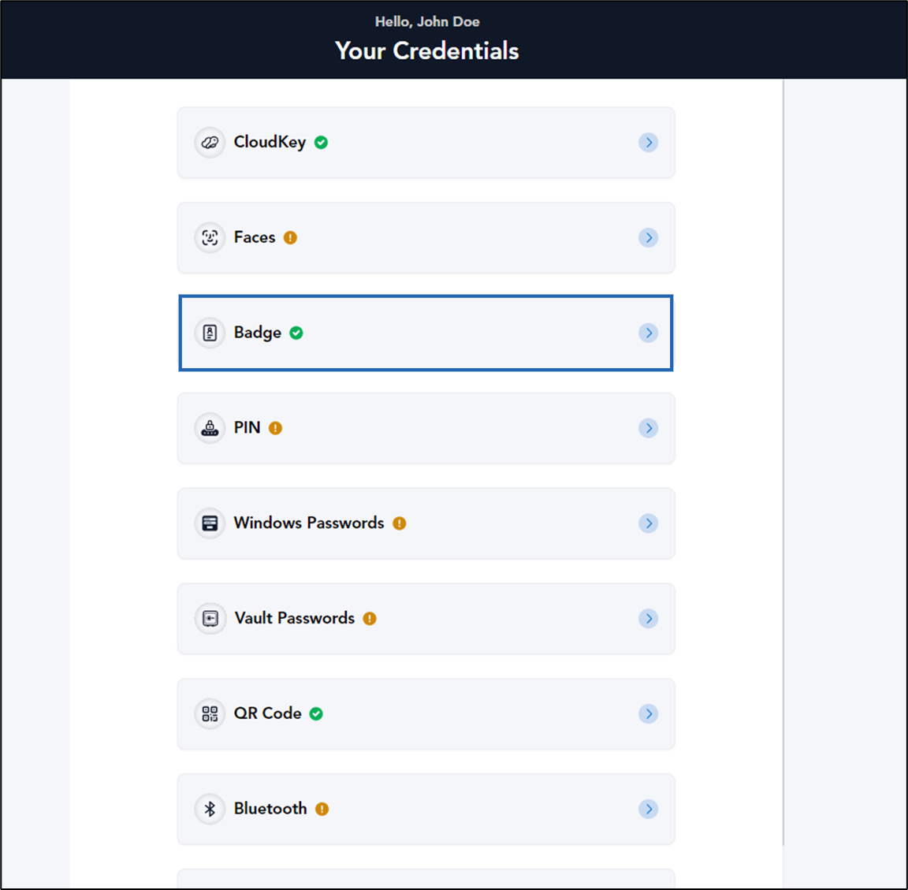
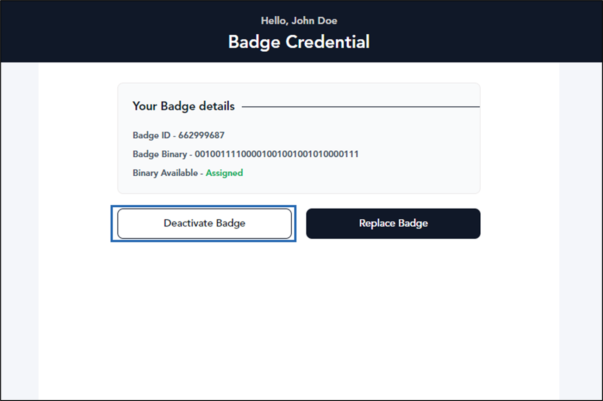
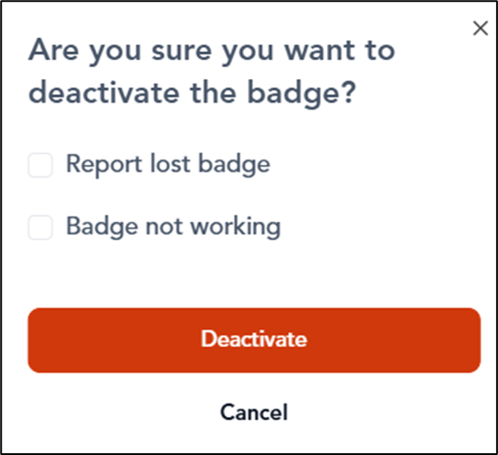
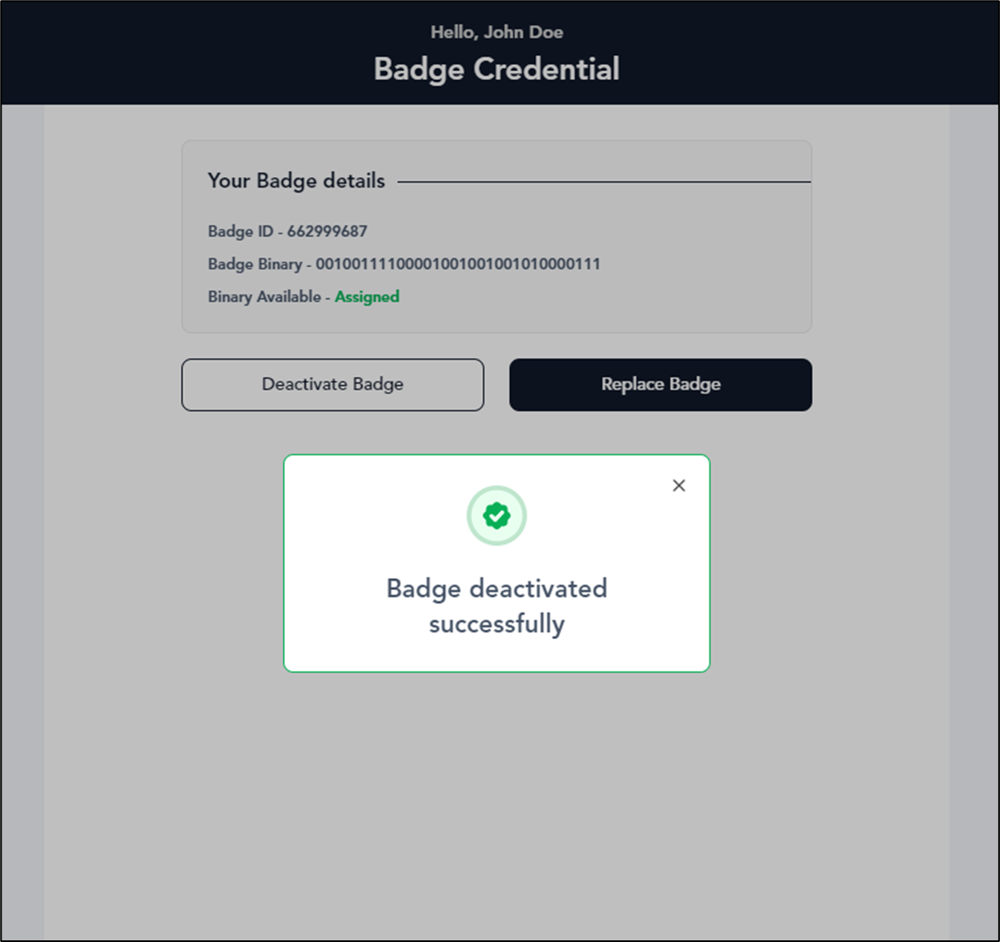

{/* Source: Intercom article 9880879 - https://oloid.help/en/articles/9880879-how-to-deactivate-badge-in-oloid-user-portal */}
{/* Generated by intercom_to_mintlify.py - re-running overwrites this file. */}

## Introduction

This document provides step-by-step instructions to Deactivate Badge in Oloid User Portal.

## Steps to Deactivate Badge

1. Login to the **Oloid User Portal**.
2. On the homepage, click **Badge**.

   

   The **Badge Credential** page is displayed.
3. Click **Deactivate Badge**.

   

   The confirmation pop-box is displayed.

   

4. On the pop-up box, do the following:
   1. Select reason. (Optional)
   2. Click **Deactivate**.
      The badge is deactivated successfully.

      
