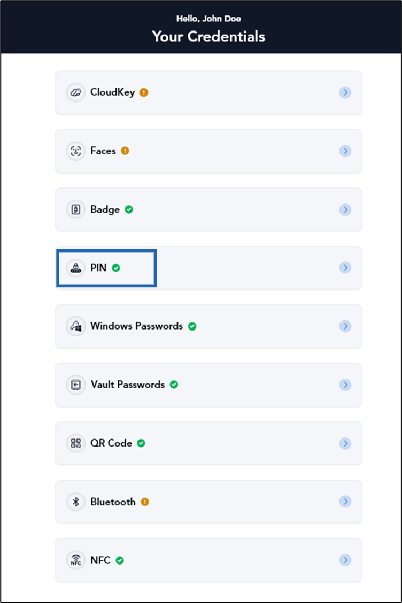
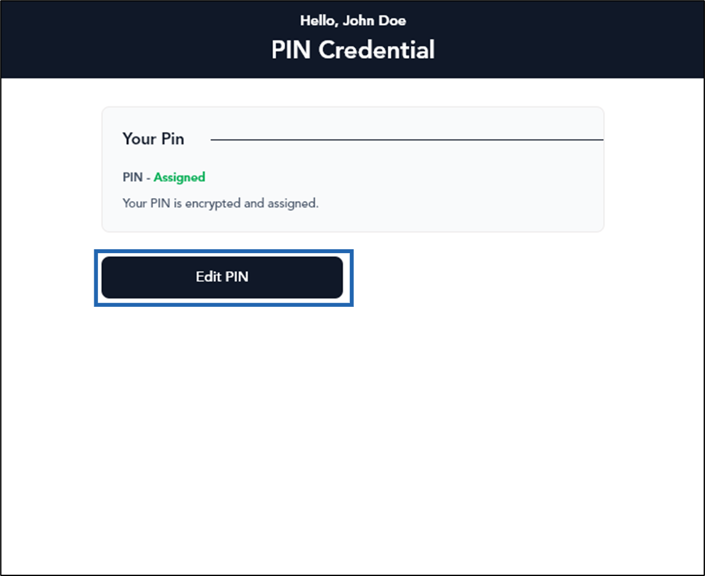
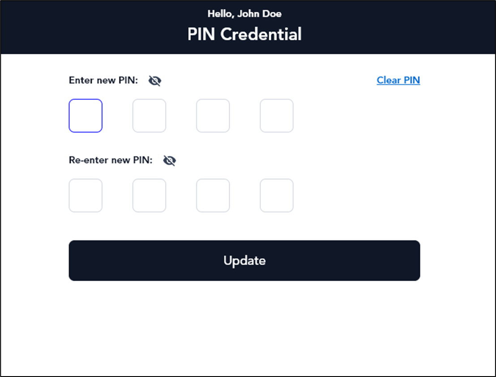
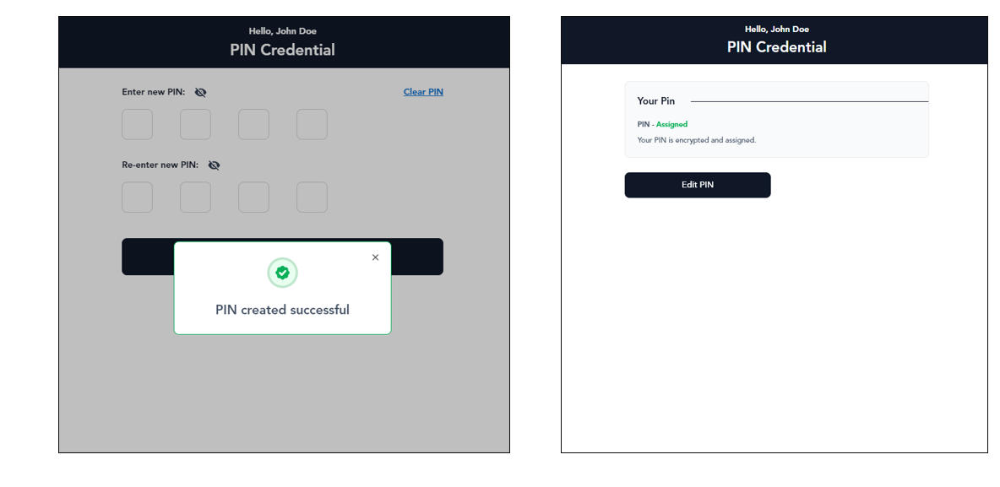

{/* Source: Intercom article 9448187 - https://oloid.help/en/articles/9448187-how-to-edit-pin-in-oloid-user-portal */}
{/* Generated by intercom_to_mintlify.py - re-running overwrites this file. */}

#### Introduction

This document provides step-by-step instructions to edit PIN in the Oloid User Portal.

#### Steps to edit PIN

1. Log in to the **Oloid User Portal**.
2. On the credential home page, select **PIN**.

   

   The **PIN Credential** page is displayed.
3. Select **Edit PIN**.

   

   The screen to reset PIN is displayed.

   

4. Do the following:
   1. **Enter new PIN**.
   2. **Re-enter new PIN**.
   3. Click **Update**.

The PIN is updated successfully.

## Video Tutorial

   Watch the video [How to edit PIN using Oloid User Portal- Video Tutorial](/platform/user-portal/videos/how-to-edit-pin-using-oloid-user-portal-video-tutorial)
