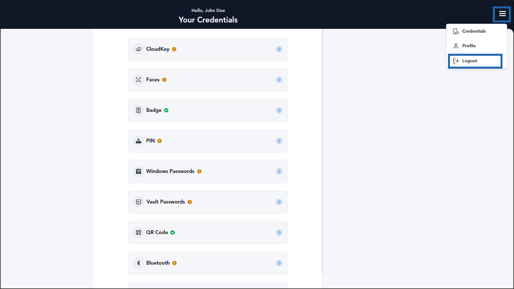

{/* Source: Intercom article 9874177 - https://oloid.help/en/articles/9874177-how-to-log-out-oloid-user-portal */}
{/* Generated by intercom_to_mintlify.py - re-running overwrites this file. */}

Steps to Logout:

1. Log in to the **Oloid User portal**.
2. On the homepage, click menu panel  icon on the top right corner.
3. Select **Logout**.

   

   The Oloid User Portal is logged out successfully.
