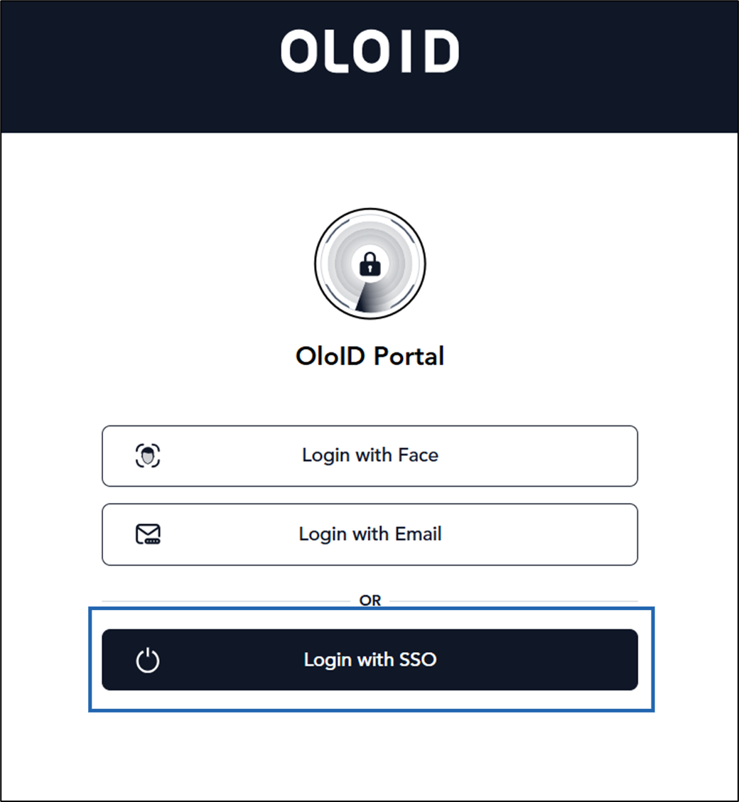
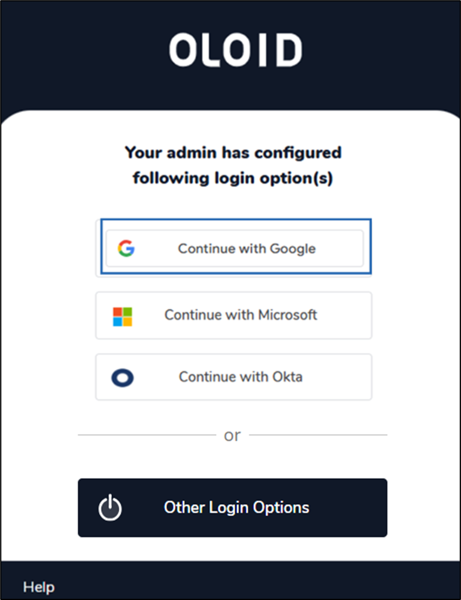
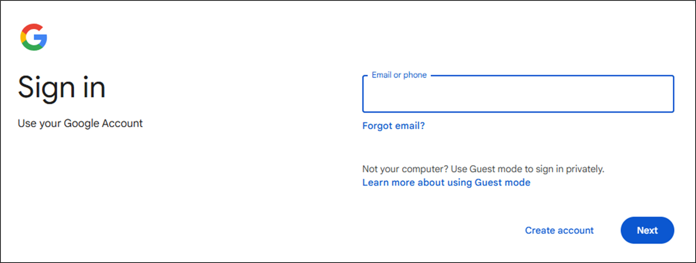
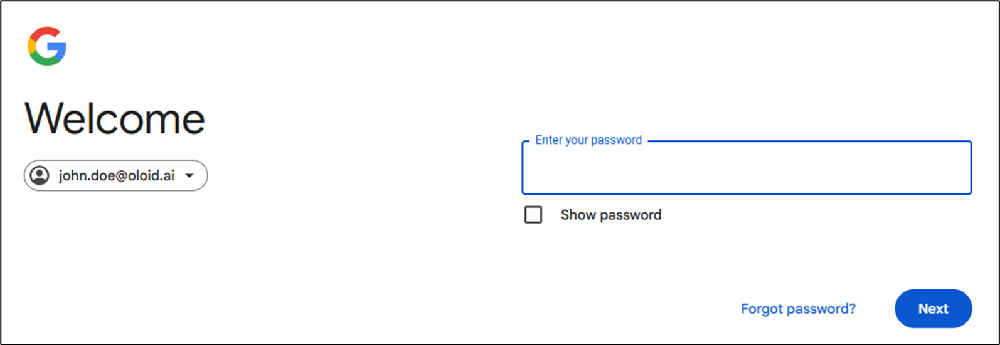
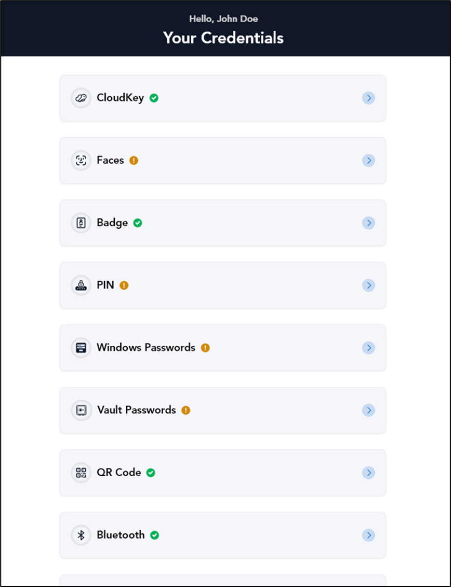

{/* Source: Intercom article 9514956 - https://oloid.help/en/articles/9514956-how-to-login-oloid-user-portal-with-google-sso */}
{/* Generated by intercom_to_mintlify.py - re-running overwrites this file. */}

To enable **Google SSO Login** on Oloid User Portal, you need to raise a ticket with [Oloid Support.](mailto:Support@oloid.ai)

**Pre-requisite**

- You should be a user in the Tenant Admin Portal.
- You must enable SSO options in Tenant Admin Portal. For more details, refer to [How to configure Oloid User Portal in Tenant Admin Portal](/platform/tenant-admin-portal/oloid-user-portal-how-to-configure-oloid-user-portal-in-tenant-admin) >[Configuring SSO options](/platform/tenant-admin-portal/oloid-user-portal-how-to-configure-oloid-user-portal-in-tenant-admin)

Steps to log in to Oloid User Portal using **Google SSO Login** option.

1. Launch your browser.
2. Enter the URL provided for you in the browser’s address bar. Then, press **Enter** on your keyboard.
   The **Oloid User Portal** page is displayed.
3. Click **Log in with SSO**.

   

   The configured Login options are displayed.
4. Click **Continue with Google**.

   

   The **Sign in** screen is displayed.

   

5. On the screen, do the following.
   1. Enter **Email or phone** > click **Next**.
      The **Welcome** screen is displayed.
   2. Enter your **Password** > click **Next**.

      

You are logged in to the Oloid User Portal using Google SSO successfully.

