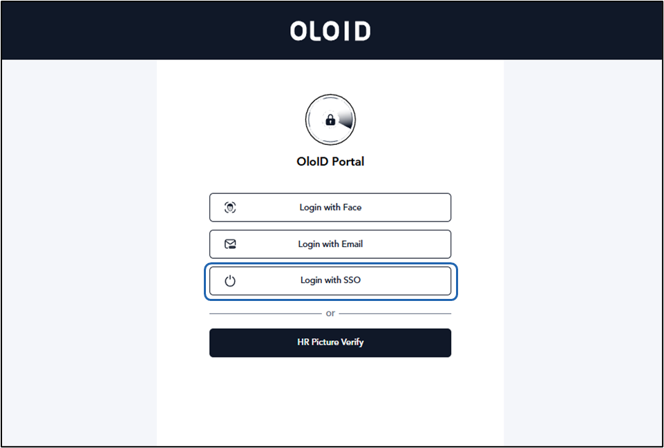
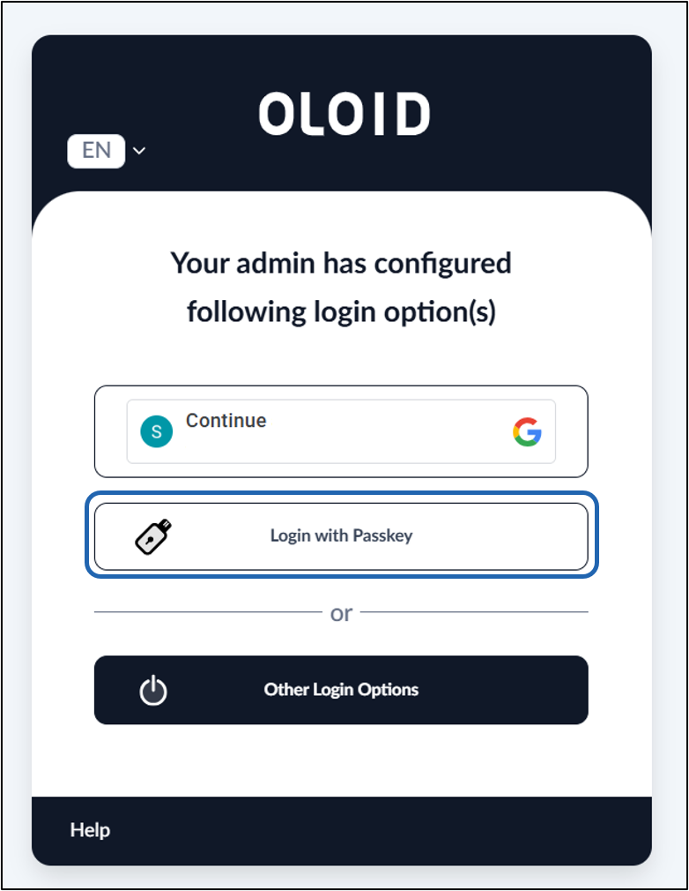
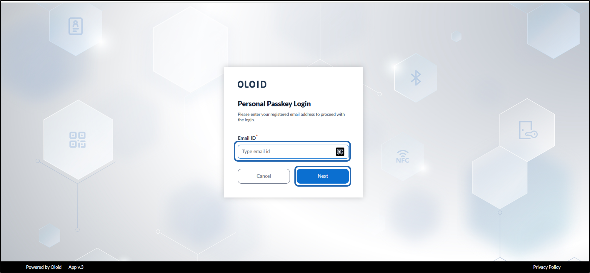
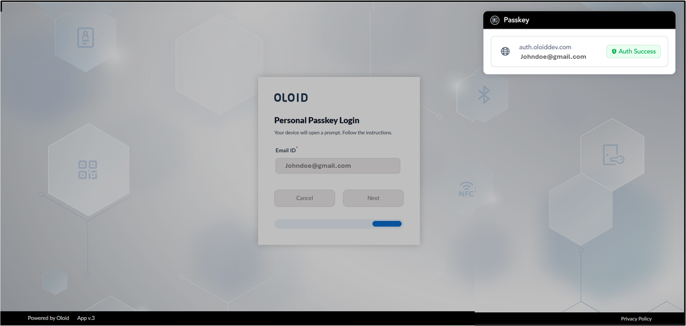
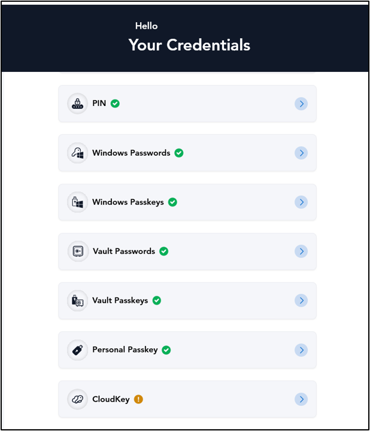

{/* Source: Intercom article 13884773 - https://oloid.help/en/articles/13884773-how-to-login-to-user-portal-with-oloid-passkey-sso */}
{/* Generated by intercom_to_mintlify.py - re-running overwrites this file. */}

## Introduction

With Oloid Passkey SSO, users can access the Oloid User portal without entering traditional credentials, ensuring a faster and more secure login process.

## Prerequisites

Ensure the following prerequisites are met before logging in to the User Portal using Oloid Passkey SSO:

- You have the **login URL** provided to access the User portal.
- Ensure Oloid Passkey is created for the user. For more, refer: [How to Generate Oloid Passkey in the User Portal](/platform/user-portal/oloid-user-portal-how-to-generate-oloid-passkey-in-the-user-portal)
- Ensure Passkey is enabled for the User from the Tenant Admin Portal. For more, refer: [How to Enable Passkey SSO in Tenant Admin Portal](/more/passwordless-authenticator/tenant-admin-portal-how-to-enable-sso-using-personal-passkey-in-the)

## Steps to log into User Portal using Oloid Passkey SSO

1. Launch your browser.
2. Enter the provided **URL** in the browser’s address bar and press **Enter**.
   The configured Log in options are displayed.
3. Click **Login with SSO**.

   

   The Authentication screen is displayed.
4. Click **Continue with Passkey.**

   

   The Oloid Passkey login page is displayed.

Enter **Email ID** > click **Next**.

The user is authenticated using passkey.

User is logged into User Portal.

