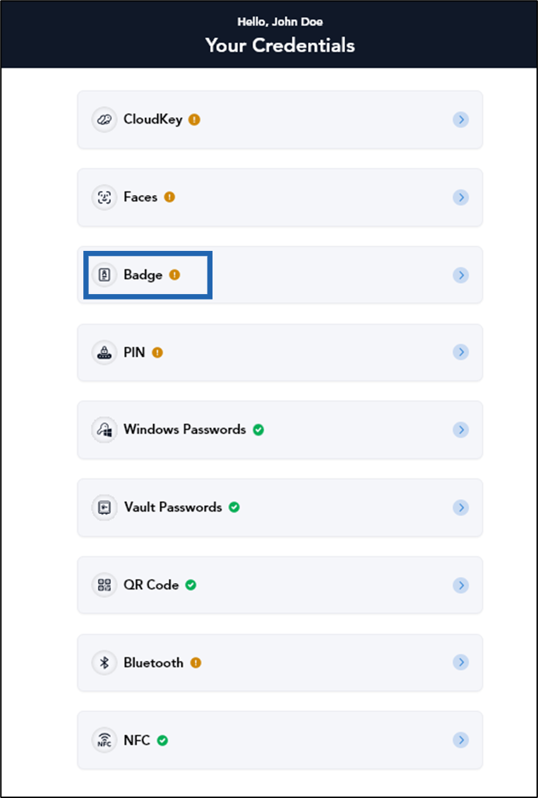
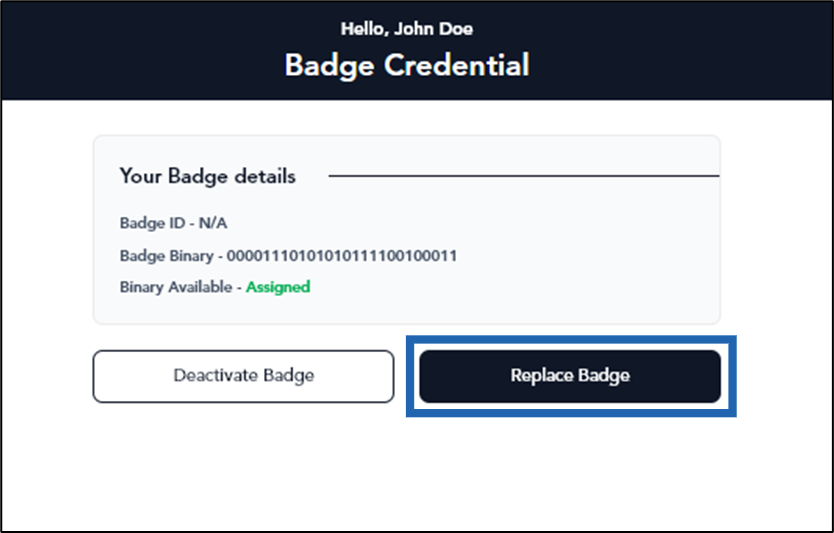
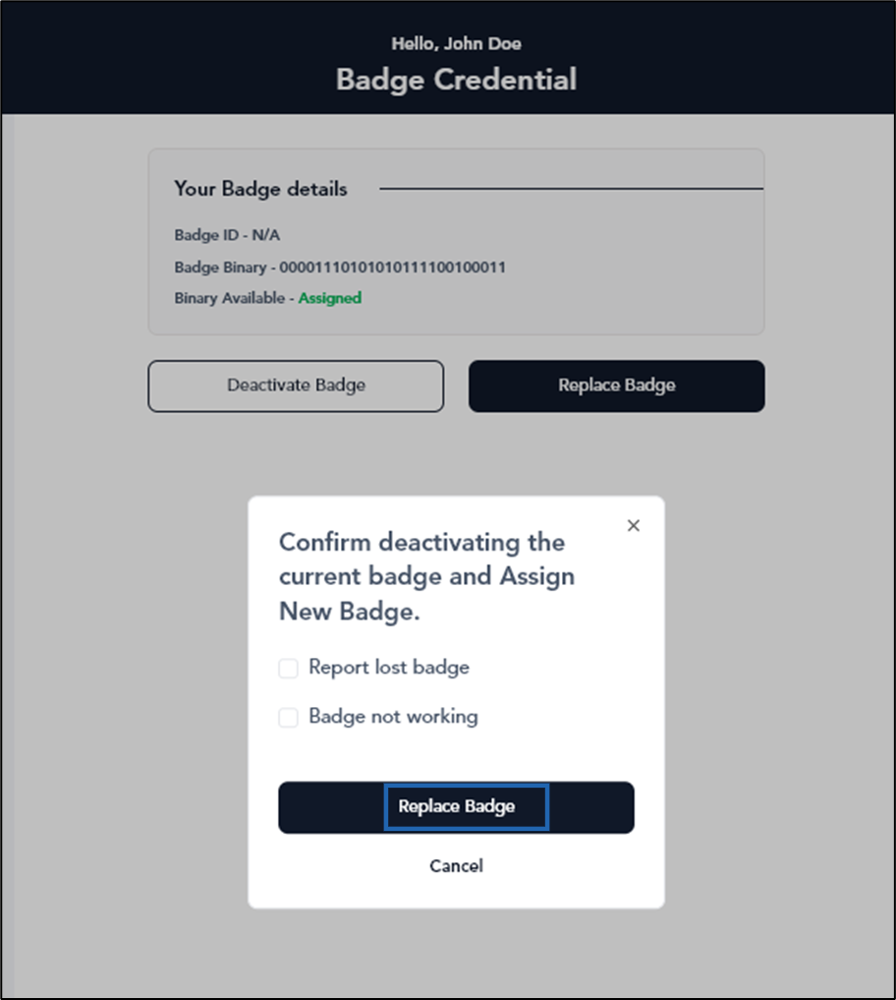
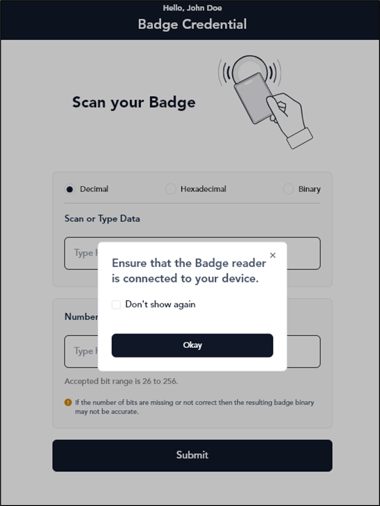
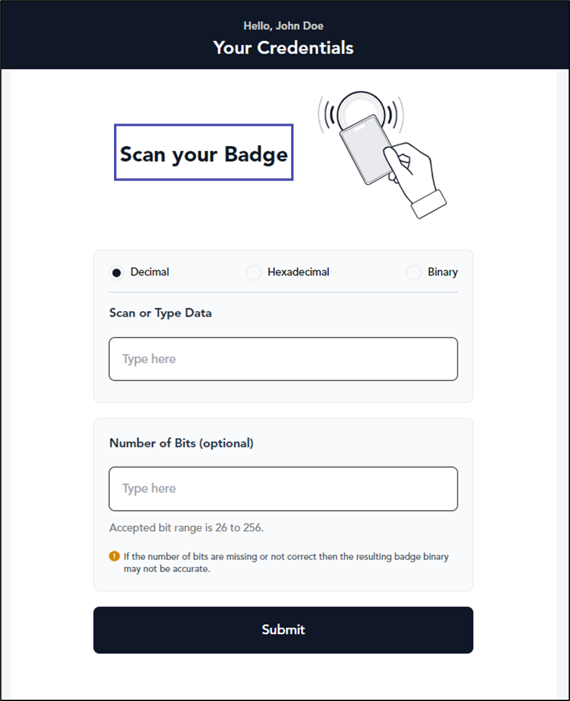
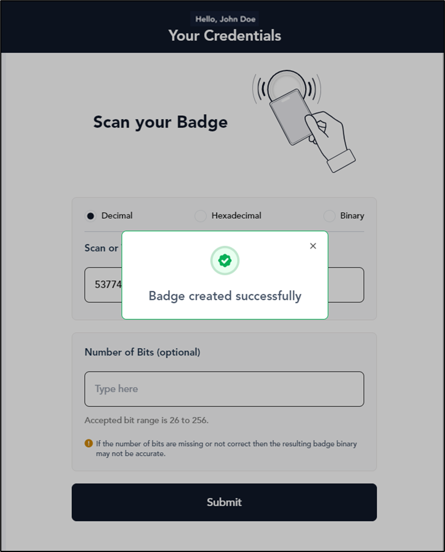
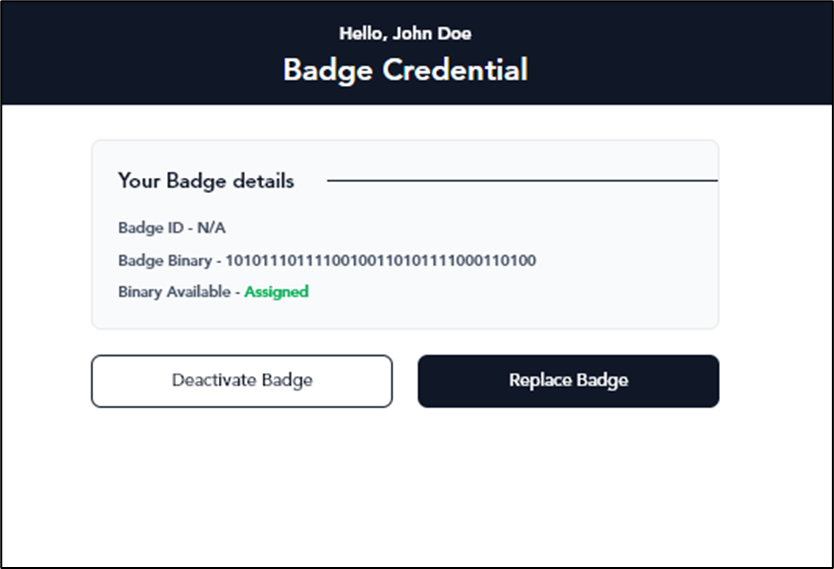

{/* Source: Intercom article 9464983 - https://oloid.help/en/articles/9464983-how-to-replace-and-assign-badge-using-oloid-user-portal */}
{/* Generated by intercom_to_mintlify.py - re-running overwrites this file. */}

#### Introduction

This document provides step-by-step instructions to replace and assign a badge in the Oloid User Portal.

#### Steps to replace and assign Badge

1. Log in to the the **Oloid User Portal**.
2. On the credential page of the Oloid User Portal, select **Badge**.

   

   The **Badge Credential** page is displayed.
3. Select **Replace Badge**.

   

4. On the confirmation pop-up box do the following:
   1. Select **Report Lost Badge**.(Optional)
   2. Select **Badge not Working**.(Optional)
   3. Select **Replace Badge**.

      

      The confirmation to ensure that the Badge reader is connect to your device is displayed.
5. Click **Okay**.

   

   The **Scan your Badge** page is displayed.

   

6. Do any of the following:
   1. Enter the badge card number.
   2. Click on the **Scan or Type Data** textbox area. Tap the **Badge** on the **Badge Reader** to scan it.

      <Note>
        **Note:** If you do not click on the Scan or Type Data textbox area, you will not see the data in the text field.
      </Note>

Click **Submit**.

You are successfully assigned a new badge on badge authentication, and a success message is displayed.

The badge is replaced and displayed under the Badge Credential.

## Video Tutorial

7. Watch the video [How to replace and assign Badge using Oloid User Portal- Video Tutorial](/platform/user-portal/videos/how-to-replace-and-assign-badge-using-oloid-user-portal-video-tutorial)
