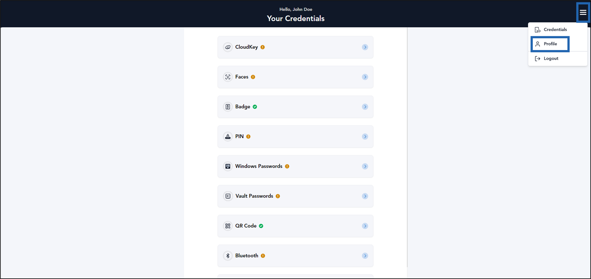
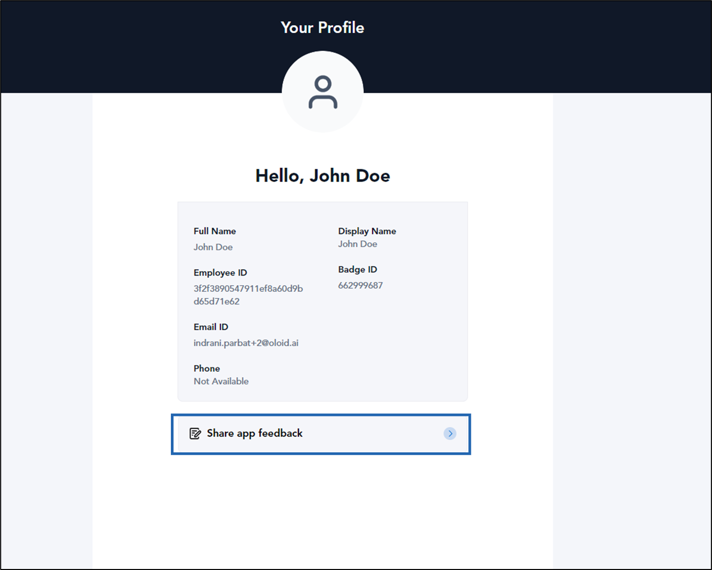
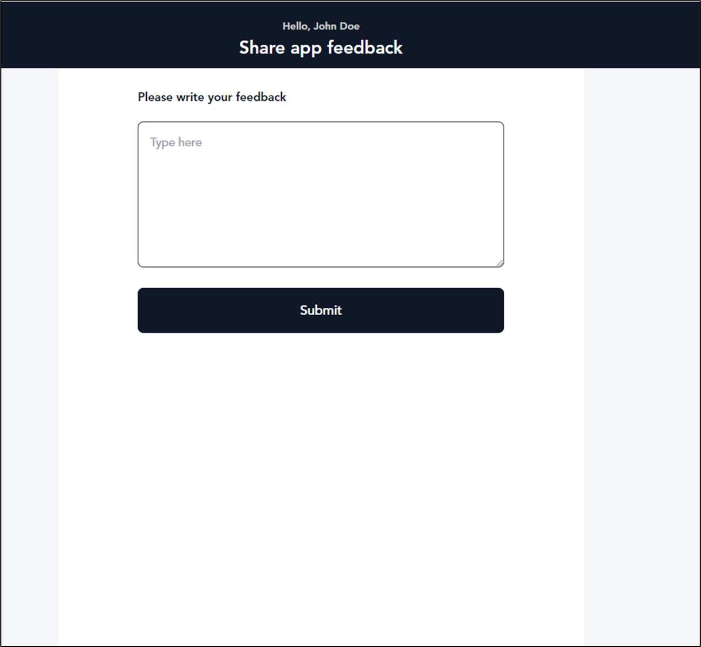
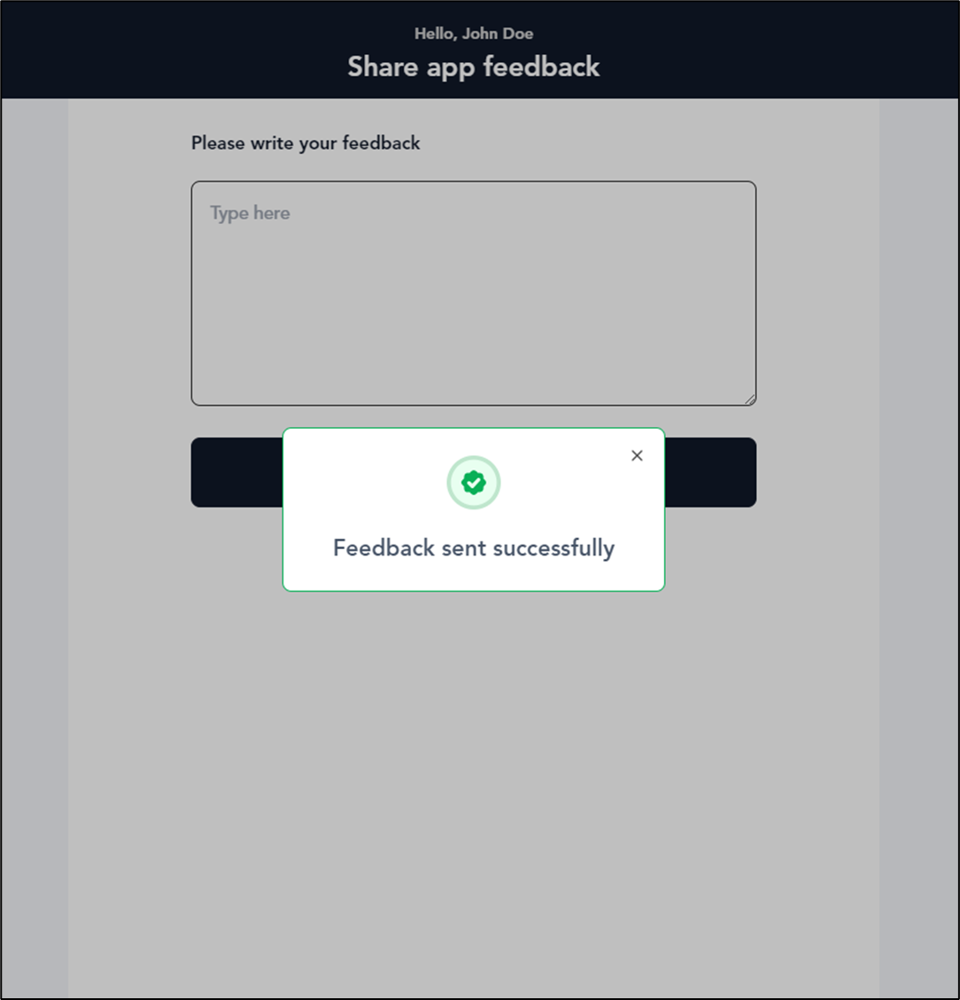

{/* Source: Intercom article 9874142 - https://oloid.help/en/articles/9874142-how-to-share-feedback-using-oloid-user-portal */}
{/* Generated by intercom_to_mintlify.py - re-running overwrites this file. */}

Steps to share feedback:

1. Login to the **Oloid User Portal**.
2. On the homepage, click menu panel  icon on the top right corner.
3. Select **Profile**.

   

   The **Your Profile** page is displayed.
4. Click **Share app feedback**.

   

   The **Share app feedback** page is displayed.
5. Do the following:
   1. Enter feedback in **Type here** field.
   2. Click **Submit**.

      

      The feedback is sent successfully.

      
