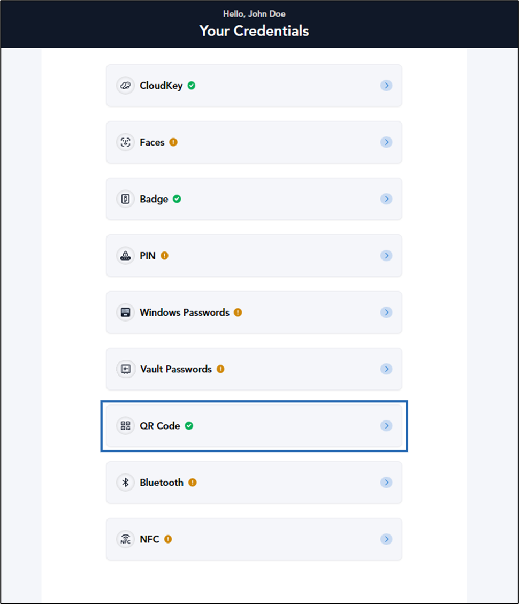
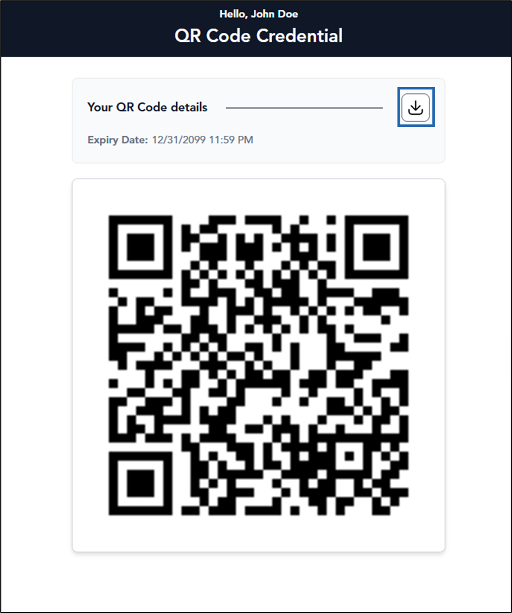

{/* Source: Intercom article 9901402 - https://oloid.help/en/articles/9901402-how-to-view-qr-code-using-oloid-user-portal */}
{/* Generated by intercom_to_mintlify.py - re-running overwrites this file. */}

Steps to view QR code:

1. Log in to the **Oloid User Portal**.
2. On the homepage, click **QR Code**.

   

   The **Assign QR Code** page is displayed and you can view the QR Code on the page.

   

   <Note>
     **Note:** You can also download the QR Code.
   </Note>
