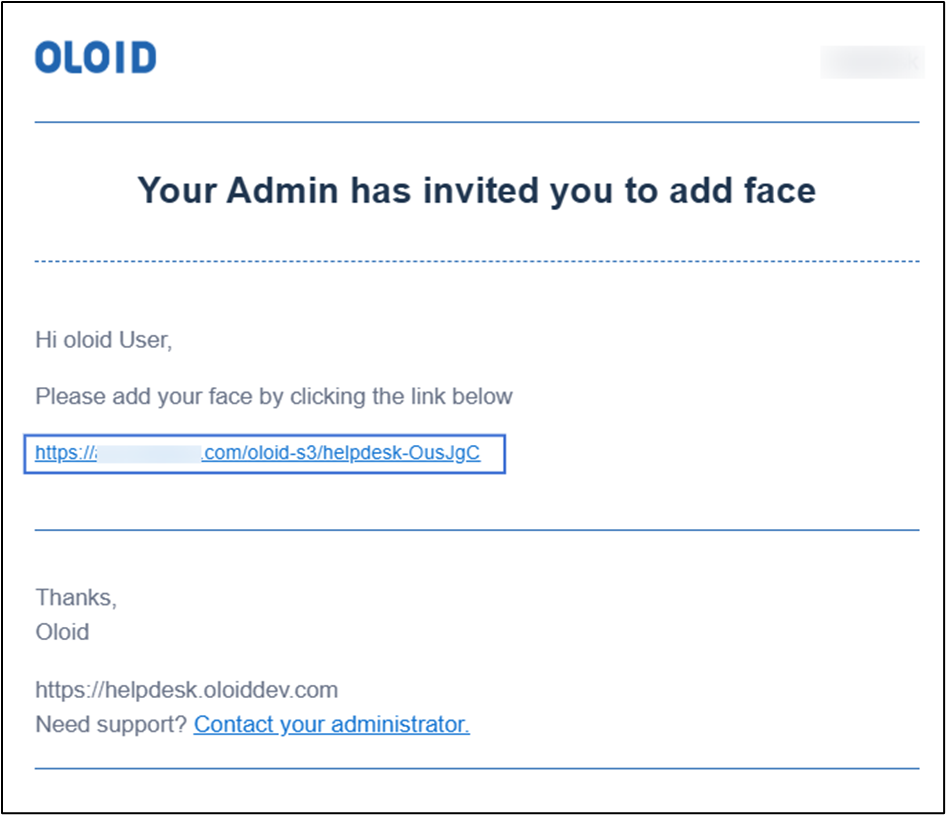
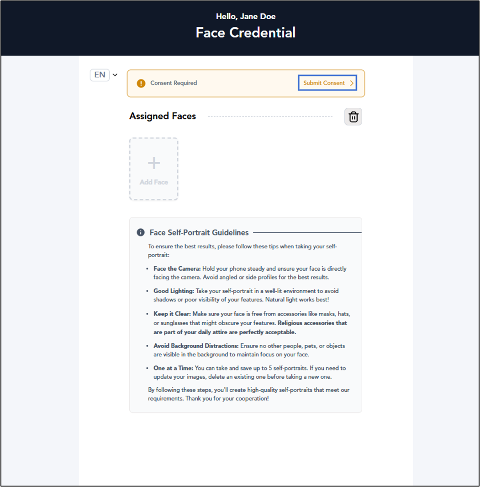
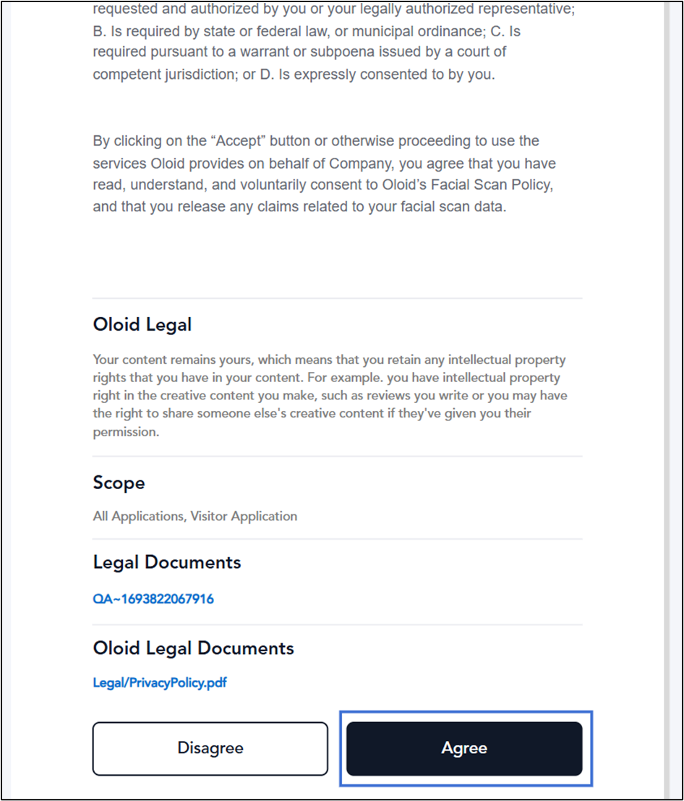
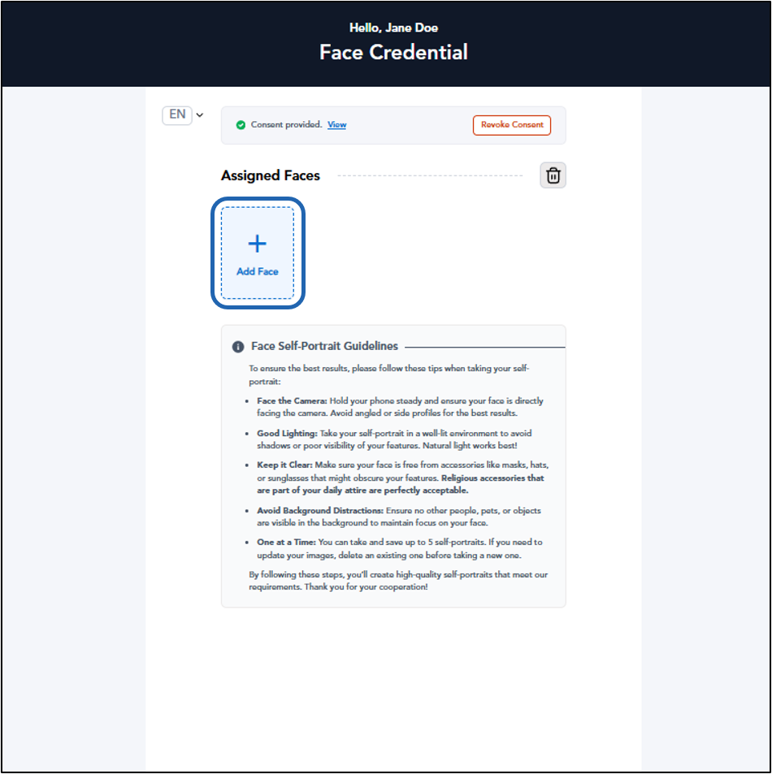
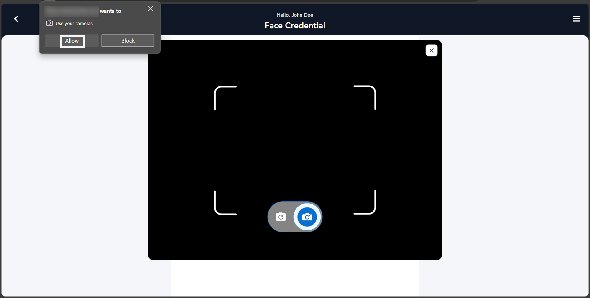
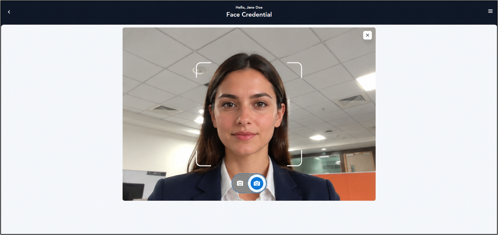
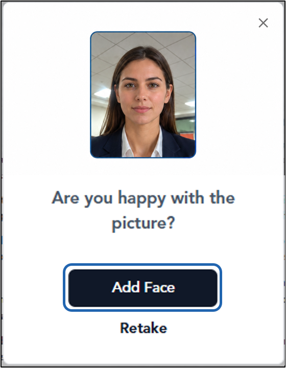
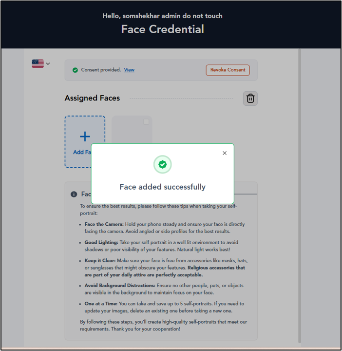

{/* Source: Intercom article 8472935 - https://oloid.help/en/articles/8472935-oloid-user-portal-how-to-add-a-face-using-invite-link */}
{/* Generated by intercom_to_mintlify.py - re-running overwrites this file. */}

## Introduction

This document provides instructions to add a face credential using the invite link in the Oloid User Portal. The invite link enables users to securely enroll face credential.

## Prerequisite

- A valid invite link to add a face must be available in the user’s mailbox.

## Steps to Add Face using invite link

1. Click the invite link available in your mailbox.

   

   The Oloid User Portal opens with Face Credential page.

   <Note>
     **Note:** You need to provide your consent to proceed to next steps if consent is enabled for you.
   </Note>

2. Click **Submit Consent.**

   <Note>
     **Note:** If configured in the Tenant Admin Portal, you can select your preferred display language from the Language Dropdown Selector
   </Note>

   

   The Consent page is displayed.
3. Click **Agree** to submit consent.

   

   The consent is submitted successfully.
4. Click **Add Face.**

   

   <Note>
     **Note:** Provide camera permission if prompted.
   </Note>

   

   This opens the camera on your device.
5. Look at the camera to capture your face.

   

   The pop-up screen appears with the captured image.
6. Do one of the following:
   1. Select **Add Face** to submit the image.
      The face is submitted successfully and is assigned as a face credential.
   2. Select **Retake** to take your photo again.
      The camera turns on to retake the photo.

<Note>
  **Note:** You can add up to five faces per user.
</Note>

Ensure your face is clearly visible in the camera, or it may be rejected. Avoid wearing items that cover your facial features, such as sunglasses, masks, or headbands.

The face is added successfully.

