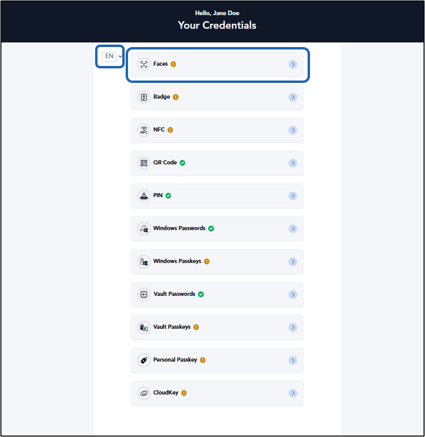
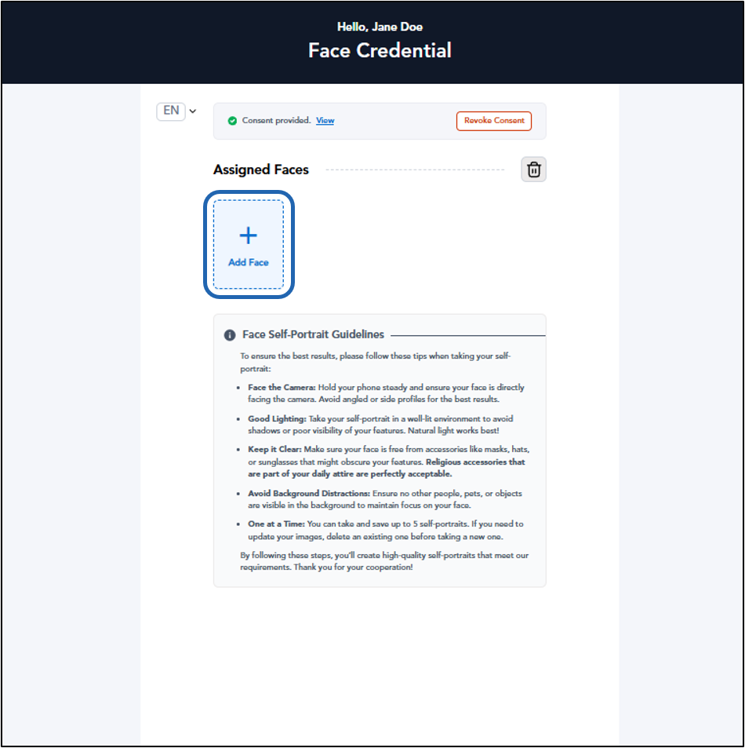
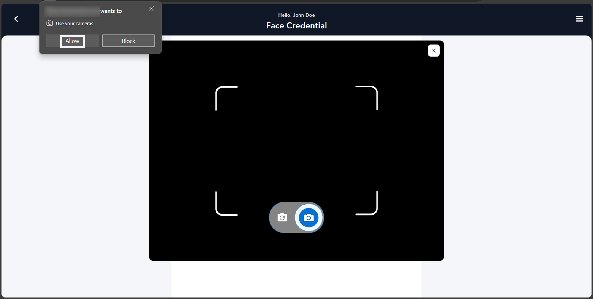
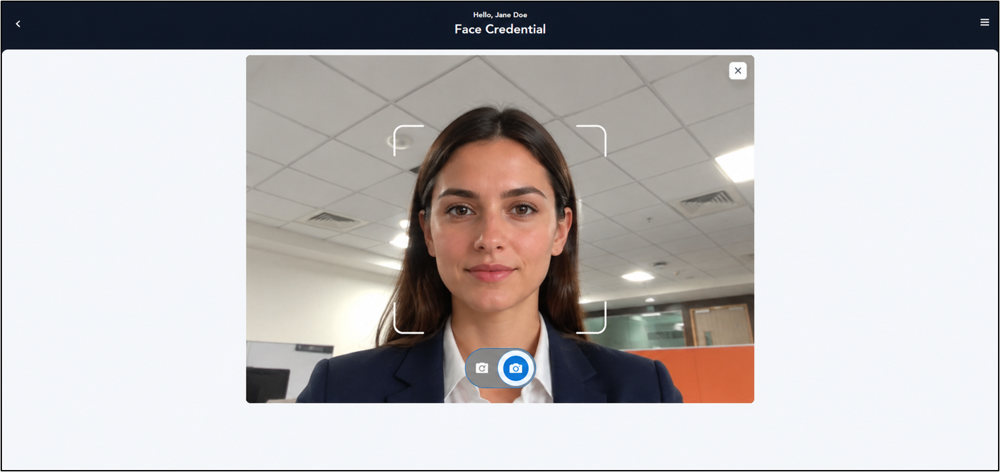
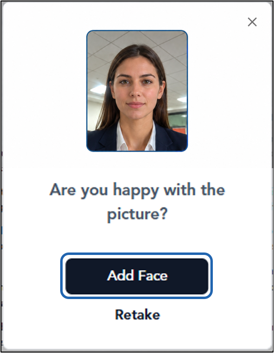
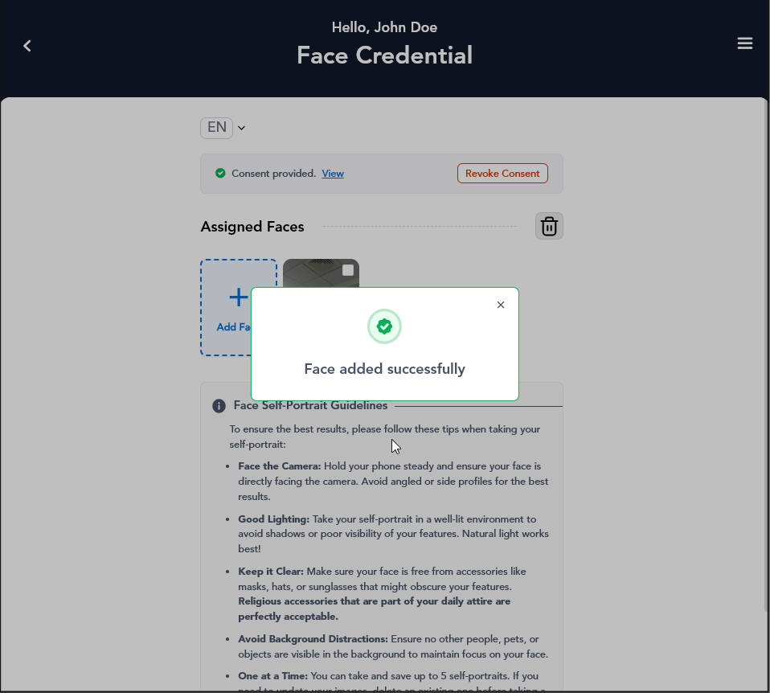

{/* Source: Intercom article 9874419 - https://oloid.help/en/articles/9874419-oloid-user-portal-how-to-add-face */}
{/* Generated by intercom_to_mintlify.py - re-running overwrites this file. */}

## Introduction

This document provides step-by-step instructions for adding a face credential through the Oloid User Portal. Users can capture and submit their face image to enroll it as a face credential for authentication.

## Prerequisites

- You have the **login URL** provided to access the User portal.
- Your **Employee ID or Email ID** must be registered in the system.
- Camera access must be available on your device.
- If Consent has been enabled, Ensure You provide consent to before adding face.

## Steps to Add Face

1. Login to the **Oloid User Portal**.
2. On the Credential Page, click **Face**.

   <Note>
     **Note:** If configured in the Tenant Admin Portal, you can select your preferred display language from the Language Dropdown Selector.
   </Note>

   

   The **Face Credential** page is displayed.

   <Note>
     **Note:** You need to provide your consent to proceed to next steps if consent is enabled for you.
   </Note>

3. Select **Add Face**.

   

   <Note>
     **Note:** Provide camera permission if prompted.
   </Note>

   

   This opens the camera on your device.
   1. Look at the camera to confirm your identity.

      

      The pop-up screen appears with the captured image.

      

   2. Do one of the following:
      1. Select **Add Face** to submit the image.
         The face is submitted successfully and is assigned as a face credential.
      2. Select **Retake** to take your photo again.
         The camera turns on to retake the photo.

         <Note>
           **Note:** You can add a maximum of five faces per user.
         </Note>

         Your face should be visible in the camera, or else it might get rejected. It is recommended to avoid wearing things that cover your facial features such as sunglasses, masks, headbands, etc.
4. The face is added successfully.

   
