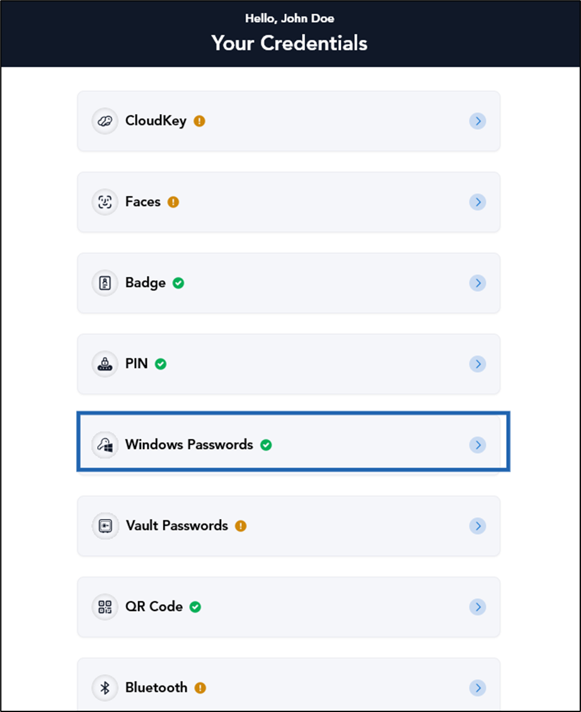
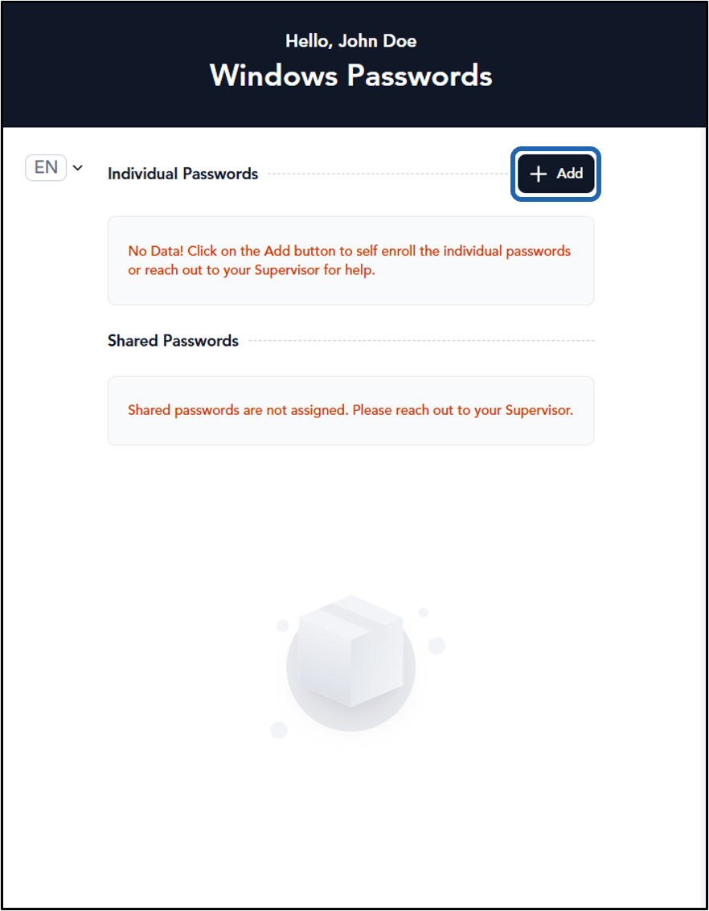
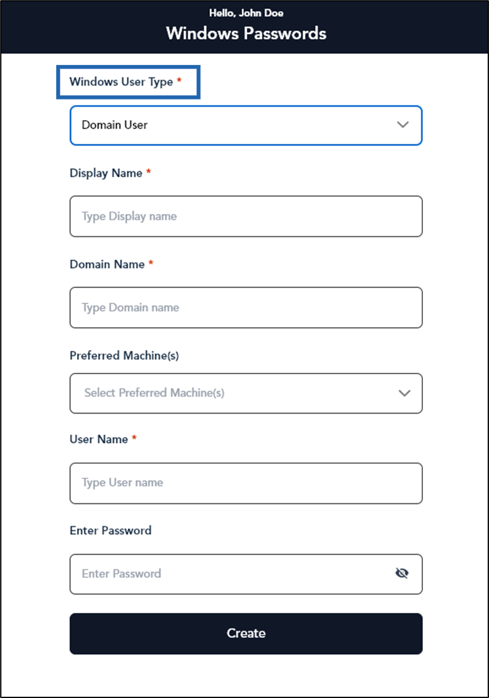
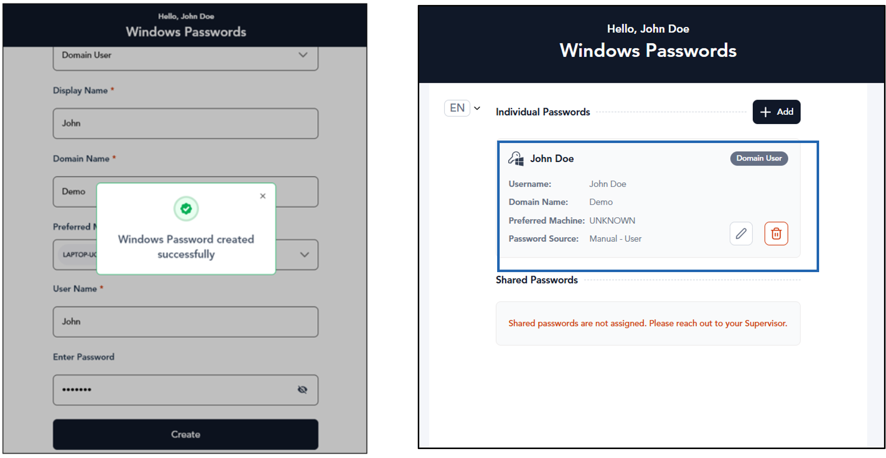
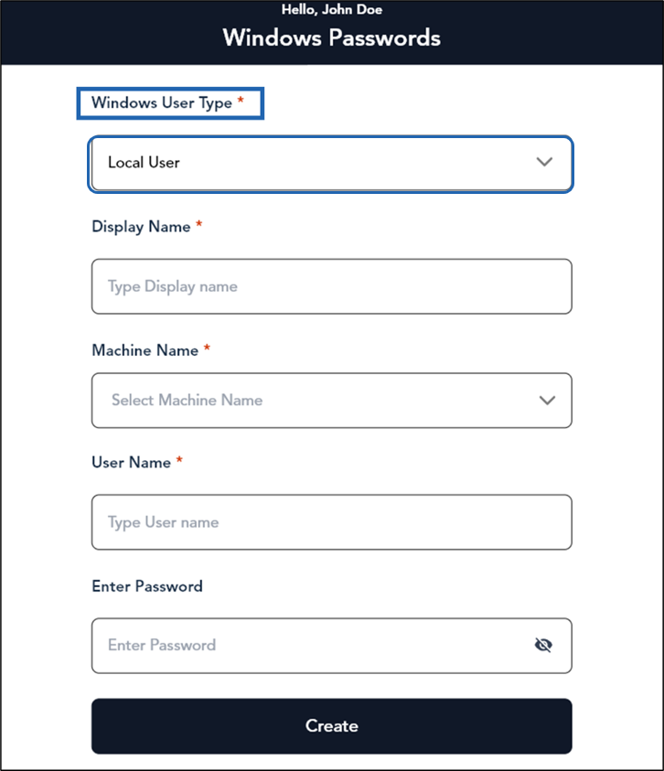
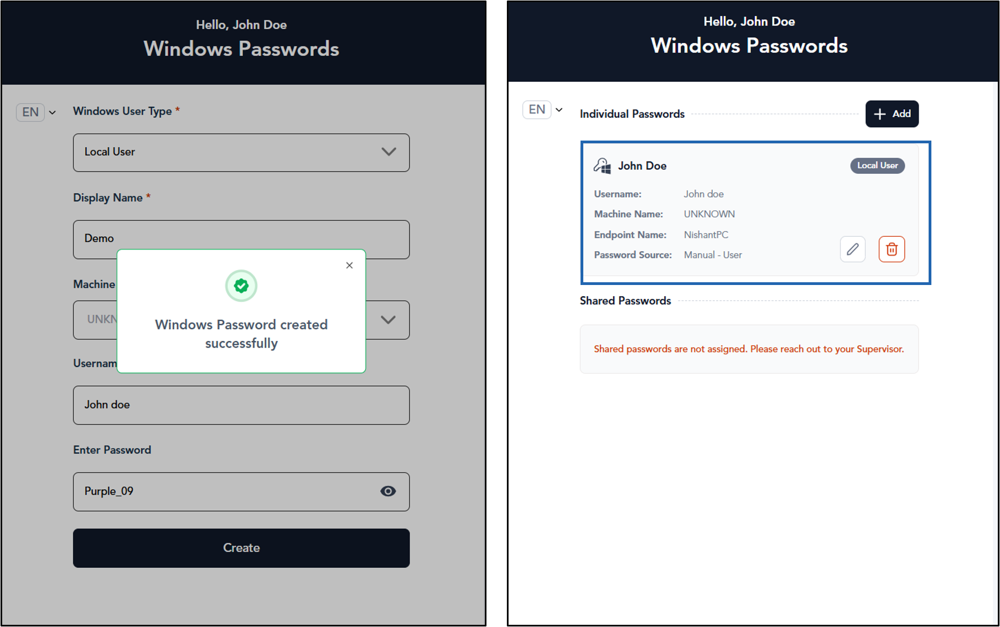

{/* Source: Intercom article 9468372 - https://oloid.help/en/articles/9468372-oloid-user-portal-how-to-create-individual-password */}
{/* Generated by intercom_to_mintlify.py - re-running overwrites this file. */}

## Introduction

This document provides instructions to create an individual password using the Oloid User Portal.

## Prerequisite

- You must have access to the Oloid User Portal.
- Windows Passwords must be enabled in the Oloid User Portal settings.

## Steps to create individual password

1. Log in to the **Oloid User Portal**.
2. On the credential home page, select **Windows Passwords**.

   

   The **Windows Passwords** page is displayed.
3. Select **+ Add** icon to create an individual password.

   

   The **Windows Passwords** page is displayed to set Password.
4. Do the following:
   1. [Create password for domain user](#create-password-for-domain-user)
   2. [Create password for local user](#create-password-for-local-user)

### Create password for Domain User

1. Select user type as **Domain User** from **Windows User Type** dropdown.
2. Enter **Display Name**.
3. Enter **Domain Name**.
4. Select **Preferred Machine(s)**. (Optional)

   <Note>
     **Note:** You can select multiple machine name
   </Note>

5. Enter **Username** of your Windows account.
6. Enter **Password** of your Windows account (Optional).
7. Click **Create**.

   

   The **Windows Password created successfully** message is displayed, and the password for the domain user is listed under **Individual Passwords**.

   

### Create password for Local User

1. Select user type as **Local User** from **Windows User Type** dropdown.
2. Enter **Display Name**.
3. Select **Machine Name**.

   <Note>
     **Note:** You can select only single machine name.
   </Note>

4. Enter **Username**.
5. Enter **Password** (Optional).
6. Click **Create**.

   

   The **Windows Password created successfully** message is displayed, and the password for the local user is listed under **Individual Passwords**.

   
