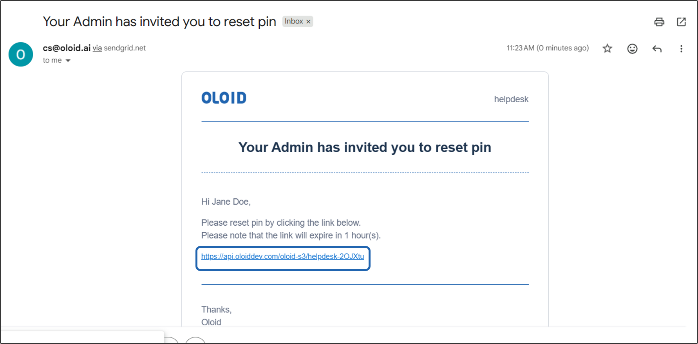
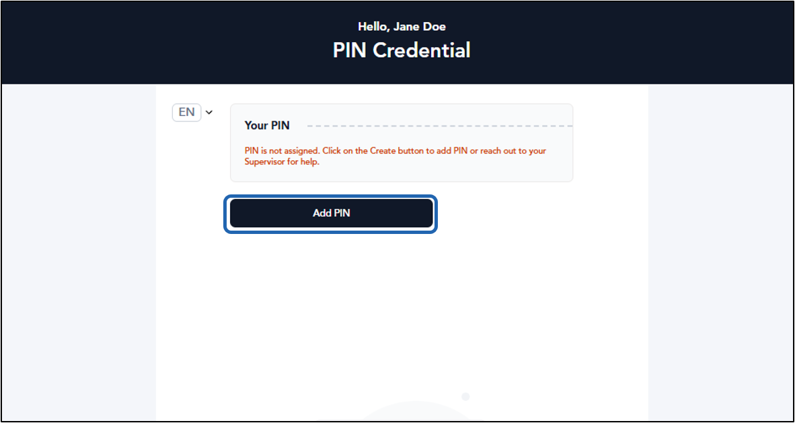
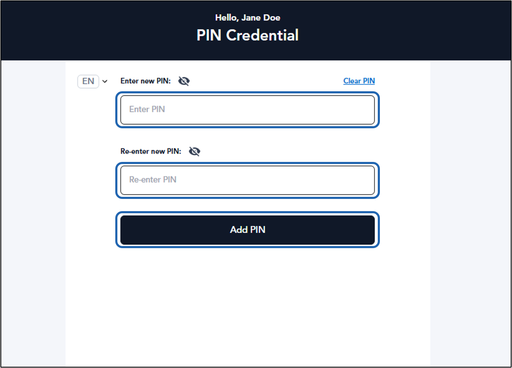
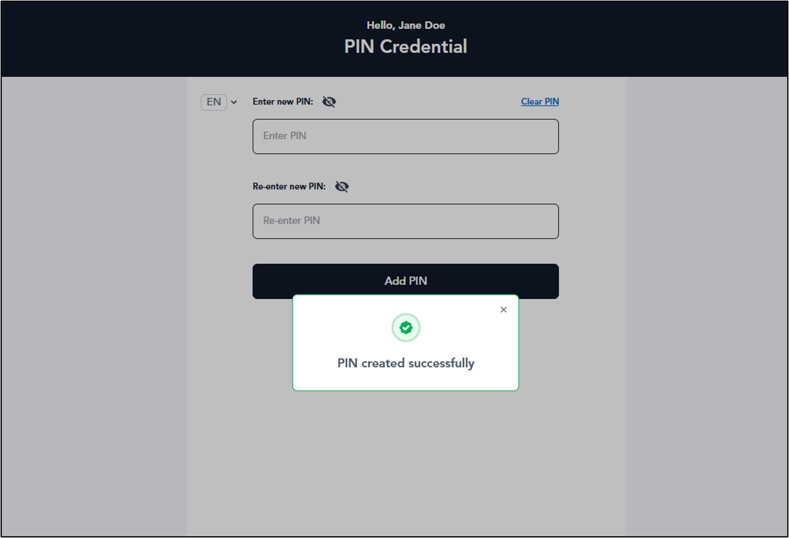

{/* Source: Intercom article 9459704 - https://oloid.help/en/articles/9459704-oloid-user-portal-how-to-create-pin-using-invite-link */}
{/* Generated by intercom_to_mintlify.py - re-running overwrites this file. */}

## Introduction

This document provides step-by-step instructions to create a PIN in the Oloid User Portal using an invite link.

<Note>
  **Note:** The admin sends an email with an invite link. The link directs the user to the Oloid User Portal where the PIN can be create.
</Note>

## Prerequisite

A valid invite link to Set PIN must be available in the user’s mailbox.

## Steps to set PIN using invite link

1. Click on the invite set PIN link.

   

   The Oloid User Portal opens with PIN Credential page.
2. Click **Add PIN**.

   <Note>
     **Note:** If configured in the Tenant Admin Portal, you can select your preferred display language from the Language Dropdown Selector
   </Note>

   

   The screen to set PIN is displayed.
3. Enter new PIN.
4. Re-enter new PIN.

Click **Create**.

The PIN is created successfully.

The PIN is created and assigned to you. The success message is displayed.

