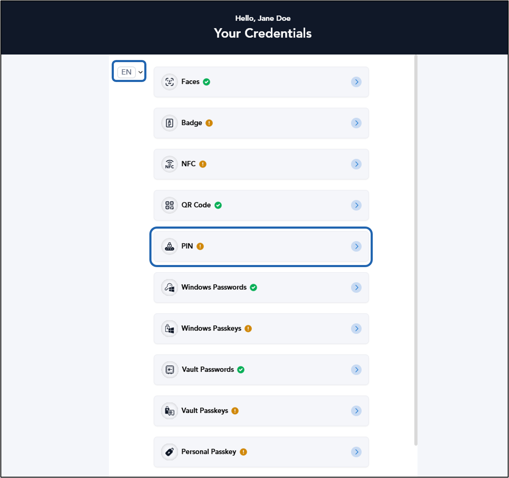
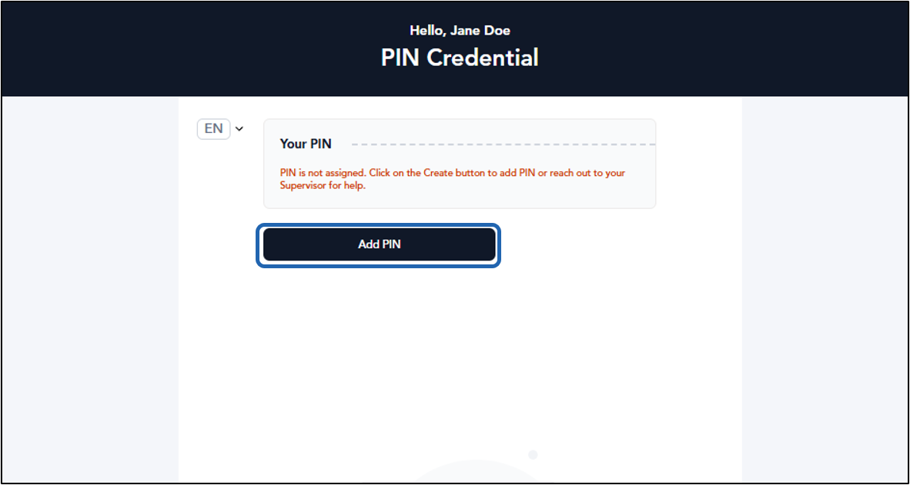
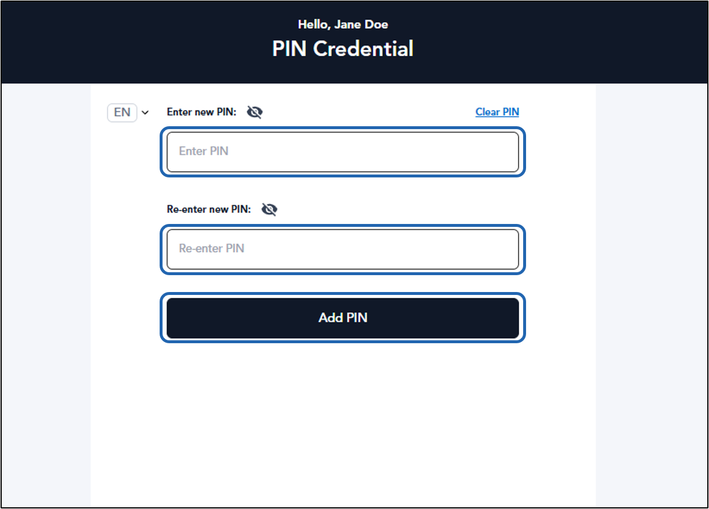
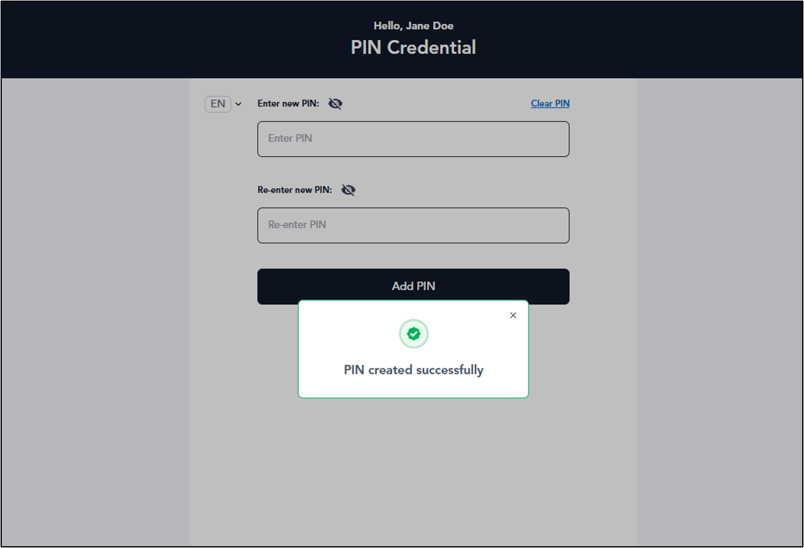

{/* Source: Intercom article 9423743 - https://oloid.help/en/articles/9423743-oloid-user-portal-how-to-create-pin */}
{/* Generated by intercom_to_mintlify.py - re-running overwrites this file. */}

## Introduction

This document provides step-by-step instructions for creating a PIN in the Oloid User Portal. Once created, the PIN is assigned to your account and can be used as a credential for authentication.

## Prerequisites

- You have the **login URL** provided to access the User portal.
- Your **Employee ID or Email ID** must be registered in the system.

## Steps to create PIN

1. Log in to **Oloid User Portal**.
2. On the credential home page, select **PIN**.

   <Note>
     **Note:** If configured in the Tenant Admin Portal, you can select your preferred display language from the Language Dropdown Selector.
   </Note>

   

   The **PIN Credential** page is displayed.
3. Click **Add PIN**.

   

   The screen to set PIN is displayed.
4. Do the following:
   1. **Enter new PIN**.
   2. **Re-enter new PIN**.

Click **Add PIN**.

The PIN is created and assigned to you. The success message is displayed.

---

##### Video Tutorial

Watch the video [How to create PIN using Oloid User Portal- Video Tutorial](/platform/user-portal/videos/how-to-create-pin-using-oloid-user-portal-video-tutorial)
