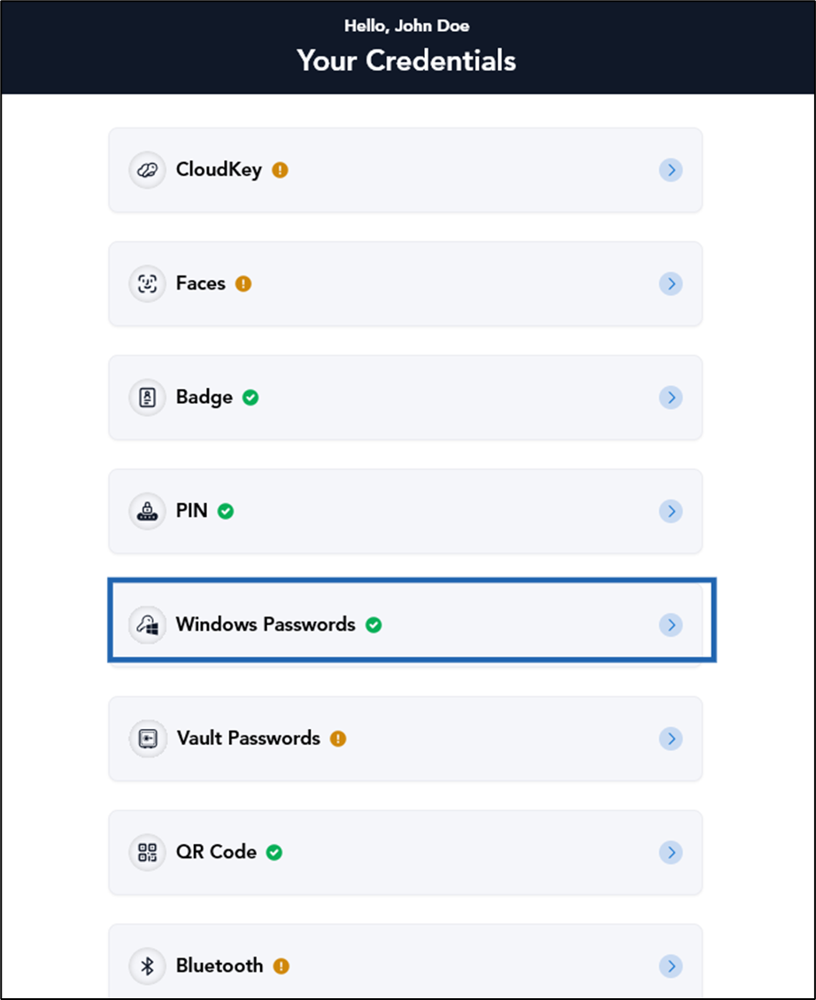
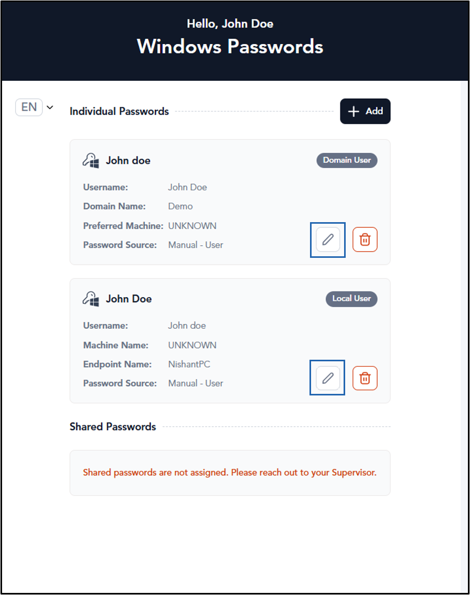
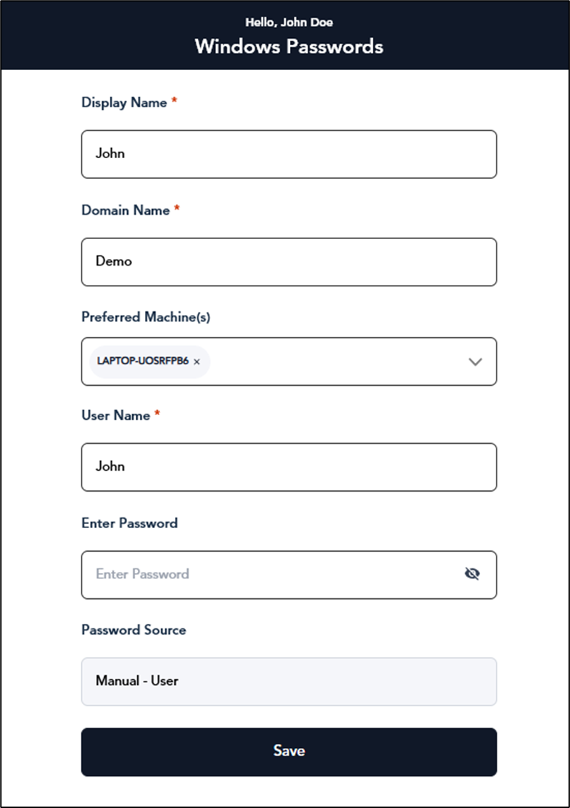
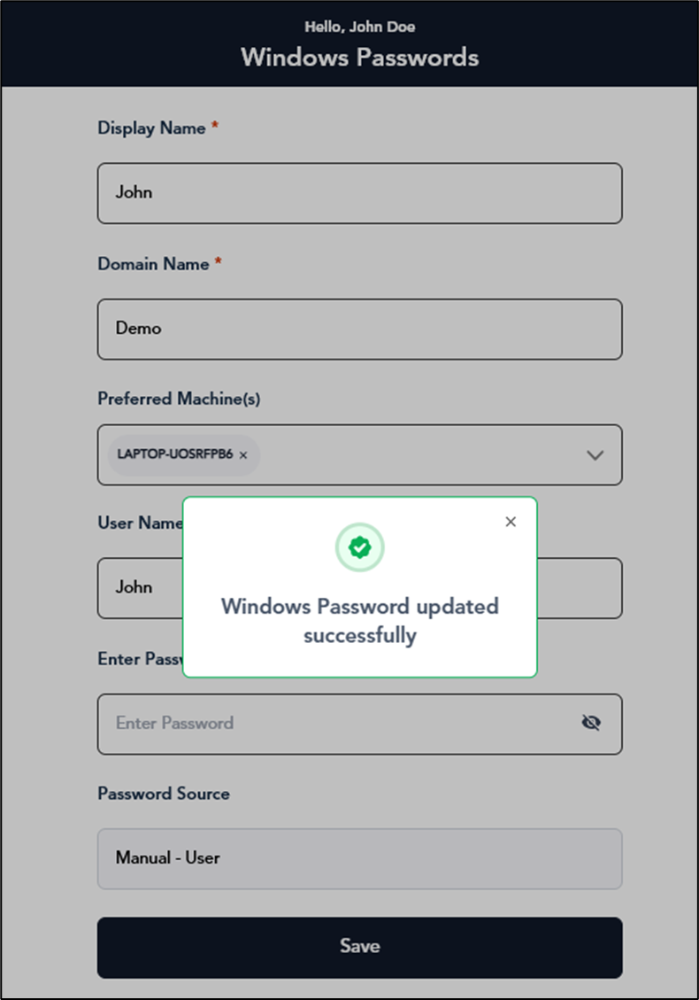
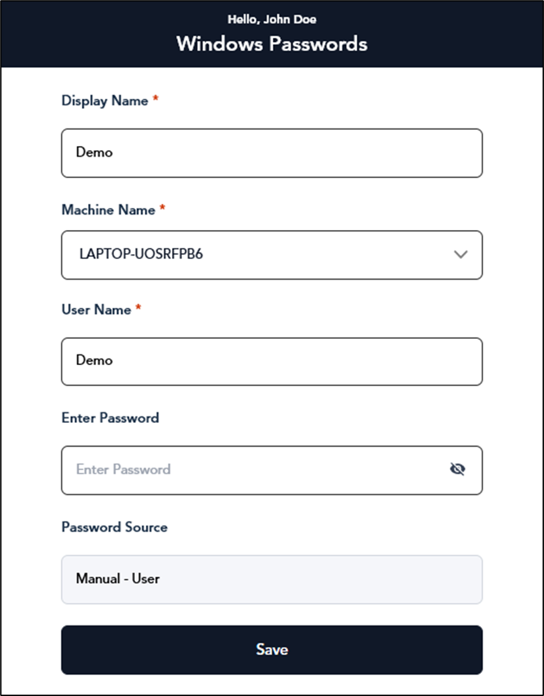
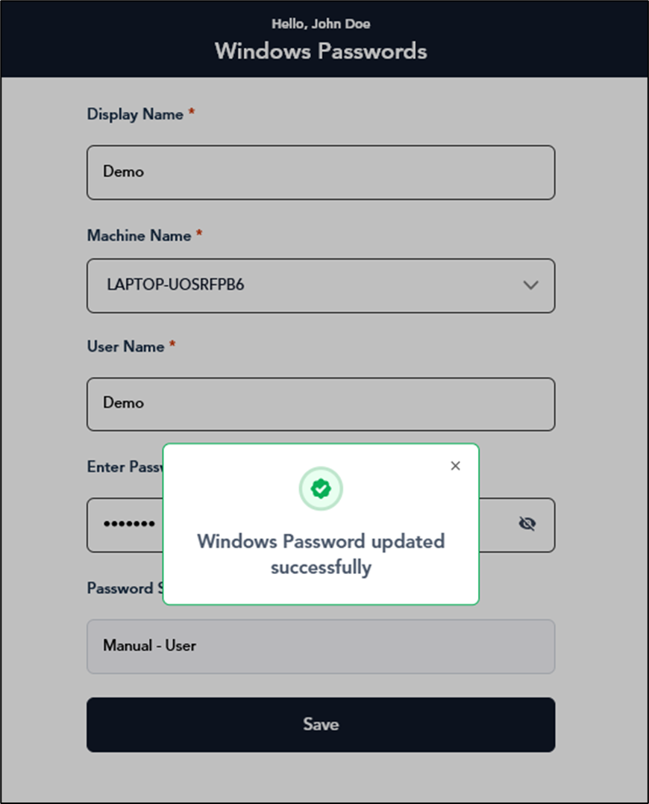

{/* Source: Intercom article 9468926 - https://oloid.help/en/articles/9468926-oloid-user-portal-how-to-edit-individual-password */}
{/* Generated by intercom_to_mintlify.py - re-running overwrites this file. */}

## Introduction

This document provides instructions to edit an individual password using the Oloid User Portal.

## Prerequisite

- You must have access to the Oloid User Portal.
- An individual password must be created. For more, refer to [How to create individual password using Oloid User Portal](/platform/user-portal/oloid-user-portal-how-to-create-individual-password)

## Steps to create individual password

1. Log in to the **Oloid User Portal**.
2. On the Credential home page, select **Windows Passwords**.

   

   The **Windows Passwords** page is displayed.
3. Select password (Domain User/Local User) and click **edit**  icon.

   

   The page is displayed to edit password.

   

4. Do the following:
   1. [View and Edit Domain User](#view-and-edit-domain-user)
   2. [View and Edit Local User](#view-and-edit-local-user)

### View and Edit Domain User

1. Edit **Display Name**.
2. Edit **Domain Name**.
3. Select **Preferred Machine** from the **Preferred Machine(s)** list. (Optional)
4. Edit **Username**.
5. Enter **Password** (Optional).
6. Click **Save**.

The Windows Password for domain user is **updated** successfully.

### View and Edit Local User

1. Edit **Display Name**.
2. Select **Machine** from the **Machine Name** dropdown list.
3. Edit **Username**.
4. Enter **Password**. (Optional)
5. Click **Save**.

The Windows Password for local user is **updated** successfully.

