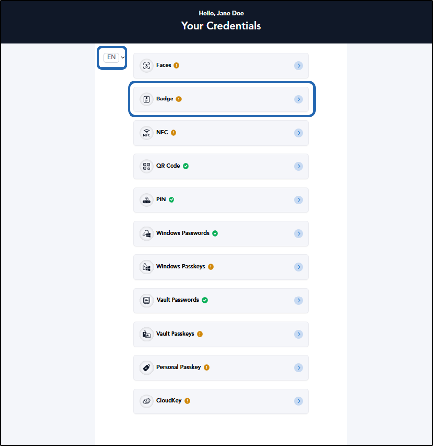
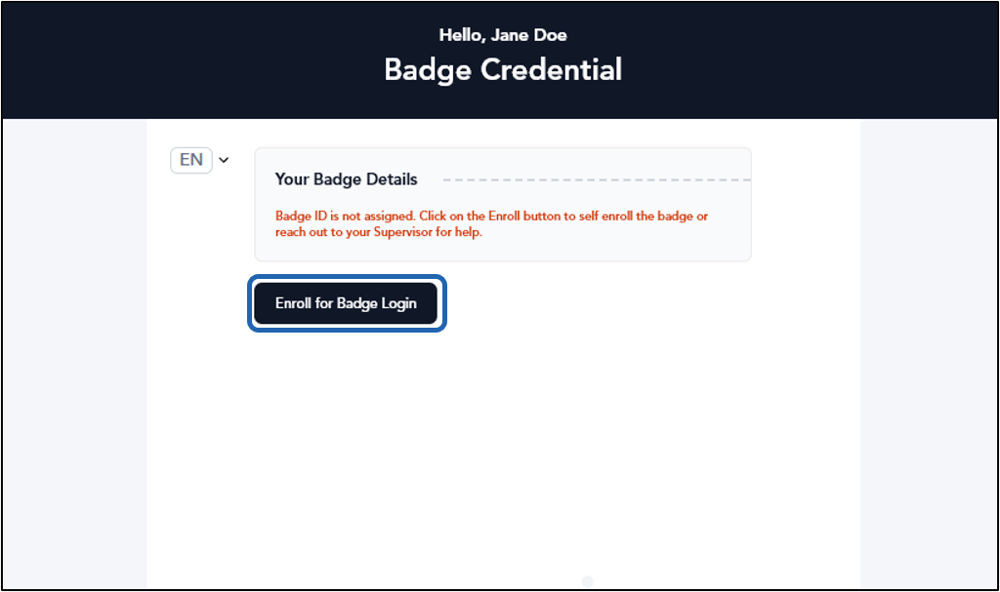
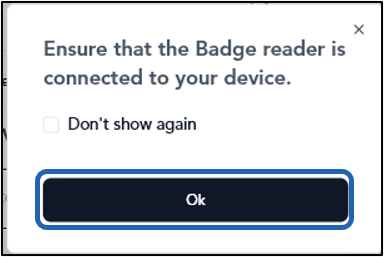
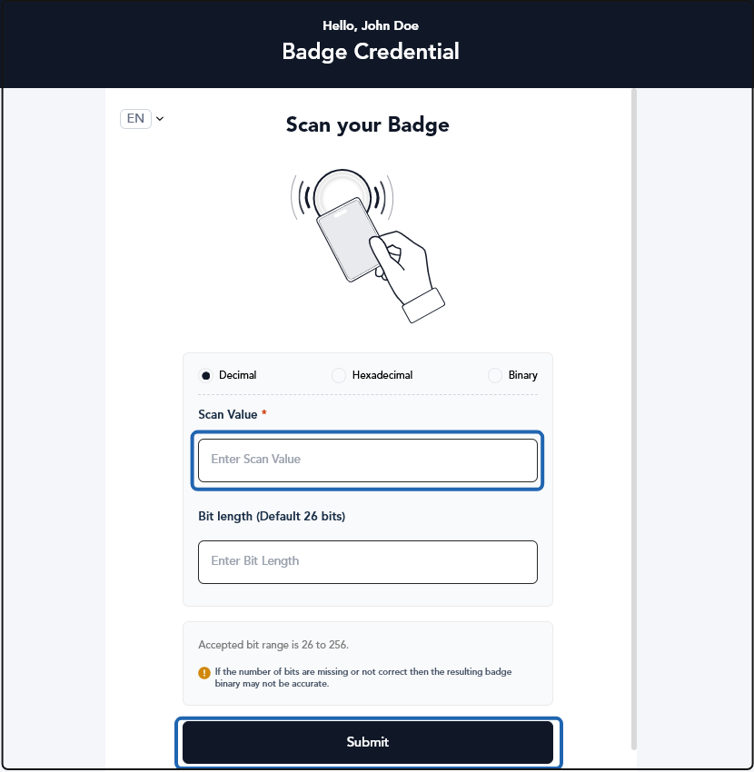
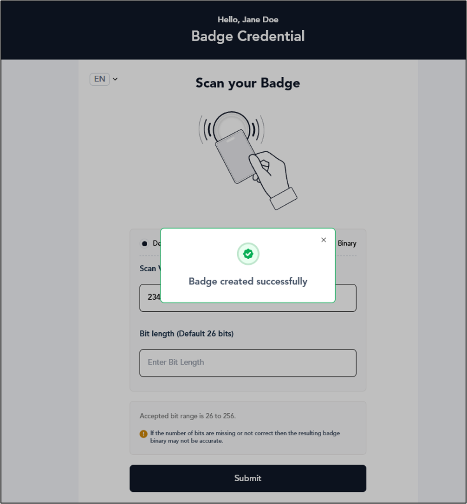

{/* Source: Intercom article 9459048 - https://oloid.help/en/articles/9459048-oloid-user-portal-how-to-enroll-for-badge-login */}
{/* Generated by intercom_to_mintlify.py - re-running overwrites this file. */}

## Introduction

This document provides step-by-step instructions for enrolling a **badge credential** through the Oloid User Portal. Once enrolled, the badge credential can be used for badge-based authentication.

## Prerequisites

- You have the **login URL** provided to access the User portal.
- Your **Employee ID or Email ID** must be registered in the system.
- Ensure You have a valid Badge and Badge Reader.

## Steps to Enroll Badge

1. Log in to the **Oloid User Portal**.
2. On the credential page of the Oloid User Portal, select **Badge**.

   <Note>
     **Note:** If configured in the Tenant Admin Portal,You can select preferred display language from the **Language Dropdown Selector**.
   </Note>

   

   The **Badge Credential** page is displayed.
3. Select **Enroll for Badge Login**.

   

   The confirmation pop-up to **ensure that the Badge reader is connected to your device** is displayed
4. Click **Okay**.

   

   The **Scan your Badge** page is displayed.
5. Do any one of the following:
   1. Enter the badge card number.
      (OR)
   2. Click on the **Scan or Type Data** textbox area. Tap the **Badge** on the **Badge Reader** to scan it.

      <Note>
        **Note:** If you do not click on the Scan or Type Data textbox area, you will not see the data in the text field.
      </Note>

6. Click **Submit**.

   

On badge authentication, you are successfully assigned a badge credential.

---

##### Video Tutorial

Watch the video [How to enroll for Badge login using Oloid User Portal](/platform/user-portal/oloid-user-portal-how-to-enroll-for-badge-login)
