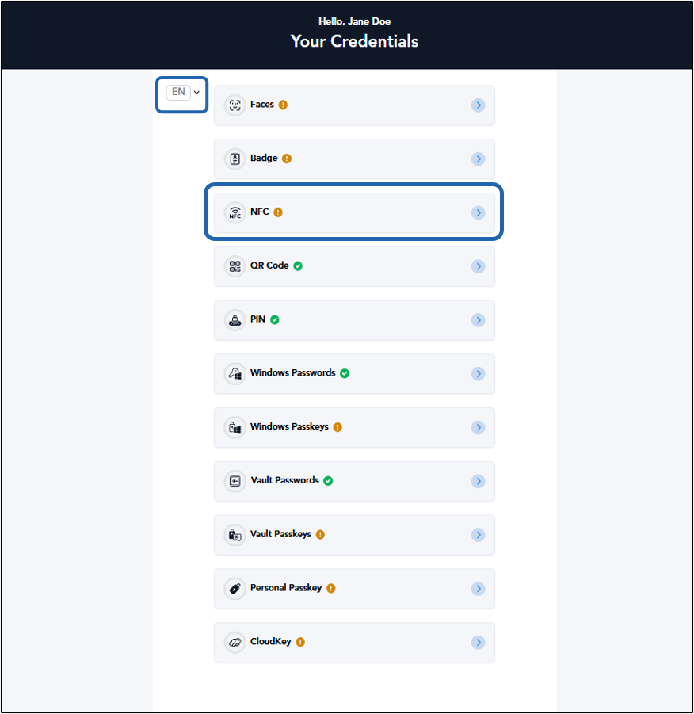
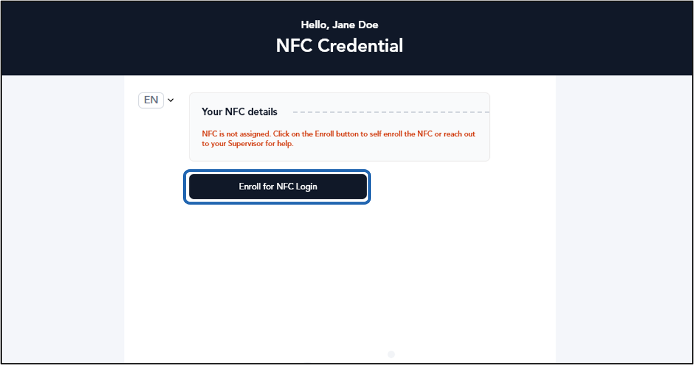
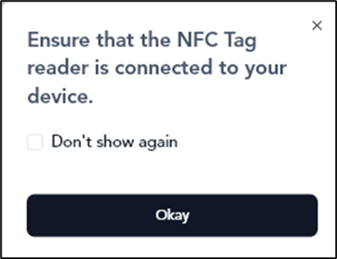
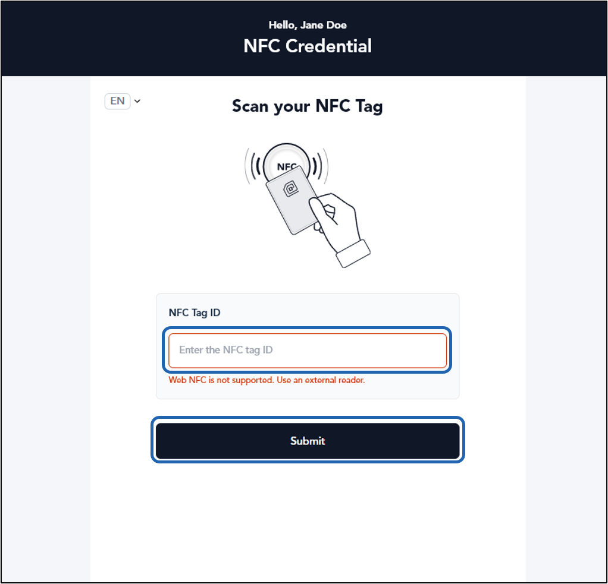
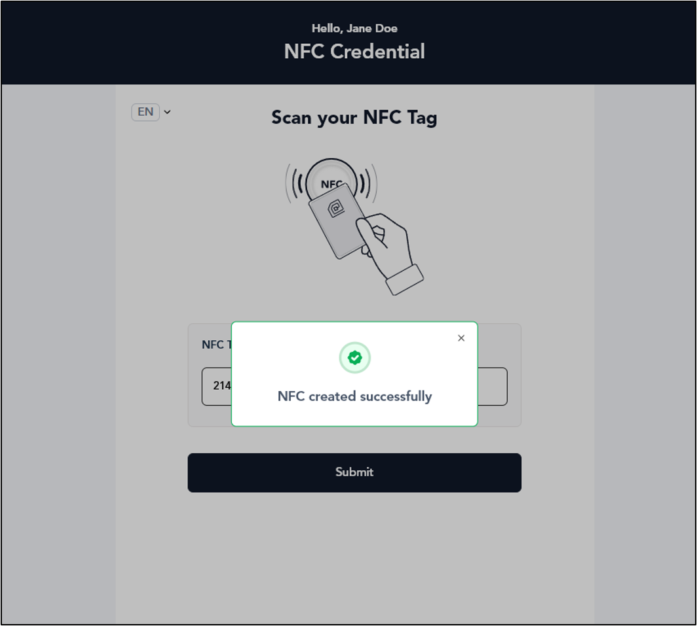

{/* Source: Intercom article 9459595 - https://oloid.help/en/articles/9459595-oloid-user-portal-how-to-enroll-for-nfc-login */}
{/* Generated by intercom_to_mintlify.py - re-running overwrites this file. */}

## Introduction

This document provides step-by-step instructions for enrolling an **NFC credential** through the Oloid User Portal. Once enrolled, the NFC credential can be used for NFC-based authentication.

## Prerequisites

- You have the **login URL** provided to access the User portal.
- Your **Employee ID or Email ID** must be registered in the system.
- Ensure you have a Valid NFC card and Reader.

## Steps to Enroll an NFC Credential

1. Log in to the **Oloid User Portal**.
   The **Your Credentials** page is displayed.
2. Click **NFC**.

   <Note>
     **Note:** If configured in the Tenant Admin Portal, You can select preferred display language from the **Language Dropdown Selector**.
   </Note>

   

   The **NFC Credential** page is displayed.
3. Click **Enroll for NFC Login**.

   

   The **Scan your NFC Tag** page is displayed.
   The confirmation pop-up to ensure that the NFC Tag reader is connected to your device is displayed.
4. Click **Okay**.

   

5. Do one of the following:
   1. Enter the **NFC number** manually.
   2. Click the **NFC Tag ID** textbox area and tap the **NFC card** on the **Card Reader** to scan it.

      <Note>
        **Note:** Ensure that you click the **Scan or Type Data** textbox before scanning the NFC card. Otherwise, the scanned data will not appear in the text field.
      </Note>

   3. Click **Submit**.

      

      Your NFC credential has been enrolled successfully.

      

---

##### Video Tutorial

Watch the video [How to enroll for NFC Login using Oloid User Portal- Video Tutorial](/platform/user-portal/videos/how-to-enroll-for-nfc-login-using-oloid-user-portal-video-tutorial)
