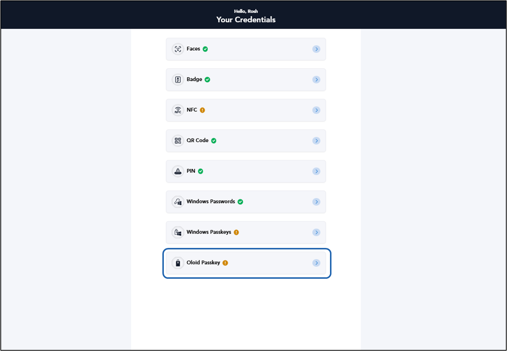
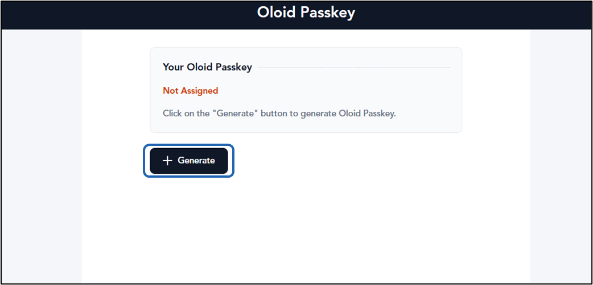
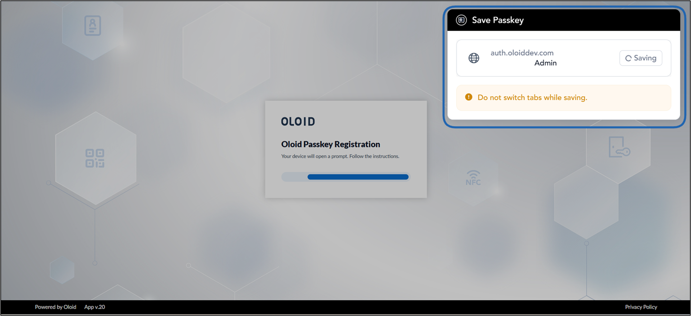
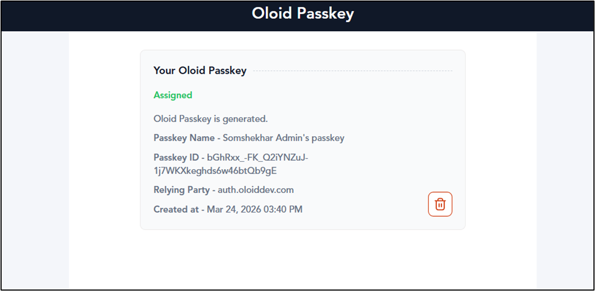

{/* Source: Intercom article 13884380 - https://oloid.help/en/articles/13884380-oloid-user-portal-how-to-generate-oloid-passkey-in-the-user-portal */}
{/* Generated by intercom_to_mintlify.py - re-running overwrites this file. */}

## Introduction

The User Portal allows users to create and register an Oloid passkey for authentication.

## Prerequisite

Oloid Passkey must be enabled in the App settings for User Portal from Tenant Admin portal.

## Steps to Generate Oloid Passkey

1. Log in to the **User Portal**.
2. On the credentials page of the portal, click **Oloid Passkey.**

   

   The **Oloid Passkey** page is displayed.
3. Click **Generate**.

   

4. The Passkey registration screen is displayed.

   

   The Passkey is successfully generated.

   
