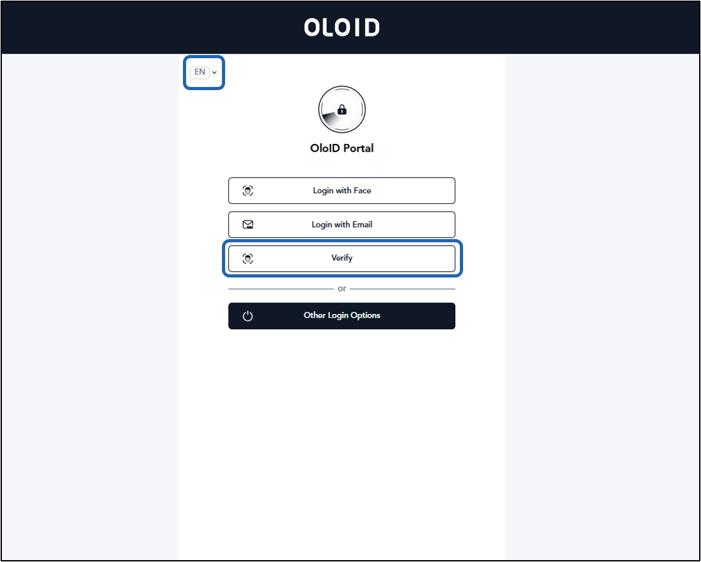
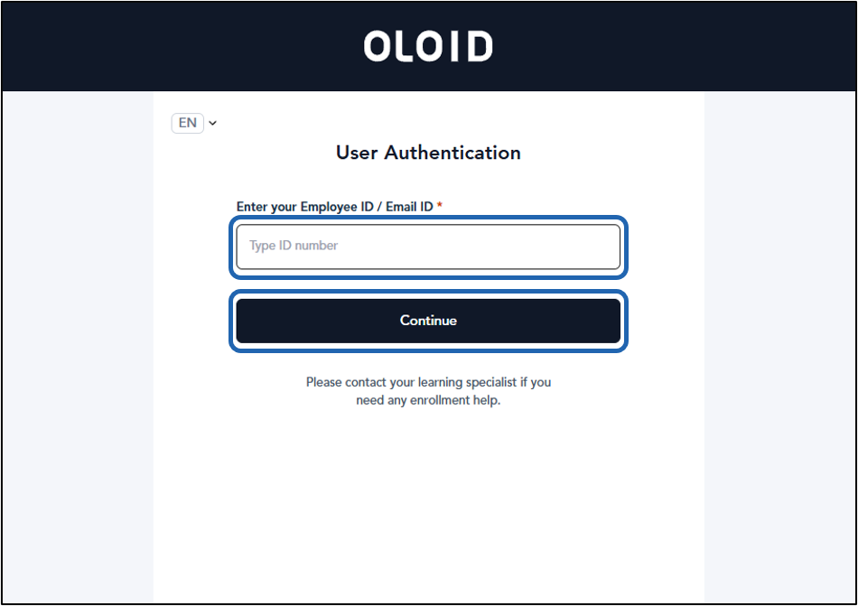
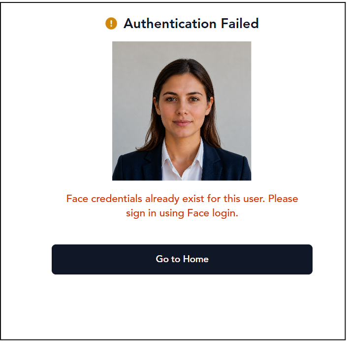
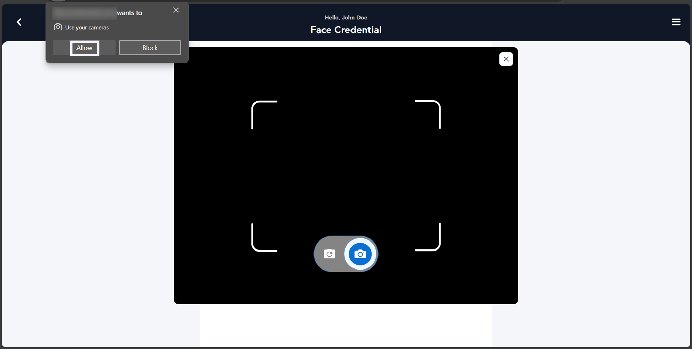
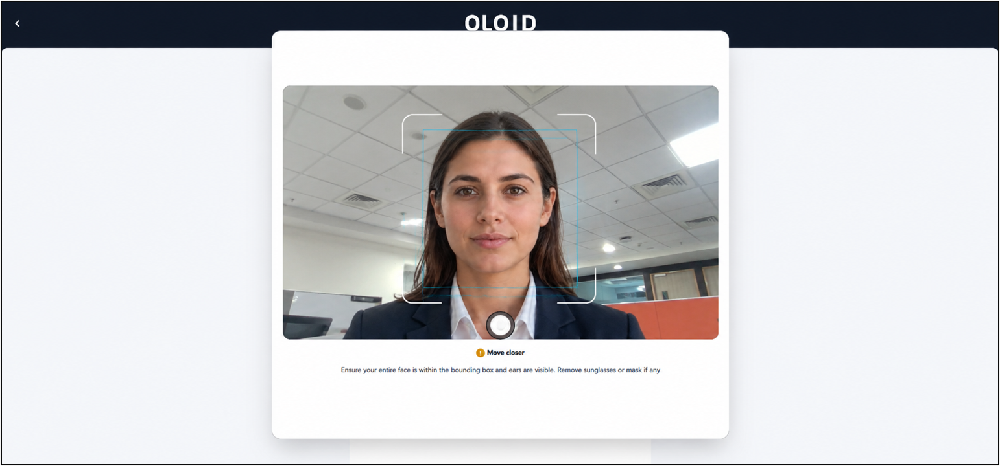
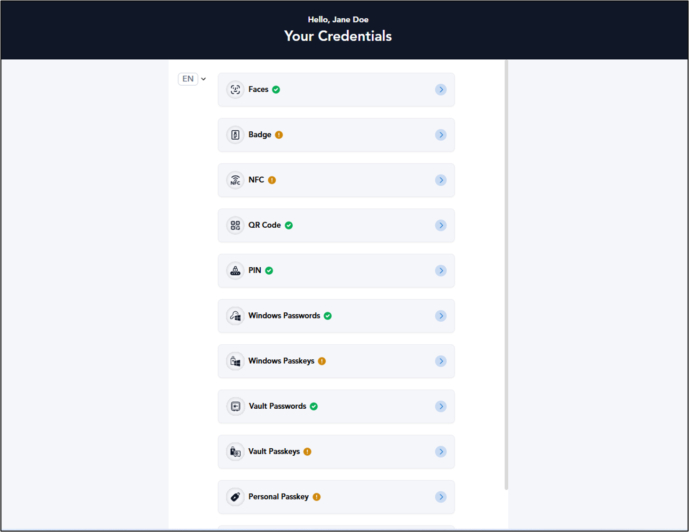
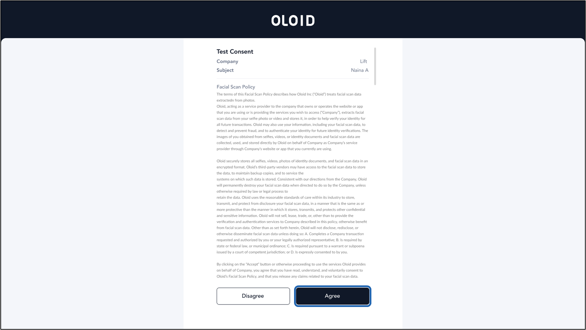
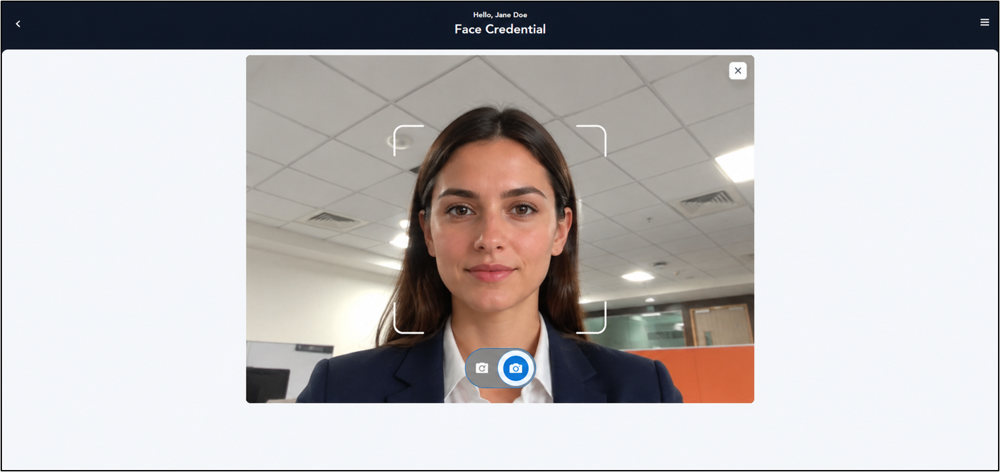
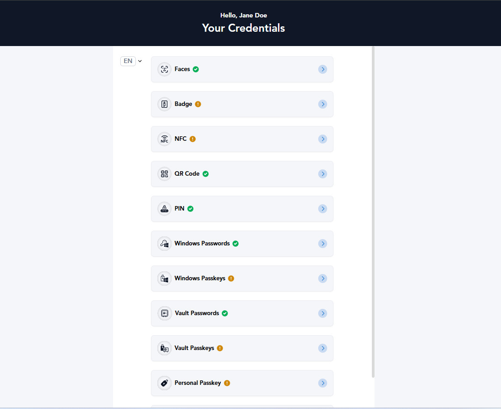
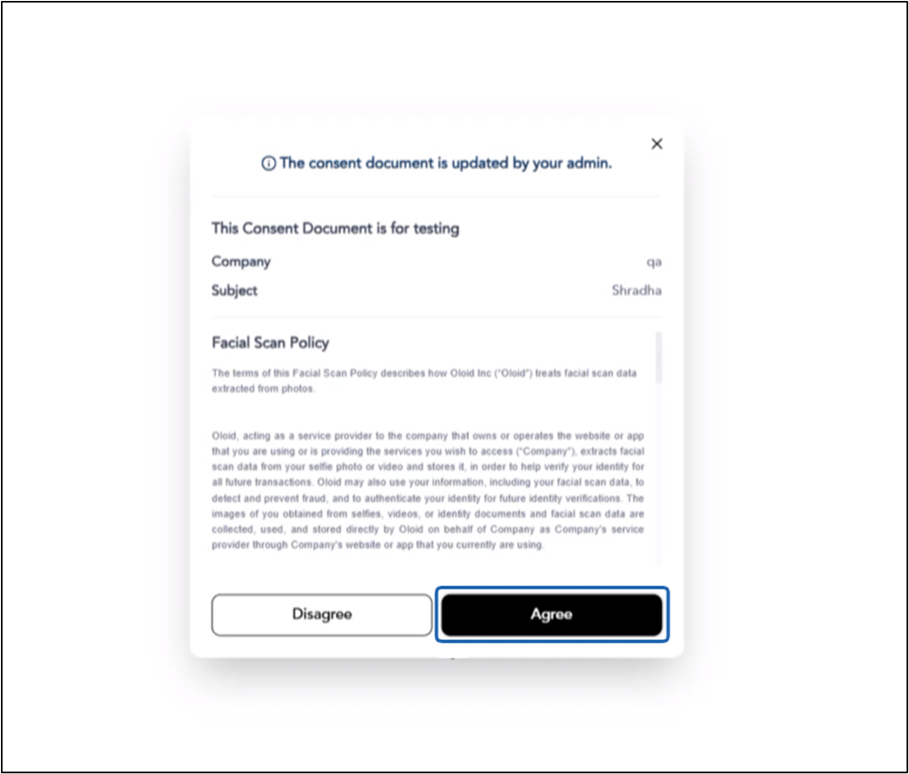

{/* Source: Intercom article 14815240 - https://oloid.help/en/articles/14815240-oloid-user-portal-how-to-login-through-hr-picture-verification */}
{/* Generated by intercom_to_mintlify.py - re-running overwrites this file. */}

## Introduction

**HR Picture Verification** enables users to authenticate by matching their live image with the HR image stored in the system. Depending on whether a face credential already exists and the user’s consent status, the system guides users through authentication or enrollment to complete the login process.

## Prerequisites

- You have the **login URL** provided to access the User portal.
- HR Picture Verification must be enabled in the Tenant settings.
- Your **Employee ID or Email ID** must be registered in the system.
- User Face must be added to HR Picture verfication.
- Camera access must be available on your device. (if required)

## Steps to log into User Portal

1. Launch your browser.
2. Enter the provided **URL** in the browser’s address bar and press **Enter**.
   The **Oloid Login** page is displayed.
3. Click **Verify.**

   <Note>
     **Note:** If configured in the Tenant Admin Portal, you can select your preferred display language from the Language Dropdown Selector.
   </Note>

   

   The User Authentication screen is displayed.
4. Enter **Employee ID/ Email ID**.
5. Click **Continue.**

   

   Based on the configurations, one of the following scenarios will occur
   1. [Face Credential Already Exists](#face-credential-already-exists)
   2. [Face Credential Not Available](#face-credential-not-available)

### Face Credential Already Exists

If the user’s face is already enrolled.

The **Authentication Failed** screen displayed > Click **Go to Home**

The **Oloid Login** page is displayed.

### Face Credential Not Available

If your face credential is not registered there can be the following scenarios:

- **[Consent Provided](#consent-provided)**
- **[Consent Not Provided](#consent-not-provided)**
- **[Re-consent pending](#re-consent-pending)**

#### Consent Provided

The camera opens.

<Note>
  **Note:** Provide camera permission if prompted.
</Note>

Position your face in front of the camera and tap the Capture button to authenticate face.

<Note>
  **Note:** If you do not tap the Capture button, the app automatically captures your face after a few seconds.
</Note>

Once the image is captured, it is matched against the HR Verification picture in the oloid database

You are signed in to the Oloid User Portal Successfully.

#### Consent Not Provided

1. The Consent page is displayed.
2. Click **Agree** to submit consent.

   

   The consent is submitted successfully.
   The camera opens.

   

3. Position your face in front of the camera and tap the Capture button to authenticate face.

   <Note>
     **Note:** If you do not tap the Capture button, the app automatically captures your face after a few seconds.
   </Note>

   

   You are signed in to the Oloid User Portal Successfully.

#### Re-consent pending

The re-submit consent screen appears

1. Click **Agree.**

   

   The camera opens.

   

2. Position your face in front of the camera and tap the Capture button to authenticate face.

   <Note>
     **Note:** If you do not tap the Capture button, the app automatically captures your face after a few seconds.
   </Note>

   

   You are signed in to the Oloid User Portal Successfully.

