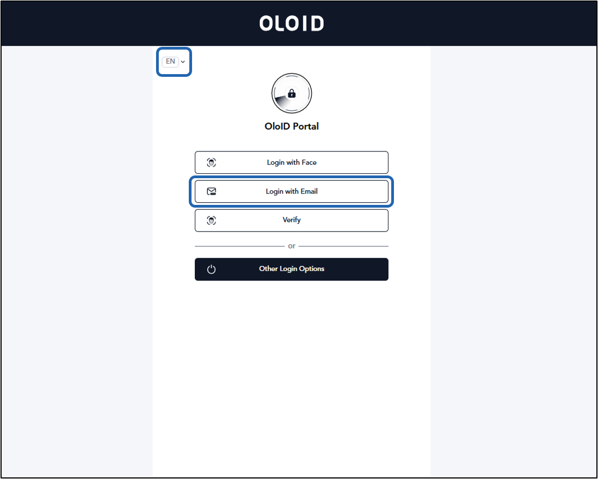
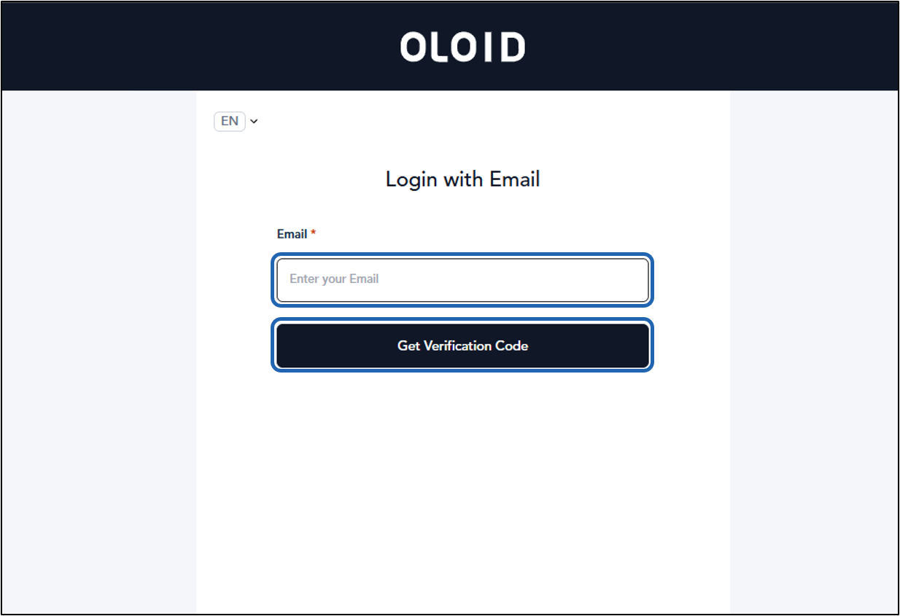
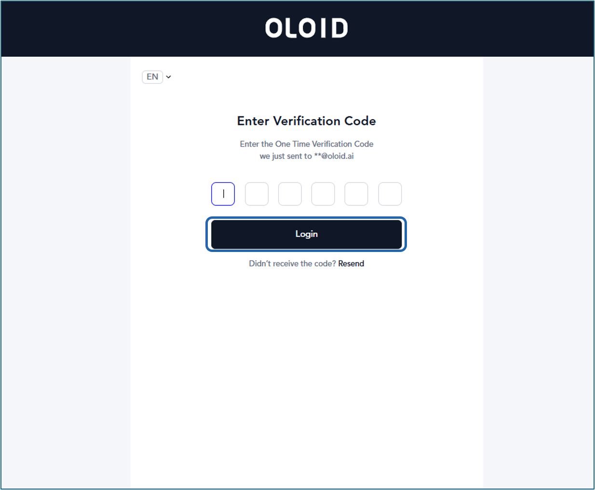
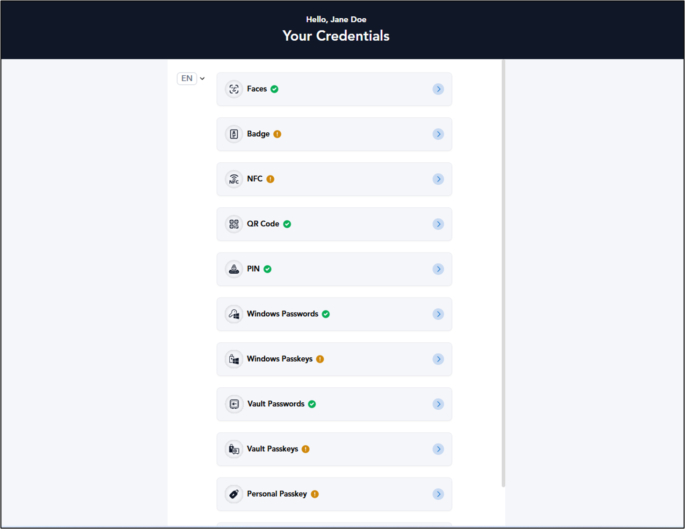

{/* Source: Intercom article 9446876 - https://oloid.help/en/articles/9446876-oloid-user-portal-how-to-login-with-email */}
{/* Generated by intercom_to_mintlify.py - re-running overwrites this file. */}

## Introduction

This document provides step-by-step instructions for logging in to the Oloid User Portal using an email address and a one-time verification code. Users can authenticate using the verification code sent to their registered email address without entering a password.

## ****Prerequisites

- You have the **login URL** provided to access the User portal.
- Your **Employee ID or Email ID** must be registered in the system.
- You should have a Oloid account.

## Steps to Log in with Email

1. Launch your browser.
2. Enter the URL provided for you in the browser’s address bar. Then, press **Enter** on your keyboard.
   The Oloid User Portal login page is displayed.
3. Select **Login with Email**.

   <Note>
     **Note:** If configured in the Tenant Admin Portal, you can select your preferred display language from the Language Dropdown Selector.
   </Note>

   

   The **Login with Email** page is displayed.
4. Do the following:
   1. Enter your email address in the **Email ID** field.
   2. Click **Get Verification Code**.

      

      A verification code is sent to your registered email ID.
   3. Enter the Verification code.

      <Note>
        **Note:** The One Time Verification Code expires after 60 seconds.
      </Note>

   4. Click **Login**.

      

You are signed in to the Oloid User Portal Successfully.

<Note>
  **Note:** Oloid uses **SSO login** and also allows you to log in to the User Portal with your Google, Microsoft, Okta account or your configured Login options ( Face, badge etc).
</Note>
