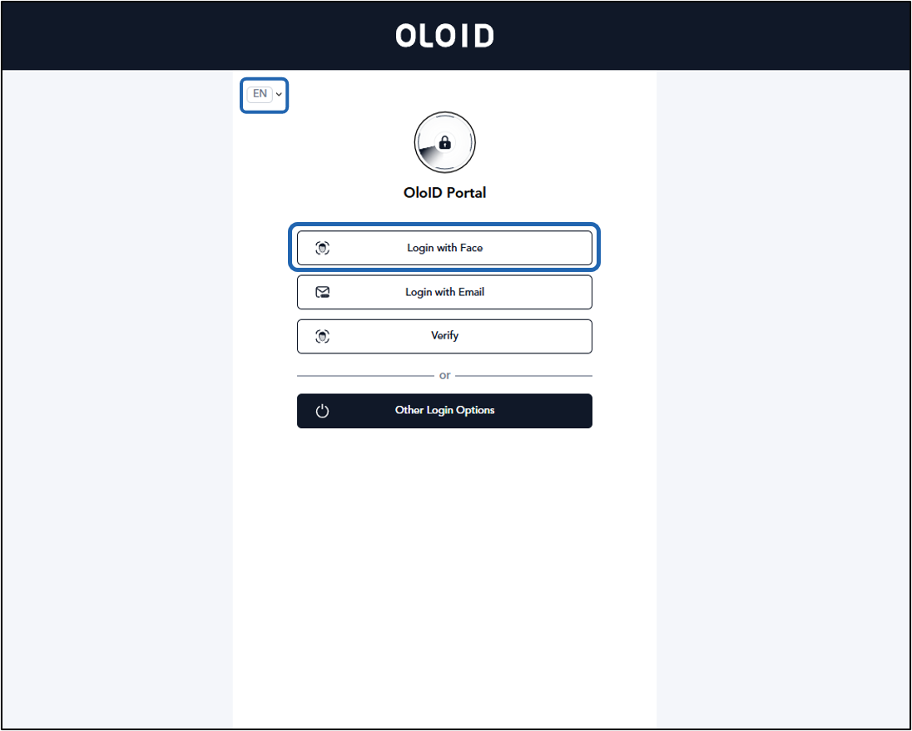
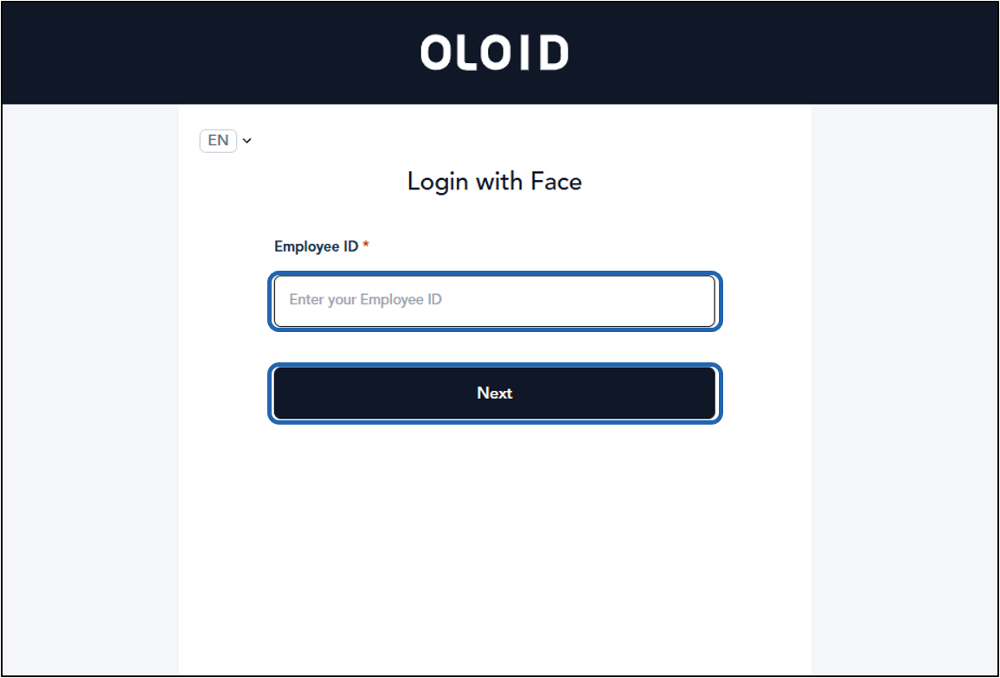
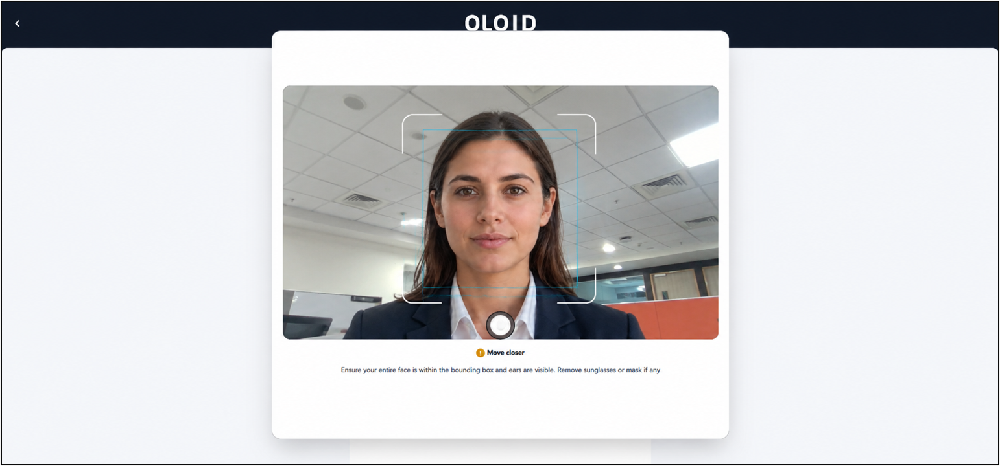
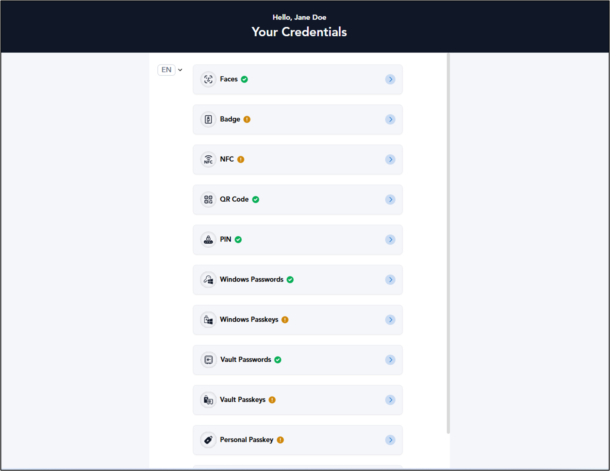

{/* Source: Intercom article 10162035 - https://oloid.help/en/articles/10162035-oloid-user-portal-how-to-login-with-face */}
{/* Generated by intercom_to_mintlify.py - re-running overwrites this file. */}

## Introduction

This document provides step-by-step instructions for logging in to the Oloid User Portal using face authentication. Users can enter their Primary ID and authenticate their identity using their enrolled face credential to securely access the User Portal.

## Prerequisites

- You have the **login URL** provided to access the User portal.
- Your **Employee ID or Email ID** must be registered in the system.
- Your face profile must be configured in the Admin Portal to access the User Portal.

## Steps to login with face

1. Launch the **Oloid User Portal**.
   The **login page** is displayed.

   <Note>
     **Note:** If configured in the Tenant Admin Portal,You can select preferred display language from the **Language Dropdown Selector**.
   </Note>

2. Click **Login with Face**.

   

   The **Login with Face** screen is displayed.
3. Enter **Employee ID** > click **Next**.

   

   The camera opens to authenticate the face.
4. Place your face in front of the camera for facial authentication and press **Enter or Spacebar.**

   

   You are signed in to the Oloid User Portal Successfully.

   
