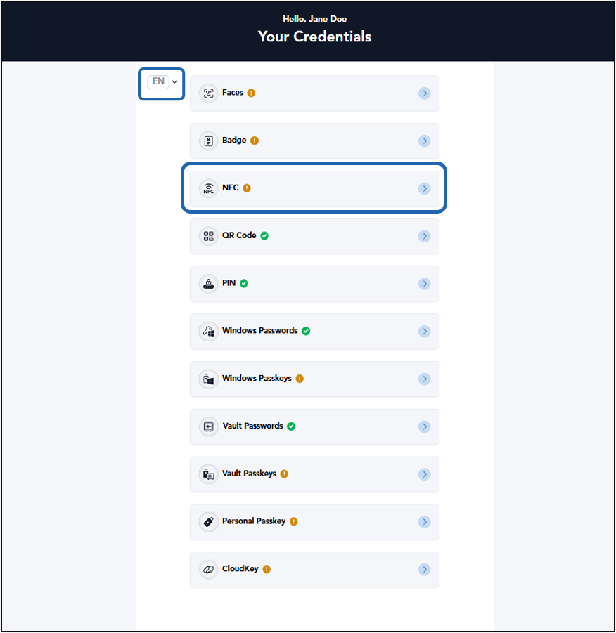
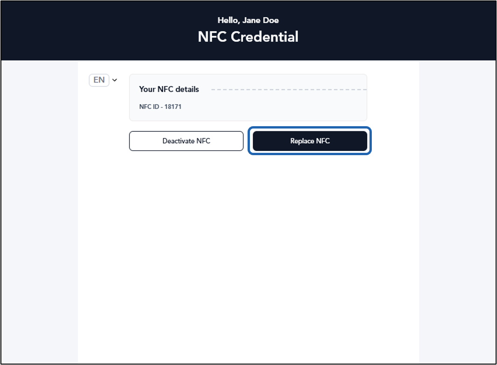
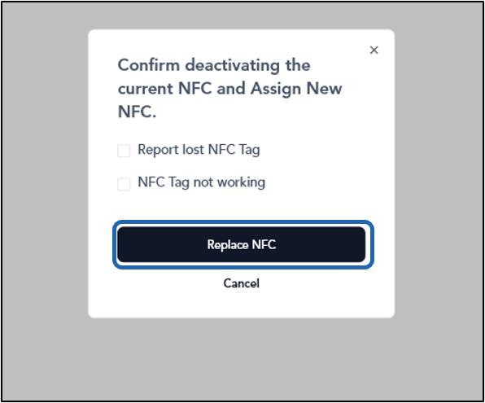
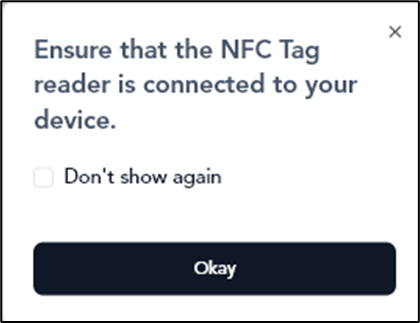
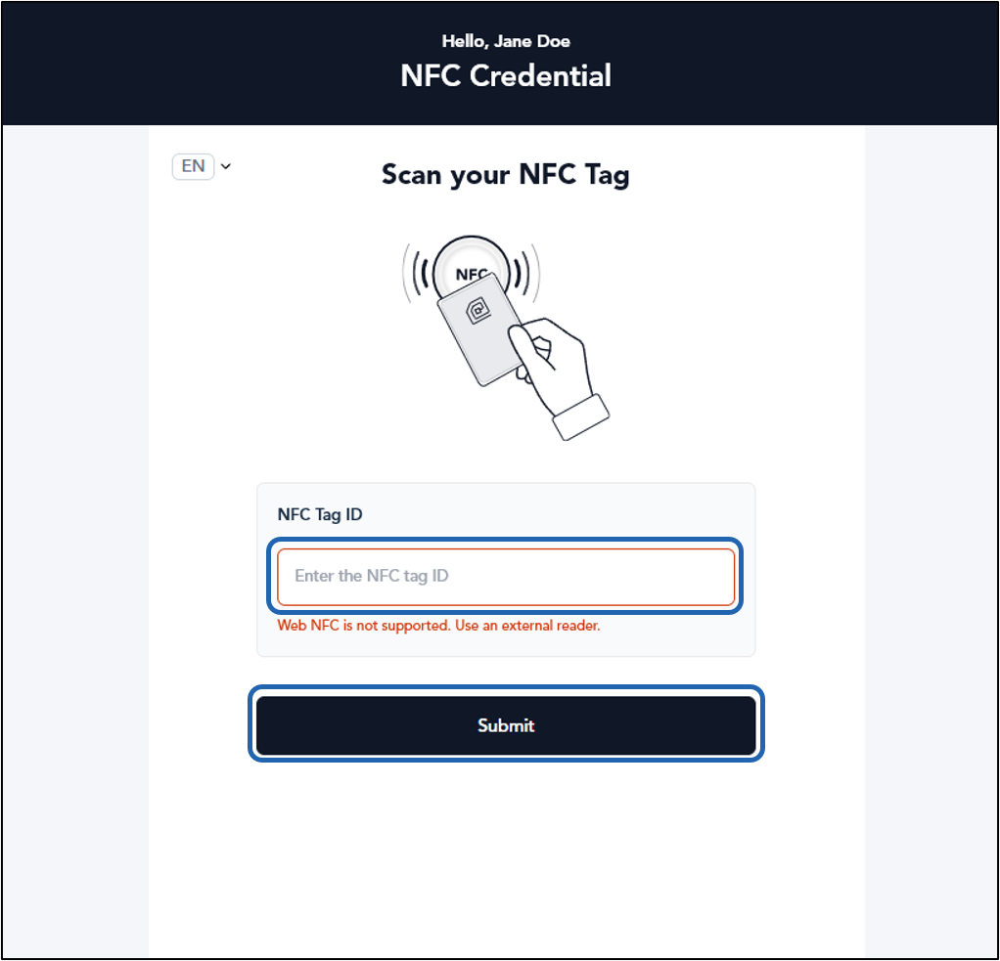
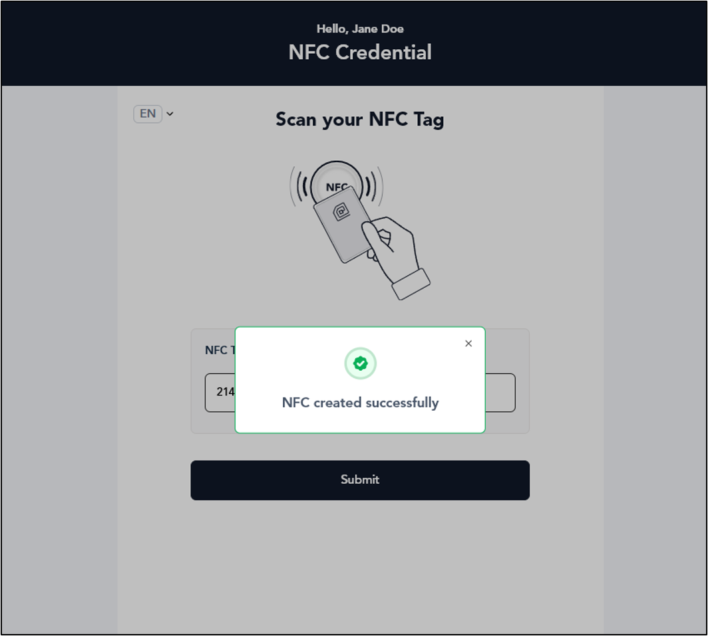

{/* Source: Intercom article 9459621 - https://oloid.help/en/articles/9459621-oloid-user-portal-how-to-replace-and-assign-nfc */}
{/* Generated by intercom_to_mintlify.py - re-running overwrites this file. */}

## Introduction

This document provides step-by-step instructions for replacing an existing **NFC credential** through the **Oloid User Portal**. Users can replace an NFC credential when the existing NFC card is lost or not working.

## Prerequisites

- You have the **login URL** provided to access the User portal.
- Your **Employee ID or Email ID** must be registered in the system.
- Ensure you have a Valid NFC card and Reader.
- NFC must already be assigned to the user, for the NFC Replacement.

## Steps To Replace and Assign NFC

1. Log in to the **Oloid User Portal**.
2. On the credential page of the Oloid User Portal, select **NFC**.

   <Note>
     **Note:** If configured in the Tenant Admin Portal, You can select preferred display language from the **Language Dropdown Selector**.
   </Note>

   

   The **NFC Credential** page is displayed.
3. Select **Replace NFC**.

   

4. On the confirmation pop-up box do the following:
   1. Select **Report lost NFC Tag** if your NFC card is lost. (Optional)
   2. Select **NFC Tag not working** if your NFC card is not working. (Optional)
   3. Click **Replace NFC**.

      

      The confirmation pop-up **Ensure that the NFC Tag reader is connected to your device** is displayed.
5. Click **Okay**.

   

   The **Scan your NFC Tag** page is displayed.
6. Do one of the following:
   1. Enter the **NFC number** manually.
      OR
   2. Click the **NFC Tag ID** textbox and scan the NFC card using the card reader.

      <Note>
        **Note:** Ensure that you click the **Scan or Type Data** textbox before scanning the NFC card. Otherwise, the scanned data will not appear in the text field.
      </Note>

   3. Click **Submit**.

      

      Your new NFC credential is assigned successfully.

      

---

##### Video Tutorial

Watch the video [How to replace and assign NFC using Oloid User Portal- Video Tutorial](/platform/user-portal/videos/how-to-replace-and-assign-nfc-using-oloid-user-portal-video-tutorial)
