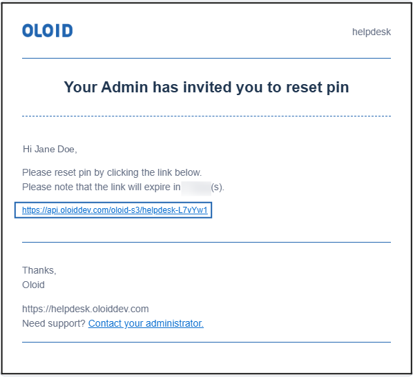
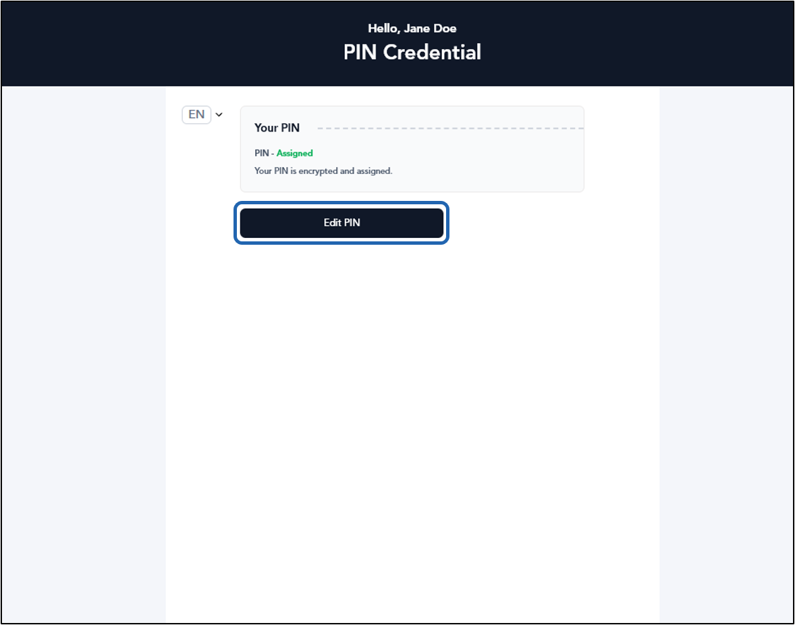
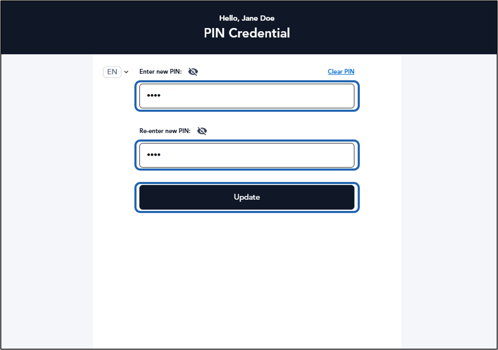
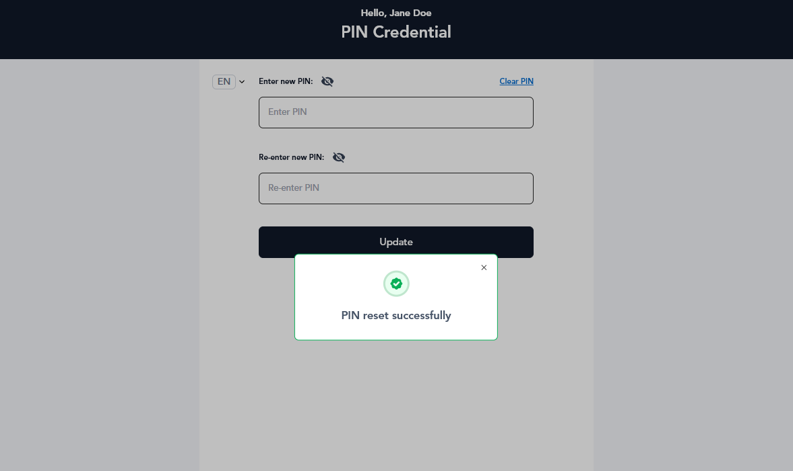

{/* Source: Intercom article 9489199 - https://oloid.help/en/articles/9489199-oloid-user-portal-how-to-reset-pin-using-invite-link */}
{/* Generated by intercom_to_mintlify.py - re-running overwrites this file. */}

## Introduction

This document explains how to reset your PIN in the Oloid User Portal using an invite link. When your admin invites you to reset your PIN, you receive an email with a link that opens the Oloid User Portal, where you can set a new PIN.

## Prerequisite

You must have the reset PIN invite email from your admin, and the link in it must not have expired.

## Steps to reset PIN using invite link

1. In the invite email, click the reset PIN link.

   

   The Oloid User Portal opens on the **PIN Credential** screen.
2. Click **Edit PIN**.

   <Note>
     **Note:** If configured in the Tenant Admin Portal, you can select your preferred display language from the Language Dropdown Selector
   </Note>

   

   The **Reset PIN** page is displayed.
3. Do the following:
   1. Enter your new PIN.
   2. Re-enter your new PIN.
   3. Click **Update**.

      

      Your PIN is updated and a success message is displayed.

      
