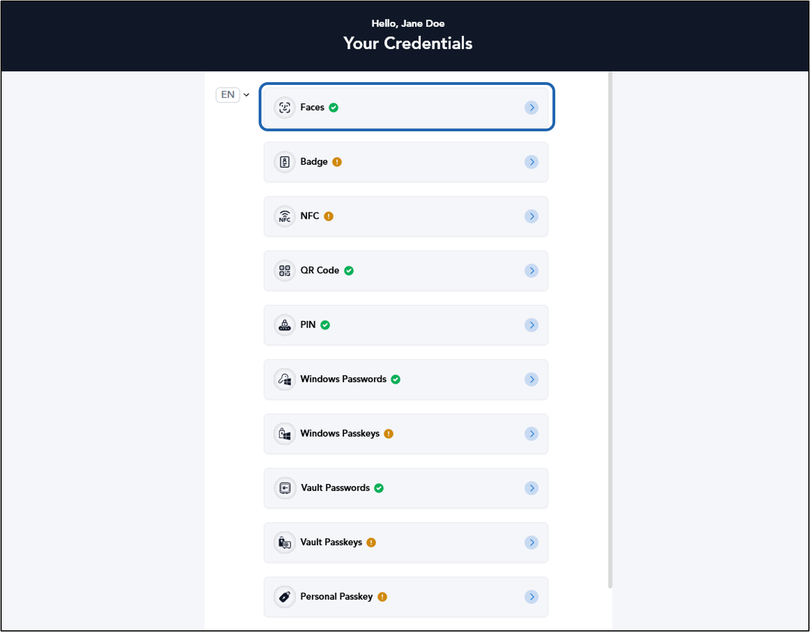
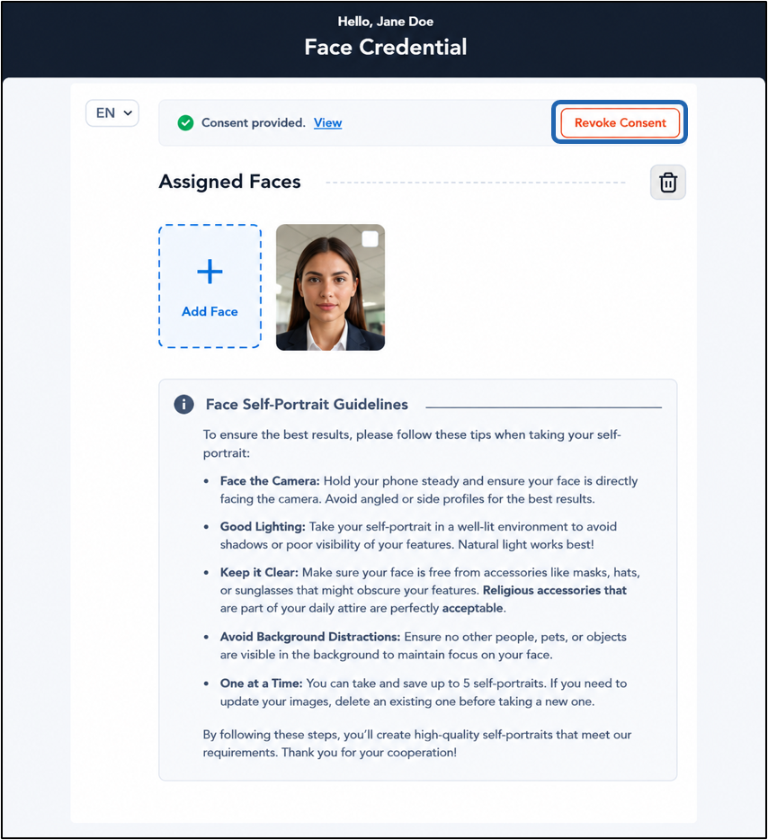
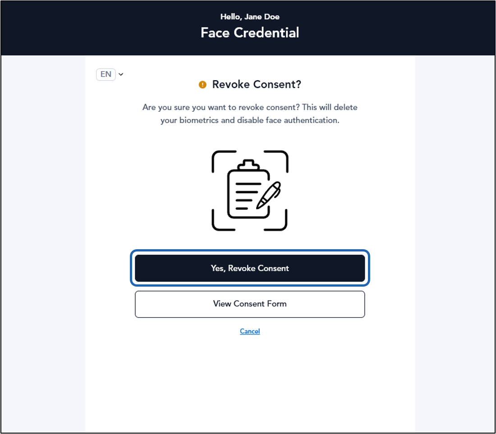
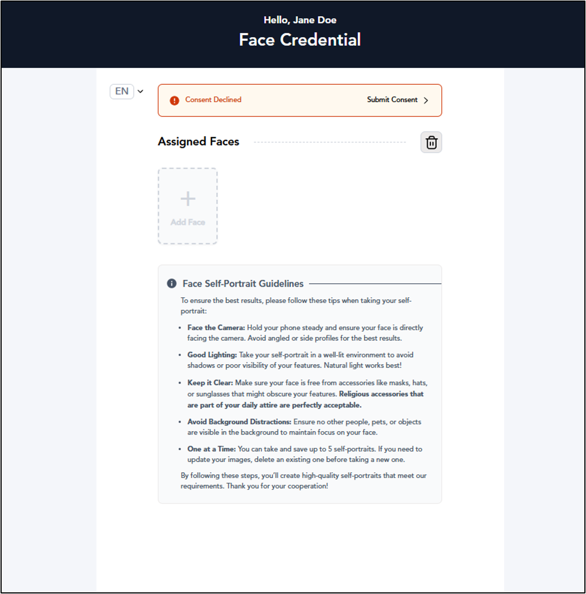

{/* Source: Intercom article 14685322 - https://oloid.help/en/articles/14685322-oloid-user-portal-how-to-revoke-consent */}
{/* Generated by intercom_to_mintlify.py - re-running overwrites this file. */}

## Introduction

This document provides step-by-step instructions for revoking consent for face credentials in the Oloid User Portal. When consent is revoked, all previously enrolled face credentials are deleted, and users must provide consent again before adding a new face credential.

## Prerequisites

- You have access to the Oloid User Portal.
- Your face credential is already onboarded and consent is previously submitted. For more, refer to [How to Add a Face Using Invite Link in Oloid User Portal](/platform/user-portal/oloid-user-portal-how-to-add-a-face-using-invite-link)

## Steps to Revoke Consent

1. Log in to Oloid User Portal.
2. On the Credentials page of the portal, click on the **Faces**.

   <Note>
     **Note:** If configured in the Tenant Admin Portal, you can select your preferred display language from the Language Dropdown Selector
   </Note>

   

   The **Face credential** page is displayed.
3. Click **Revoke Consent.**

   

   The **Revoke Consent** Pop up is displayed.

Click **Yes, Revoke Consent** to revoke your consent.

The Consent is revoked successfully, and all previously enrolled face credentials are deleted.

<Note>
  **Note:** If consent is revoked, the **Add Face** option is disabled and cannot be selected. To add a face credential, consent must be provided.
</Note>

##### Related Document

[How to Add a Face Using Invite Link in Oloid User Portal](/platform/user-portal/oloid-user-portal-how-to-add-a-face-using-invite-link)
