{/* Source: Intercom article 13855587 - https://oloid.help/en/articles/13855587-android-passwordless-device-unlock-with-automatic-okta-login */}
{/* Generated by intercom_to_mintlify.py - re-running overwrites this file. */}

## Introduction

This document provides step by step instructions for configuring passwordless access on Android devices using **Oloid DeviceLock** and **WebKey (Oloid Browser).** The setup enables users to authenticate via **Face or NFC** through the **DeviceLock** app and automatically launch the **WebKey page** in Oloid Browser to seamlessly access the **Okta dashboard** without entering credentials.

## Prerequisites

- You must have **Admin access** to the Tenant Admin Portal.
- You must **create and configure the DeviceLock application** and enable Face and NFC under the authenticator tab.
- You must **create and configure WebKey application.**

## Step 1: Configure Device Lock and Webkey Applications

- Setup Device Lock Application in platform
- Setup Webkey Application in the platform

### Setup Device Lock Application in Tenant Admin Portal

1. Log in to the **Tenant Admin Portal.**
2. On the homepage of the portal, click on the **Device Lock** application to edit.

   <Note>
     **Note:** Refer to [create and configure the DeviceLock application.](/platforms/windows/windows-login/devicelock-app-how-to-create-and-configure-devicelock-application-in)
   </Note>

   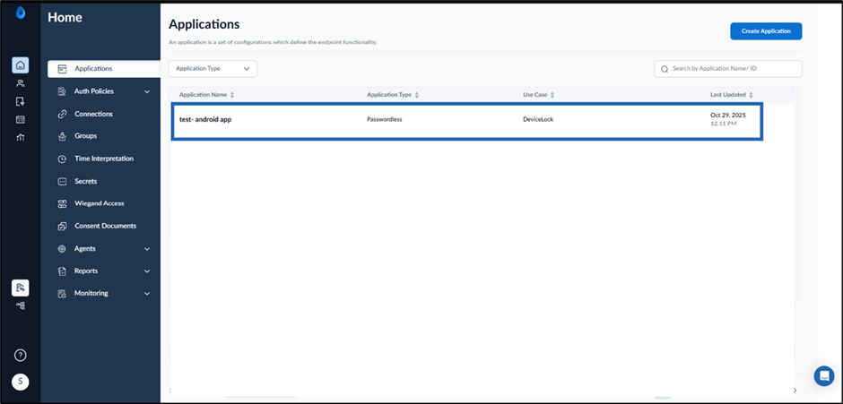

   The application details page is displayed.

   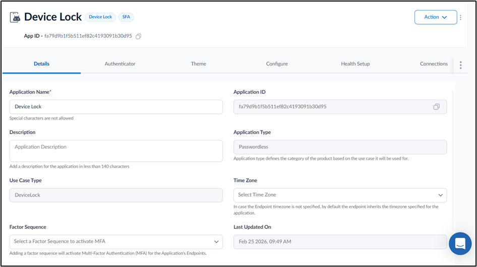

3. Go to **Configure** tab > Click **Settings**.

   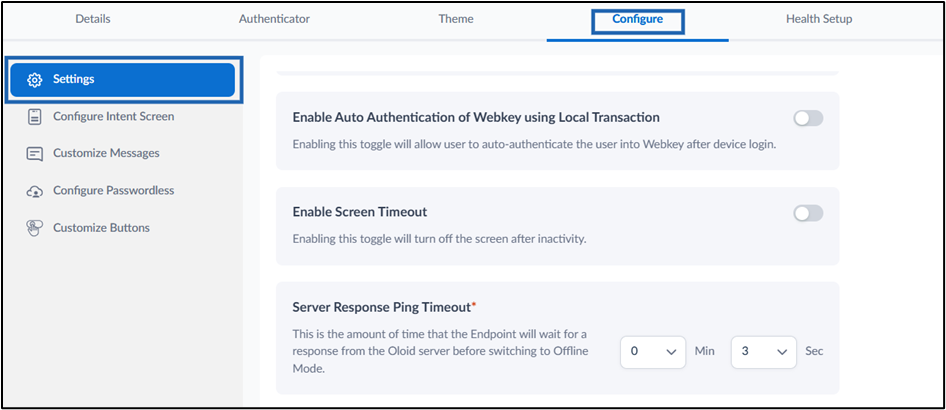

   The Settings page is displayed.
4. Enable **Auto Authentication of Webkey using Local Transaction** toggle**.**
5. Click **Save.**

   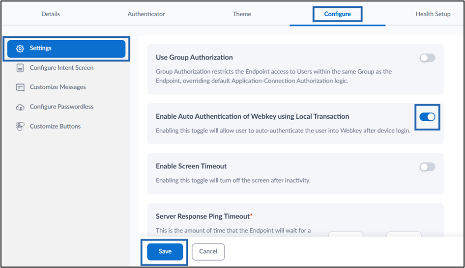

6. Go to **Configure Passwordless.**
   The Configure Passwordless screen is displayed.
7. Do the following:
   1. **Enable Passwordless Config** toggle.
   2. Select **Device Lock Mode.**
   3. Click **Save.**

      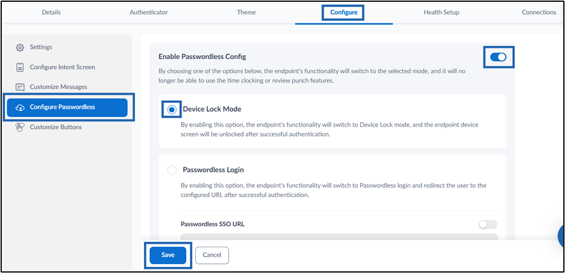

      The Device Lock application setup is completed successfully.

      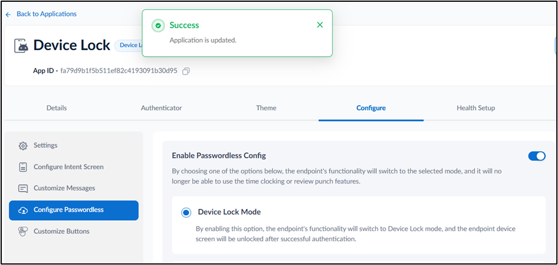

### Setup Webkey Application in the Tenant Admin Portal

1. Log in to the **Tenant Admin Portal**.
2. On the **Applications** page, click on the **Webkey** application to edit. For more, refer to [create and configure WebKey application.](/platforms/web/webkey/webkey-how-to-create-and-configure-a-webkey-application-in-tenant)

   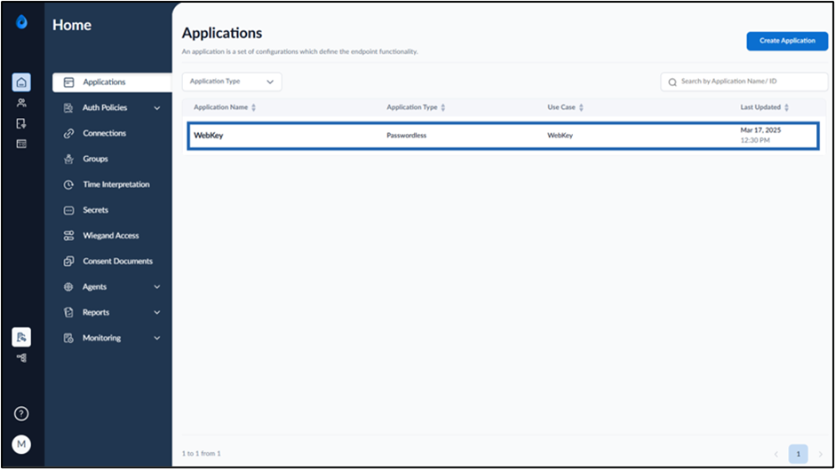

   The **Application Details** page is displayed.

   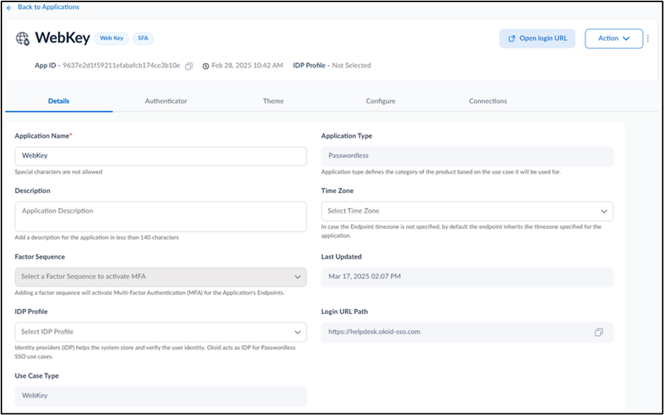

3. Go to **Configure** > Click **Settings**.
   The settings page is displayed.

   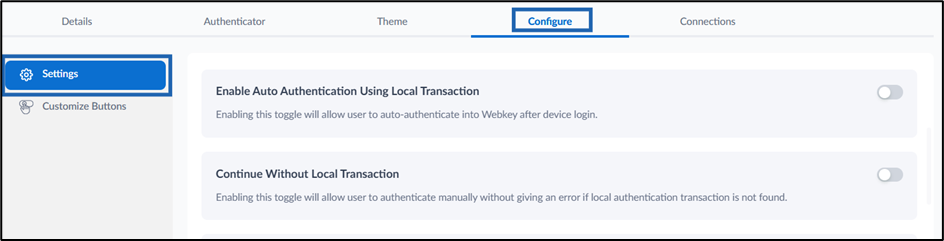

4. Do the following:
   1. Enable **Auto-Authentication using Local transactions** toggle button will allow user to auto-authenticate into Webkey after device login.
   2. Enable **Continue Without Local Transaction** toggle button will allow user to authenticate manually without giving an error if local authentication transaction is not found.
   3. Click **Save.**

      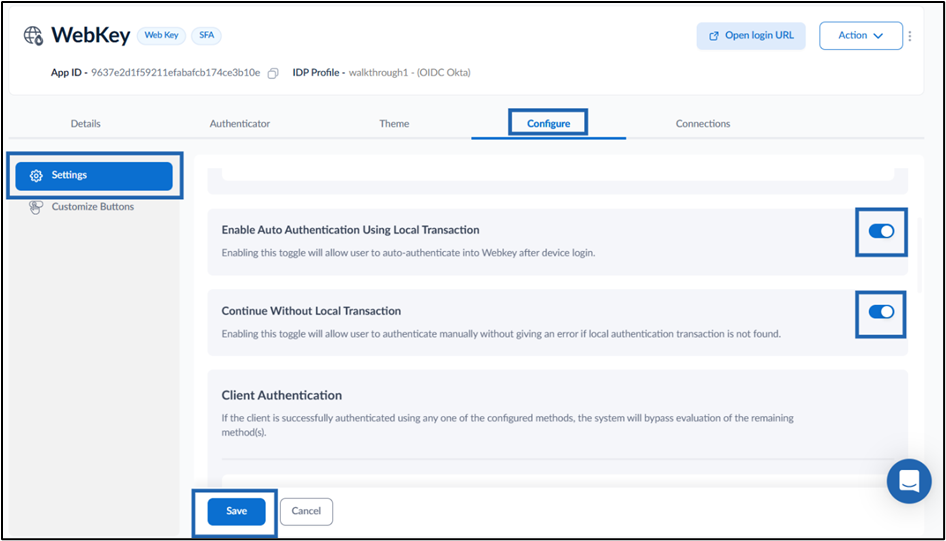

      The **Webkey** application setup is completed successfully.

      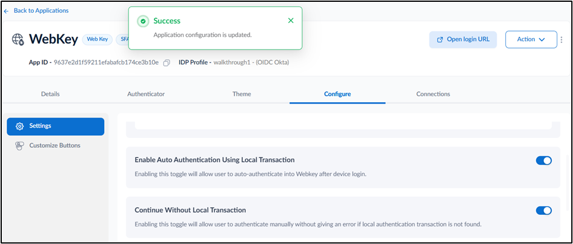

## Step 2: Install, Pair and Setup the Oloid Browser and Device Lock Application on Android Device

### Installation

1. Install Oloid Browser on your android device.

   <Note>
     **Note:** Contact **Oloid support** to get the **APK files.**
   </Note>

2. Download and install the **DeviceLock** app from the **Google Play Store**. For More, refer to [How to Download DeviceLock App](/platforms/android/devicelock/devicelock-app-how-to-download-devicelock-app)
3. Provide all the required permissions to DeviceLock app. (Go to Settings and allow Restricted Permissions for the DeviceLock app to provide all required permissions.)

### Steps to Pair Device Lock Endpoint

Once the Device Lock application is successfully installed you need to pair your endpoint.
You can pair DeviceLock endpoint using any of the following options:

- [How to pair Oloid DeviceLock App using "Pair as Supervisor" option](/platforms/android/devicelock/devicelock-app-how-to-pair-oloid-devicelock-app-using-pair-as).
- [How to Pair Oloid DeviceLock App using "Auto-Pair" option](/platforms/android/devicelock/devicelock-app-how-to-pair-devicelock-app-using-auto-pair-option).
- [How to Pair Oloid DeviceLock App using the “Auto-Pair using Config File” option](/platforms/android/devicelock/devicelock-app-how-to-pair-devicelock-app-using-the-auto-pair-using).
- (Optional) You can select the Device Lock Endpoint template while pairing the endpoint. For more, refer to [How to Create and Configure DeviceLock Endpoint Template in Tenant Admin Portal](/platforms/android/devicelock/devicelock-app-how-to-create-and-configure-devicelock-endpoint)

  <Note>
    **Note:** After the endpoint is successfully paired, you must enable the **Passwordless Session Token** toggle and the **Include user token in response** toggle for the endpoint in the **Tenant Admin Portal**. For more, refer to [How to Configure Endpoint in the Tenant Admin Portal](/platforms/android/devicelock/devicelock-app-how-to-configure-endpoint-in-the-tenant-admin-portal)
  </Note>

### Add WebKey Shortcut to Oloid Browser

1. Open **Oloid Browser** on the Android device.
2. Open a new tab and navigate to the **configured WebKey URL**.
3. Tap the **browser menu** (kebab icon).

   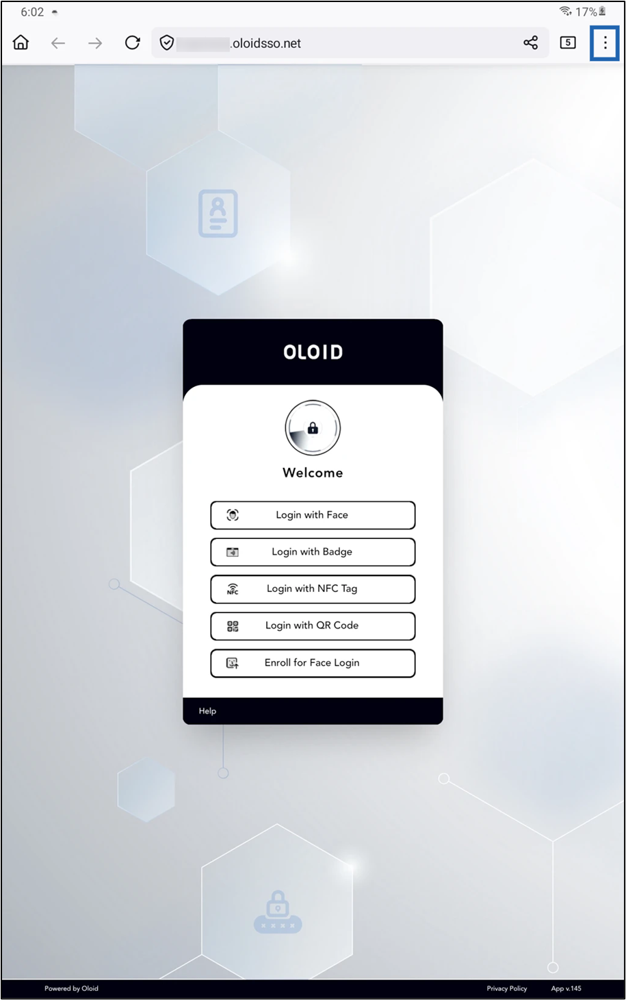

4. Select **Add app to Home screen.**

   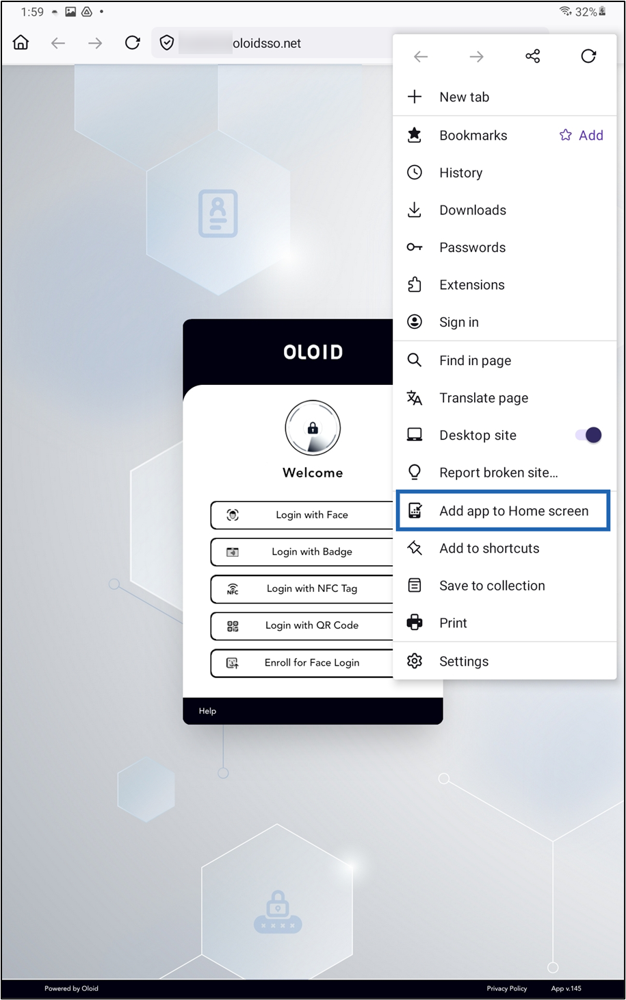

   A Confirmation pop-up box is displayed.
5. Tap **Add**.

   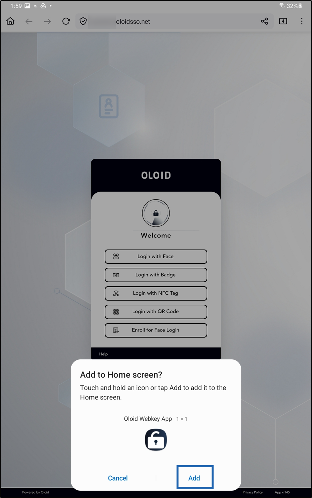

   The **Oloid WebKey App** shortcut is added to the Android home screen.

   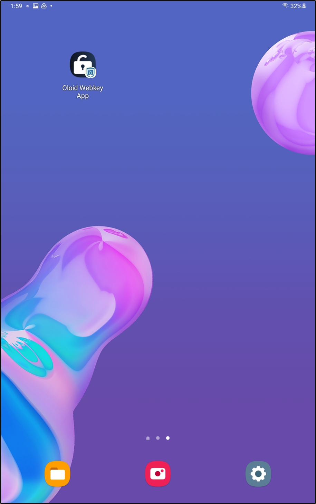

## Step 3: Use Case

### Authenticate using Face

1. Press the **Power button** or tap the screen on your device.
   The **Welcome** screen is displayed.
2. Tap **Login with Face**.

   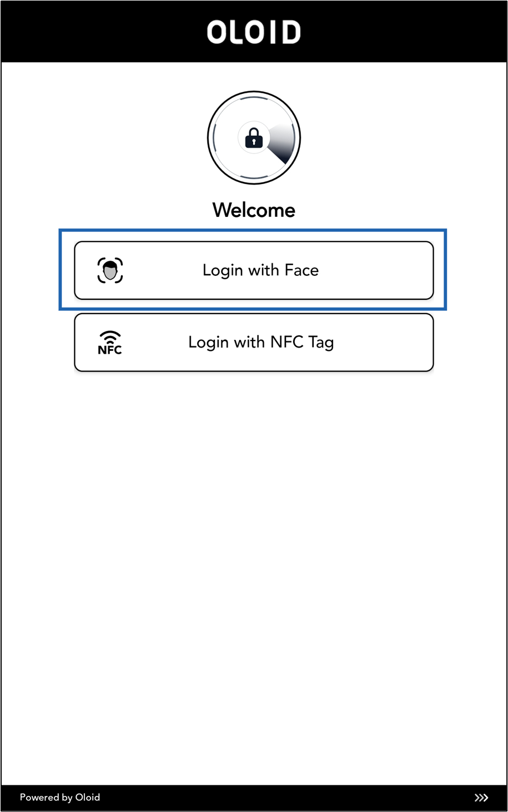

   The camera turns on.
3. Position your face in front of the camera and tap the **Capture** button to complete the authentication process.

   <Note>
     **Note:** If you do not tap the Capture button, the app automatically captures your face after a few seconds.
   </Note>

   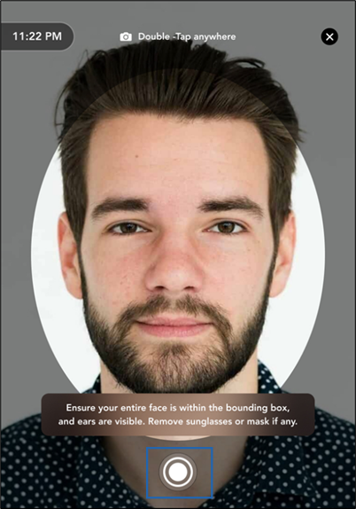

   After successful authentication, the user is redirected to the Android home page.
4. Tap **Oloid Webkey App.**

The Oloid Browser redirects the user to the **WebKey page**.

The WebKey page redirects to the Okta dashboard automatically and Okta dashboard is launched successfully.

### Authenticate using NFC

1. Press the **Power** button or tap the screen on your device.
   The **Welcome** screen is displayed.
2. Tap **Login with NFC Tag**.

   <Note>
     **Note:** Ensure that the Android device must be connected to an external NFC reader/card reader.
   </Note>

   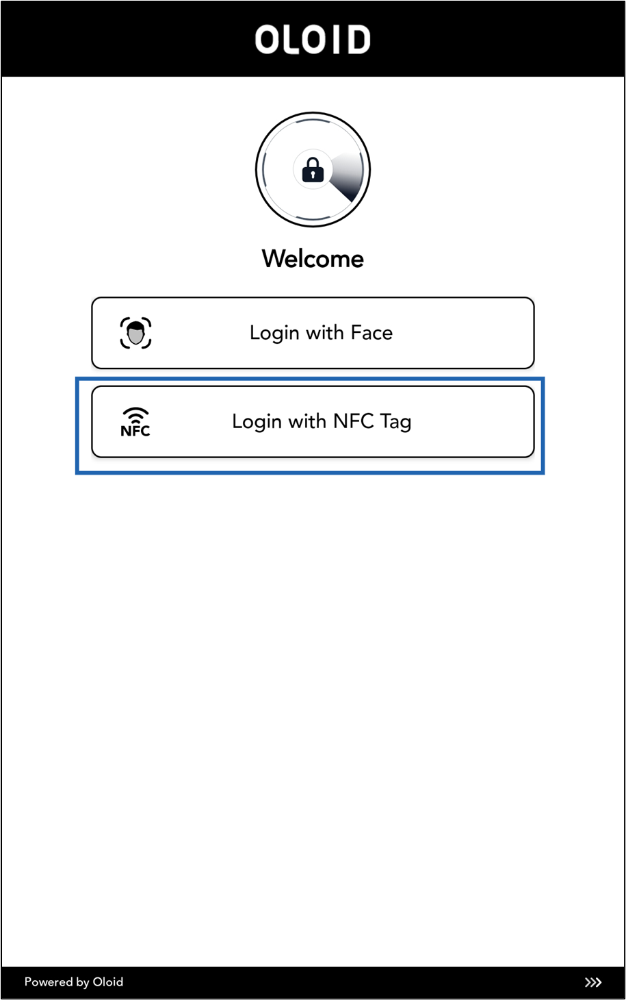

   The **Tap NFC Tag at the device** pageis displayed.
3. Scan the NFC Tag.

   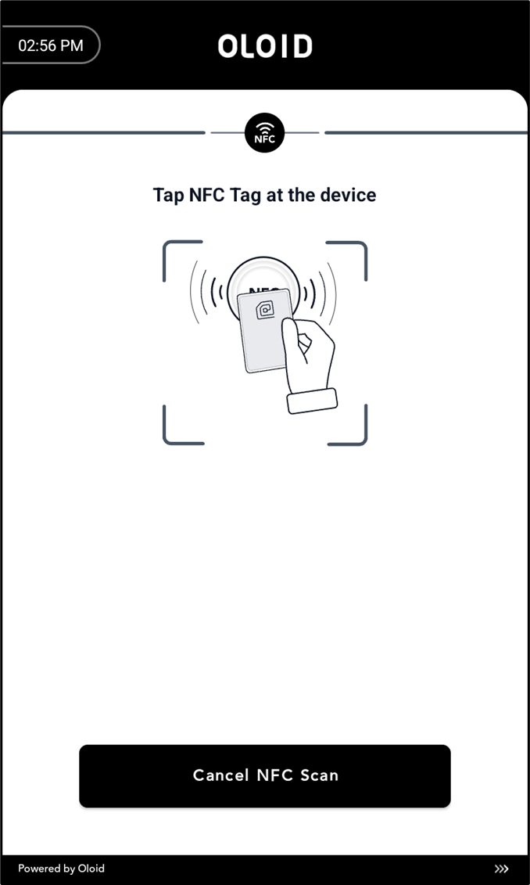

   After successful NFC authentication, the user is redirected to the Android home page.
4. Tap **Oloid Webkey App** to launch the browser.

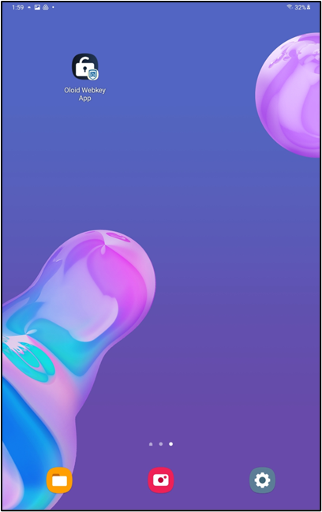

The Oloid Browser redirects the user to the **WebKey page**.

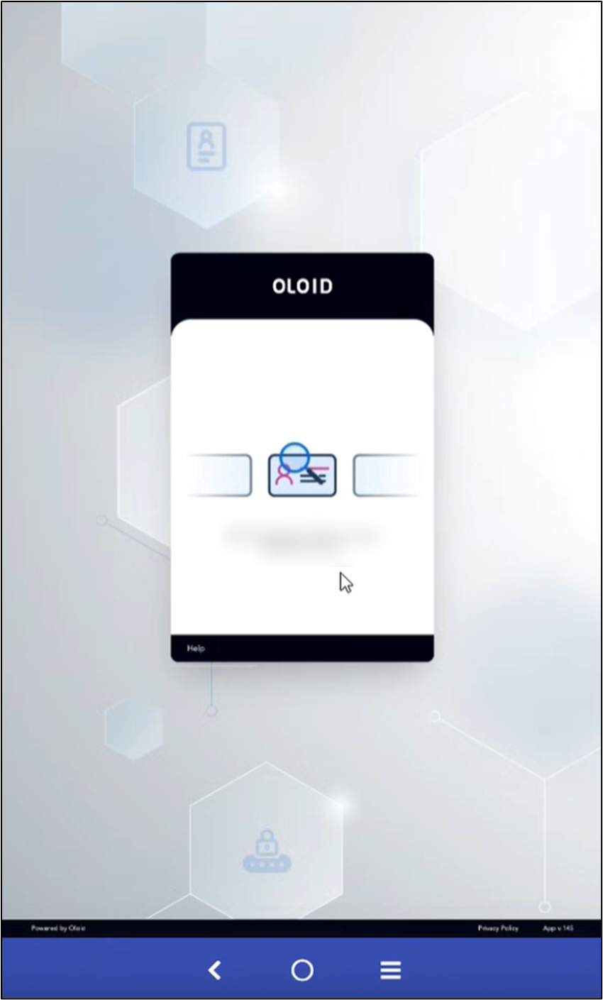

The WebKey page redirects to the Okta dashboard automatically and Okta dashboard is launched successfully.

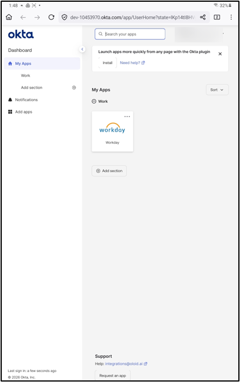
