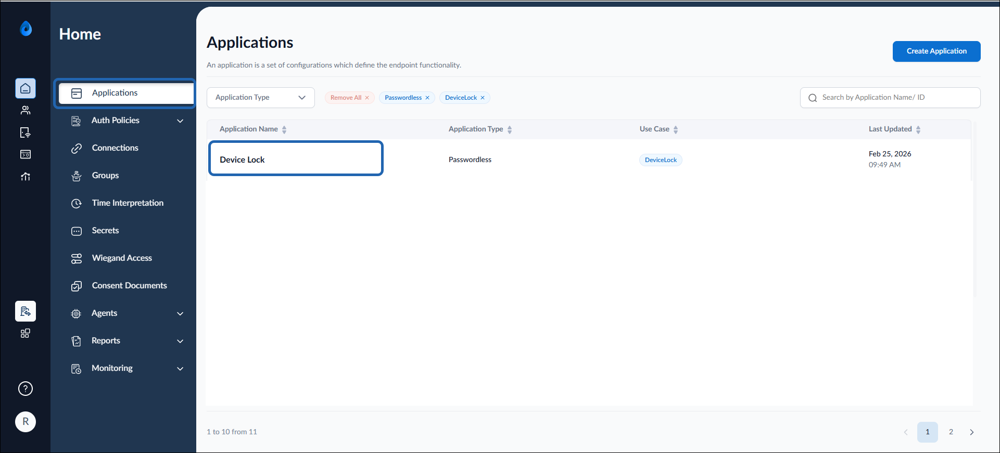
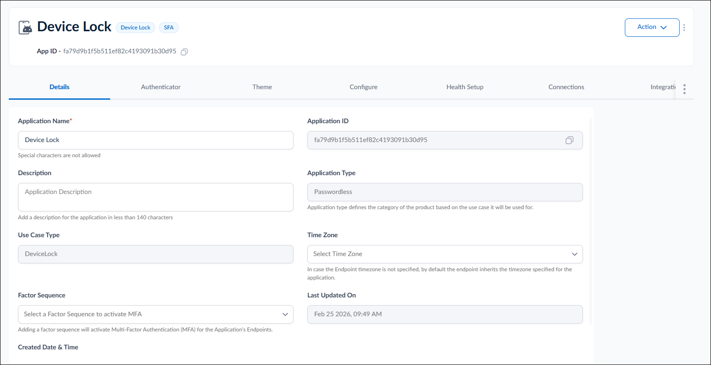
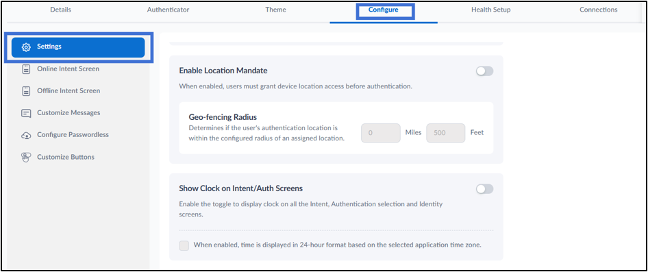
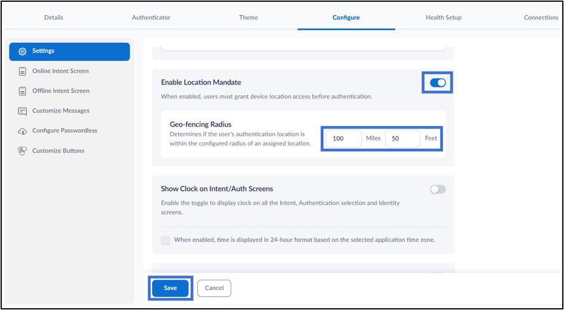
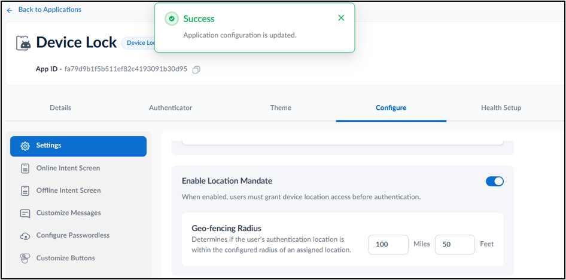

{/* Source: Intercom article 15515518 - https://oloid.help/en/articles/15515518-device-lock-how-to-enable-location-mandate-and-configure-geo-fencing-radius */}
{/* Generated by intercom_to_mintlify.py - re-running overwrites this file. */}

## Steps to Enable Location Mandate

1. Log in to the **Tenant Admin Portal**.
2. On the **Applications** page, click on the Device Lock application.

   

   The application **details** page is displayed.

   

3. Go to **Configure** tab > **Settings.**

   

   The settings page is displayed.
4. **Enable Location Mandate** toggle.
   When enabled, users must grant device location access before authentication. For more, refer to
5. In the **Geo-fencing Radius** section, configure the allowed authentication distance:
   **Miles** – Enter the allowed radius in miles.
   **Feet** – Enter the allowed radius in feet.
6. Click **Save.**

   

   The Location mandate is configured successfully.

   
