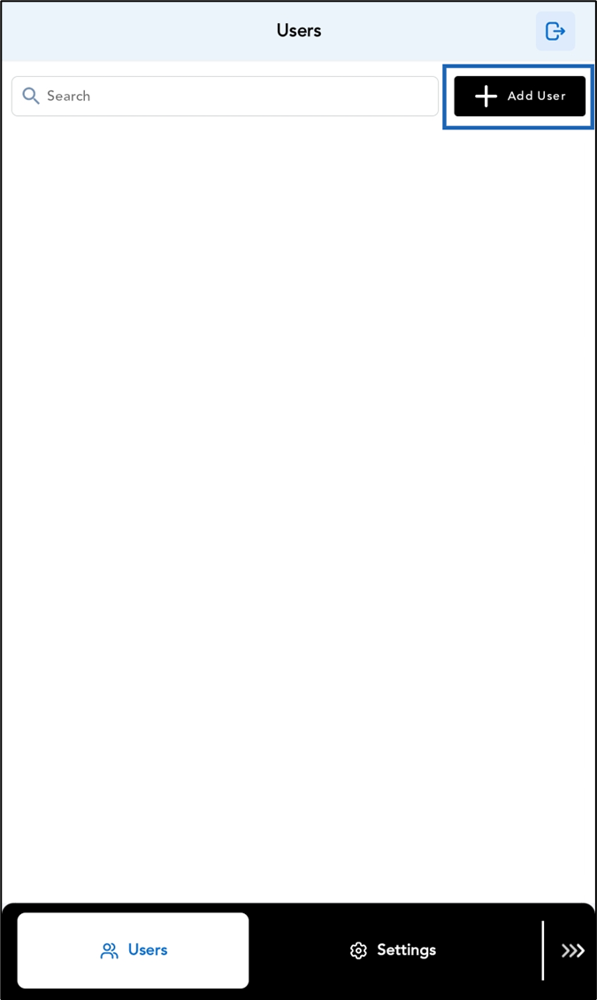
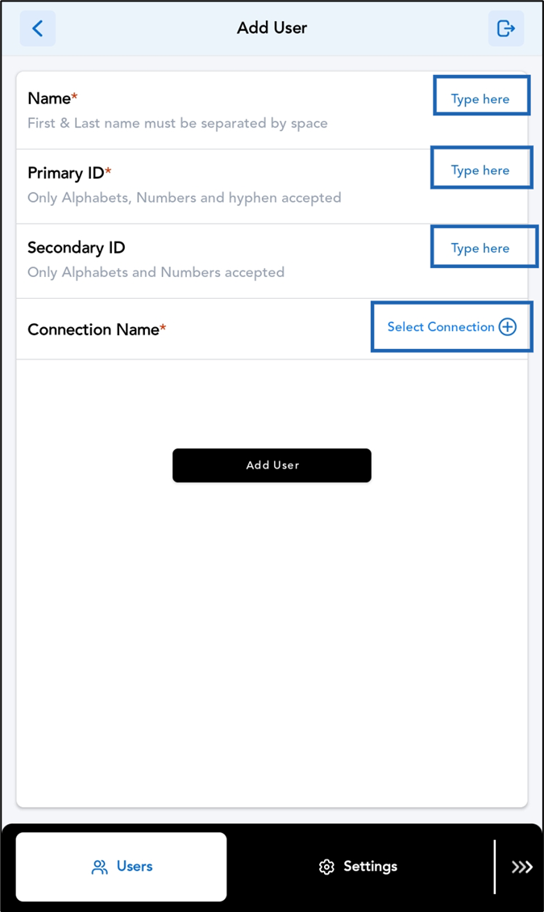
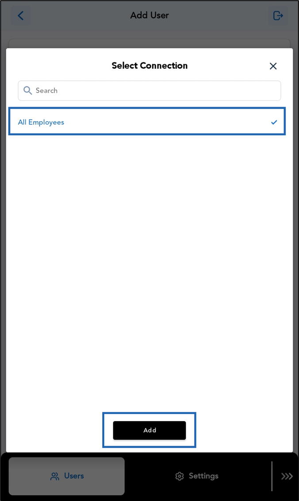
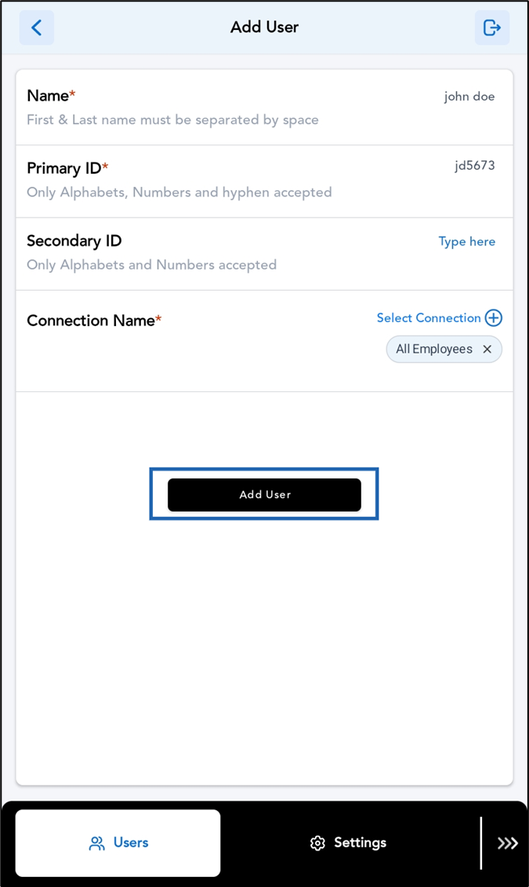
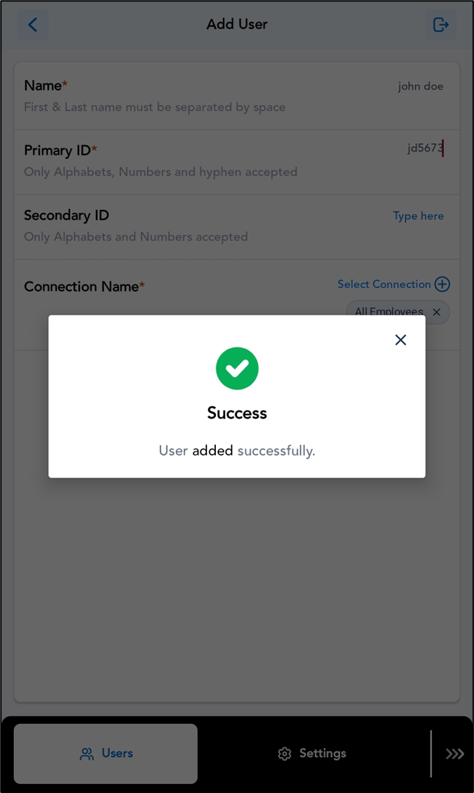

{/* Source: Intercom article 9335055 - https://oloid.help/en/articles/9335055-devicelock-app-how-to-add-user-in-oloid-devicelock-app */}
{/* Generated by intercom_to_mintlify.py - re-running overwrites this file. */}

## Introduction

The Add User feature in the Oloid DeviceLock App allows administrators to register new users and assign them unique identification details for device access. By adding users through Admin Mode, organizations can efficiently manage user credentials, maintain secure access control, and ensure proper tracking of device usage.

## Prerequisite

You must create a connection. To create connection refer [How to create Connections in the Tenant Admin Portal](/platform/tenant-admin-portal/tenant-admin-portal-how-to-create-connection).

## Steps to add user

1. Launch **Oloid DeviceLock App** on your device.

   

2. Log in to the Admin Mode in **Oloid DeviceLock** App. For more details, refer this [How to log in to admin mode in DeviceLock App](/platforms/android/devicelock/devicelock-app-how-to-log-in-to-admin-mode).
3. Click **Add User** on the right-top side of the screen.

   

   The **Add User** screen is displayed.
4. Enter **Name**.

   <Note>
     **Note:** First name and Last name should be separated by a space.
   </Note>

5. Enter **Primary ID**.

   <Note>
     **Note:** Only alphabets, numbers, and hyphen are accepted.
   </Note>

6. Enter **Secondary ID**.

   <Note>
     **Note:** Only numbers are accepted.
   </Note>

7. Click **Select connection**.

   

   The Select Connections pop-up box is displayed.
8. Select the preferred connection.
9. Click **Add**.

   

   The **Add User** screen is displayed.

Click **Add User**.

The user is successfully added and listed in the users list.

