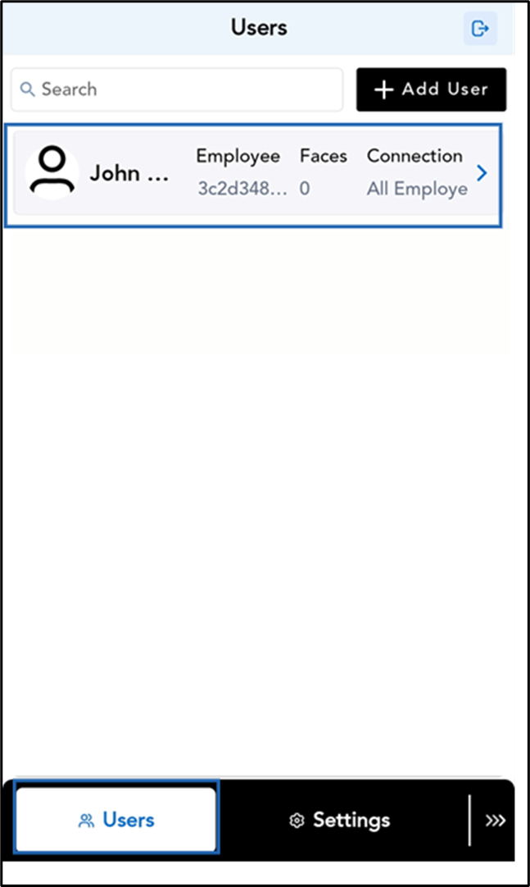
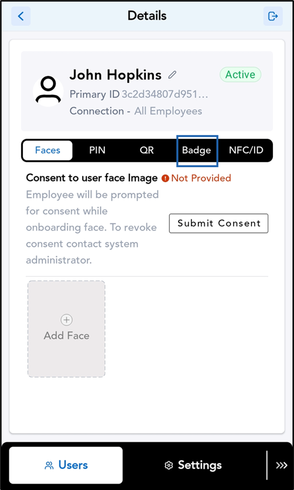
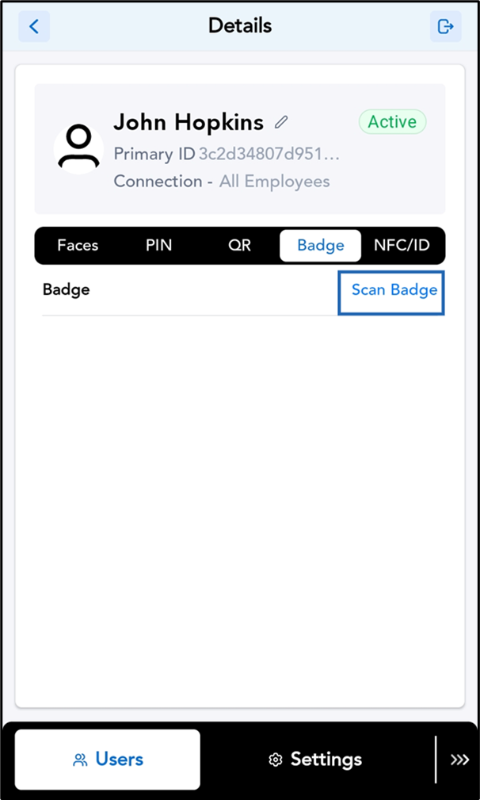
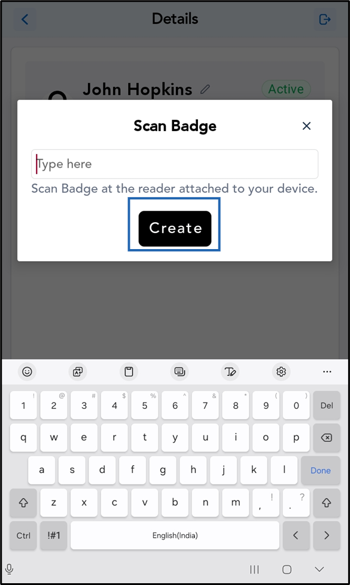
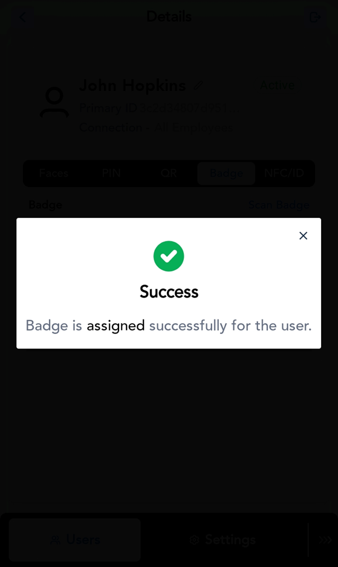

{/* Source: Intercom article 12741589 - https://oloid.help/en/articles/12741589-devicelock-app-how-to-assign-a-badge-for-users-in-the-devicelock-app-through-admin-mode */}
{/* Generated by intercom_to_mintlify.py - re-running overwrites this file. */}

## Introduction

The **Badge Assignment** feature in the **Oloid DeviceLock app** allows admin to assign badge credentials to users for authentication on Android devices. Users can tap their assigned badge on a connected card reader to unlock the device or access Workforce or HRMS applications securely.

## Prerequisite

- You must have Admin Access in the Device Lock Application.
- Ensure the Android device is connected to an external card reader.
- You must have a badge available to assign to a user.

## Steps to Assign Badge

1. Log in to the admin mode in **DeviceLock App.** To login refer[How to log in to admin mode in DeviceLock App](/platforms/android/devicelock/devicelock-app-how-to-log-in-to-admin-mode).
2. Go to **Users** tab > select the preferred user.

   

   The user details screen is displayed.
3. Tap **Badge**.

   

   The **Badge** screen is displayed.
4. Tap **Scan Badge**.

   

   The **Scan Badge** screen is displayed.
5. Do one of the following:
   1. Manually enter the Badge number.
      OR
   2. Tap the Badge on the card reader to scan it.
   3. Tap **create.**

Badge is assigned successfully.

