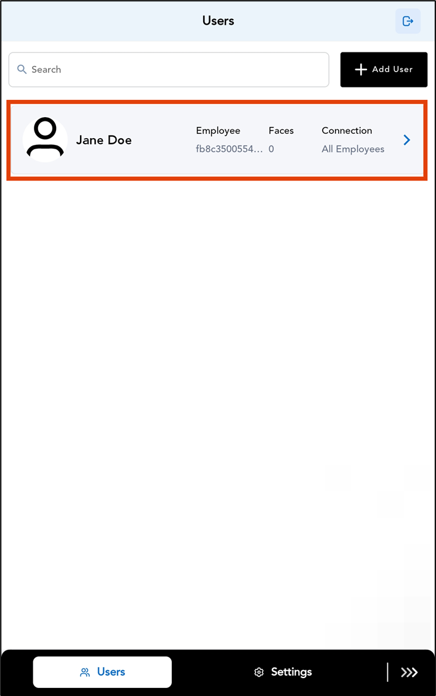
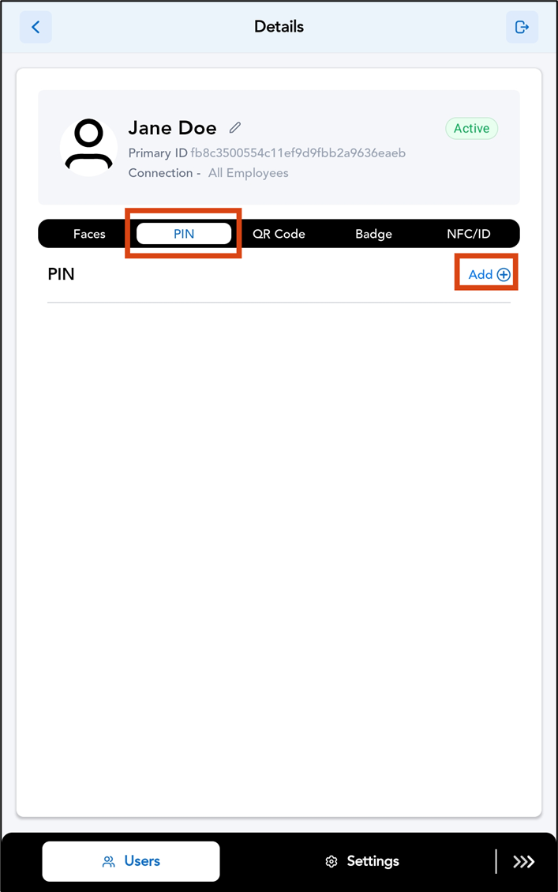
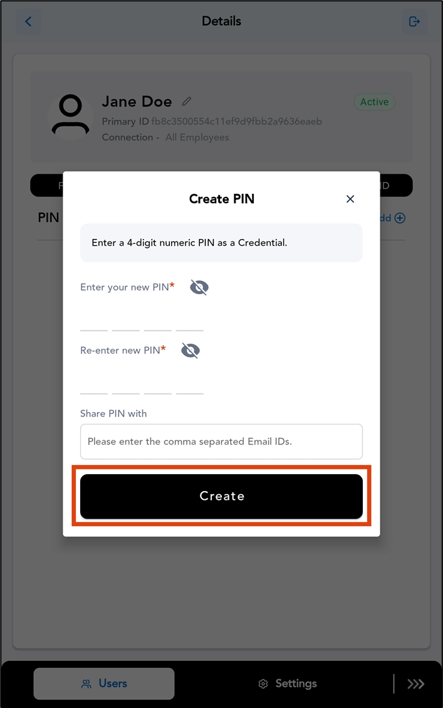
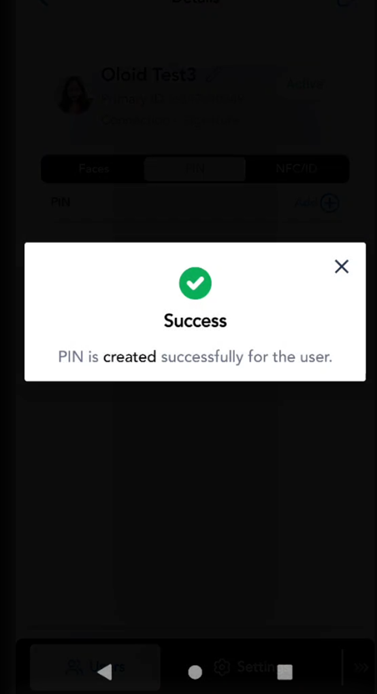

{/* Source: Intercom article 12157257 - https://oloid.help/en/articles/12157257-devicelock-app-how-to-assign-a-pin-for-users-in-the-devicelock-app-through-admin-mode */}
{/* Generated by intercom_to_mintlify.py - re-running overwrites this file. */}

## Introduction

Tenant Admin or Supervisor can assign a PIN for users directly in the DeviceLock app through admin mode. Once enrolled, the PIN is linked to the user’s profile and can be used for authentication purpose, providing an additional or alternative login method to access the device.

## Steps to enroll PIN

1. Log in to the admin mode in **DeviceLock App.** To log in refer[How to log in to admin mode in DeviceLock App](/platforms/android/devicelock/devicelock-app-how-to-log-in-to-admin-mode).
2. Go to **Users** tab > select the preferred user.

   

3. Go to **PIN** tab > tap **Add** PIN.

   

   The **create PIN** pop-up box is displayed.
4. Do the following:
   1. Enter the **PIN**.
   2. Re-enter the **PIN**.
   3. Enter recipient email ID to share the **PIN**.
   4. Tap **Create**.

      <Note>
        **Note:** The PIN can be configured as a **4-digit**, **6-digit**, or **open (alpha- numeric) PIN** from the Tenant Admin Portal.
      </Note>

      

      The PIN is successfully enrolled.

      
