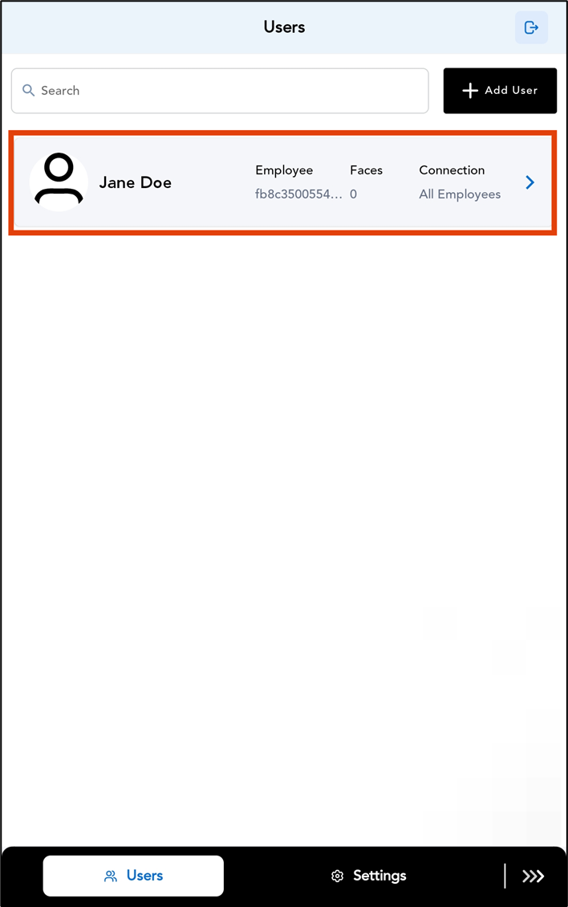
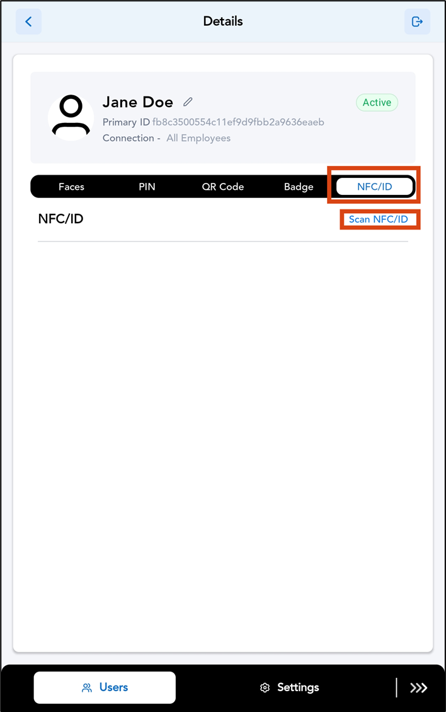
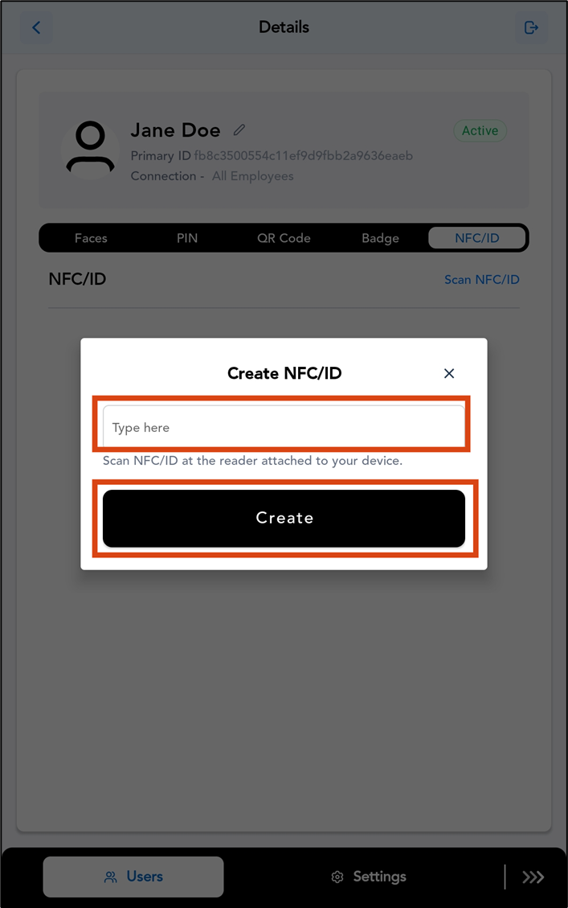
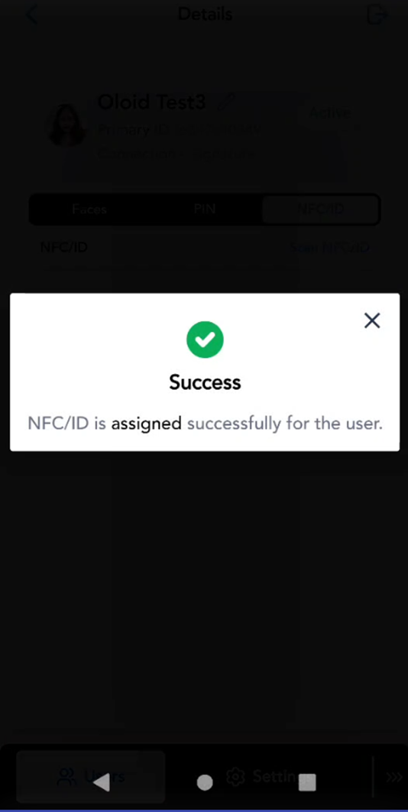

{/* Source: Intercom article 12157546 - https://oloid.help/en/articles/12157546-devicelock-app-how-to-assign-nfc-id-for-users-in-the-devicelock-app-through-admin-mode */}
{/* Generated by intercom_to_mintlify.py - re-running overwrites this file. */}

## Introduction

The **NFC/ID authentication** feature in the DeviceLock app allows users to unlock their Android devices by scanning an assigned NFC tag or ID card. Admin can enroll and assign NFC/ID credentials to users directly from the DeviceLock app, enabling secure, fast, and contactless access to the device.

## Prerequisites

- You must have **Admin access** in the DeviceLock app to enroll NFC/ID for users.
- Ensure the Android device is connected to an external NFC reader/card reader.

  <Note>
    **Note:** If the Android device has a **built-in NFC reader**, you can scan the tag directly on the device.
  </Note>

- You must have an **NFC tag or ID card** available for enrollment.

## Steps to Assign NFC/ID

1. Log in to the Admin mode in **DeviceLock App.** To log in refer[How to log in to admin mode in DeviceLock App](/platforms/android/devicelock/devicelock-app-how-to-log-in-to-admin-mode).
2. Go to **Users** tab > select the preferred user.

   

3. Go to **NFC/ID** tab > tap **Scan NFC/ID**.

   

   The **create NFC/ID** pop-up box is displayed.
4. On the **Create NFC/ID** pop-up box, do the following:
   1. Enter the **NFC ID** manually or scan the **NFC tag** using the connected card reader.
   2. Tap **Create**.

      

      The NFC/ID is assigned successfully.

      

---

##### Keywords

| NFC/ID Enrollment | Assign NFC ID to user | Configure NFC/ID in DeviceLock app |
