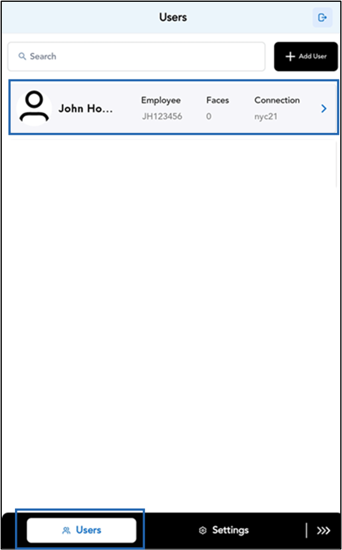
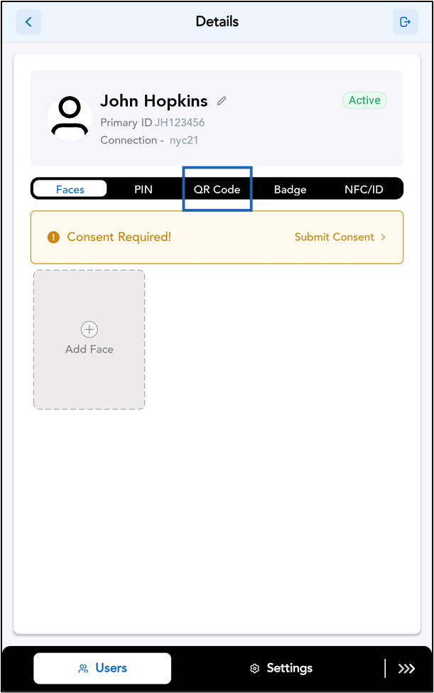
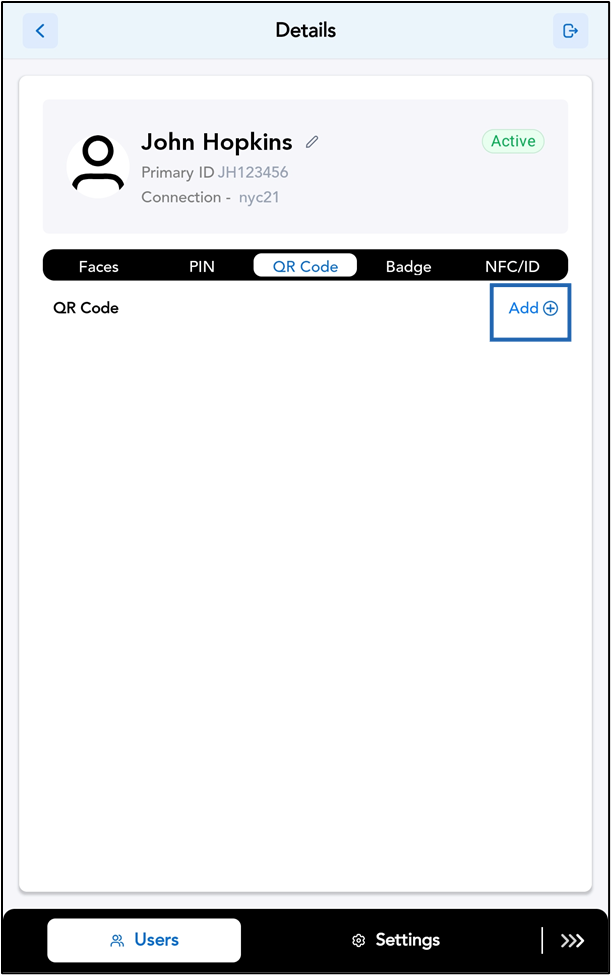
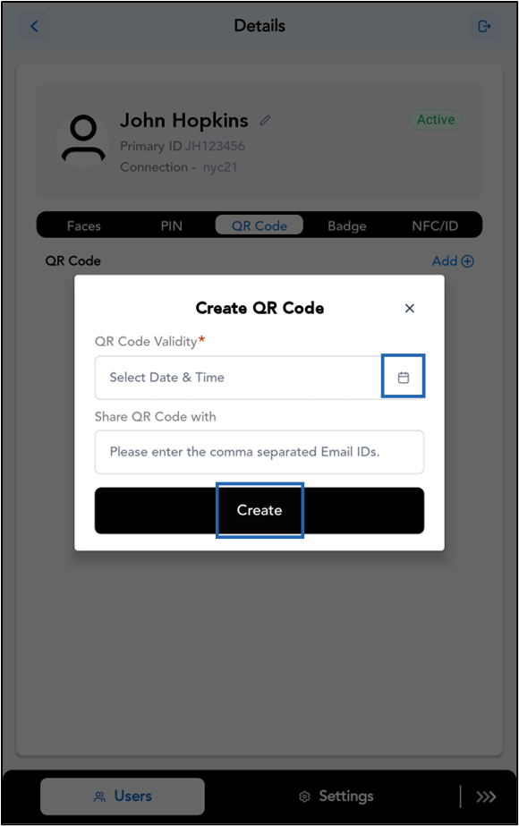
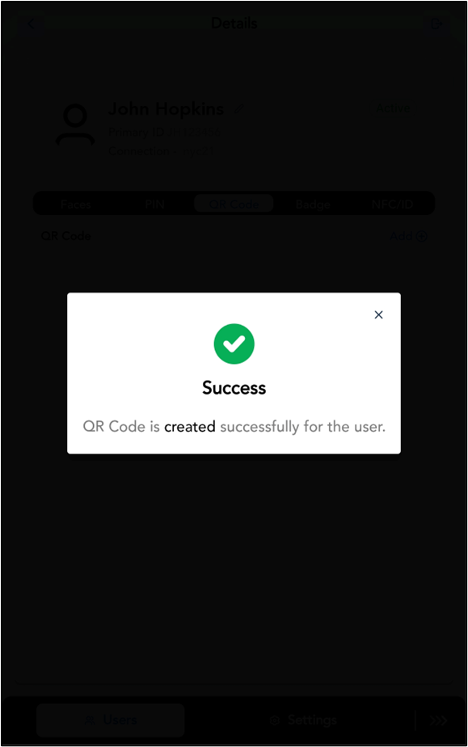
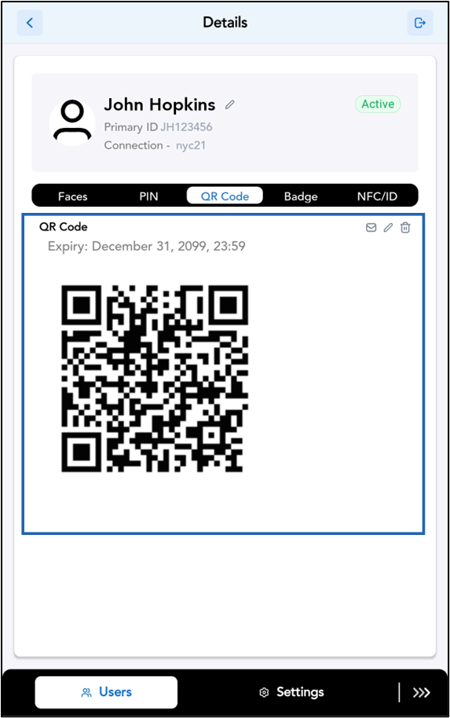

{/* Source: Intercom article 12741303 - https://oloid.help/en/articles/12741303-devicelock-app-how-to-assign-qr-code-for-users-in-the-devicelock-app-through-admin-mode */}
{/* Generated by intercom_to_mintlify.py - re-running overwrites this file. */}

## Introduction

The **QR Code** feature in the **Oloid DeviceLock App** allows admin to assign QR codes to users for secure, passwordless authentication on Android devices.

## Prerequisite

You must have **Admin Access** in the Device Lock Application.

## Steps to Assign QR Code

1. Login to the Admin mode in **DeviceLock App.** To login refer[How to log in to admin mode in DeviceLock App](/platforms/android/devicelock/devicelock-app-how-to-log-in-to-admin-mode).
2. Go to **Users** tab > select the preferred user.

   

   The user details screen is displayed.
3. Tap **QR Code**.

   

   The QR Code screen is displayed.
4. Tap **Add**.

   

   The **Create QR Code** pop-up box is displayed.
5. Do the following:
   1. Select **QR Code Validity**.
   2. Enter the Email ID (Optional).
   3. Tap **Create**.

The QR Code is added successfully.

The created QR code is displayed in the QR Code tab.

