{/* Source: Intercom article 13330667 - https://oloid.help/en/articles/13330667-devicelock-app-how-to-configure-endpoint-in-the-tenant-admin-portal */}
{/* Generated by intercom_to_mintlify.py - re-running overwrites this file. */}

## Introduction

This document describes how to configure a paired **DeviceLock** endpoint in the Tenant Admin Portal. It covers endpoint configuration and monitoring using the **Details**, **Settings**, **Groups**, **Integrations**, **Transactions**, and **Health** tabs.

## Prerequisite

The endpoint is successfully paired with the DeviceLock application.

## Steps to Configure the Endpoint

1. Log in to the **Tenant Admin Portal**.
2. On the home page of the portal, click **Endpoints** on the left menu panel.

   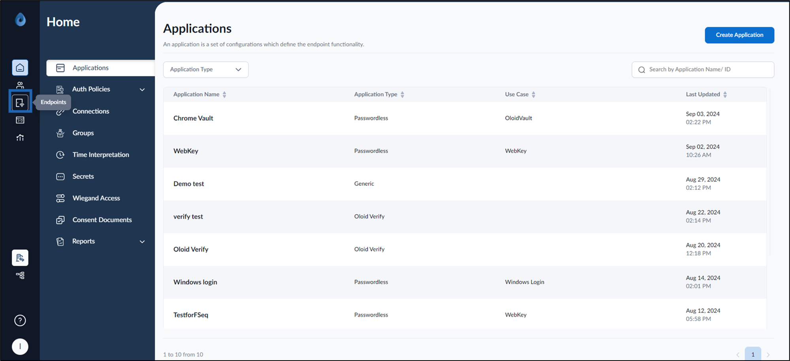

   The **Endpoints** page is displayed.
3. Select the paired Devicelock Endpoint.

   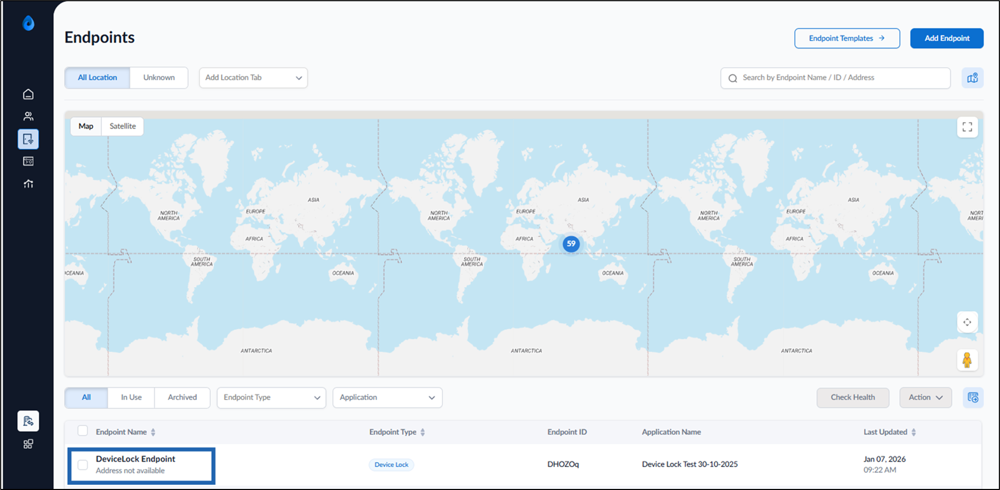

   The **Endpoint Details** page is displayed.

   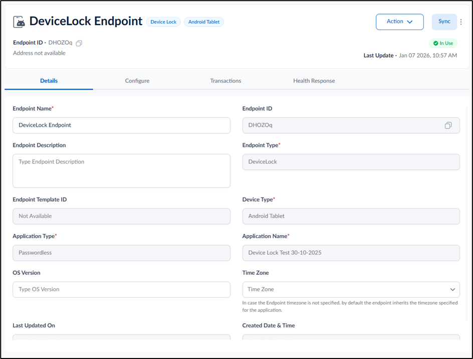

4. Do the following:
   1. [Configure Details Tab](/platforms/ios/time-clock/oloid-connect/oloid-connect-how-to-configure-endpoint-in-the-tenant-admin-portal)
   2. [Design Configure Tab](/platforms/ios/time-clock/oloid-connect/oloid-connect-how-to-configure-endpoint-in-the-tenant-admin-portal)
   3. [Configure Transactions Tab](/platforms/ios/time-clock/oloid-connect/oloid-connect-how-to-configure-endpoint-in-the-tenant-admin-portal)
   4. [Configure Health Response Tab](/platforms/ios/time-clock/oloid-connect/oloid-connect-how-to-configure-endpoint-in-the-tenant-admin-portal)

### Configure Details Tab

1. Click Details tab, and do the following:
   1. Edit **Endpoint Name** (if required).
   2. Enter **Endpoint Description**. (Optional)
   3. Enter **OS Version**. (Optional)
   4. Select **Time Zone** from the dropdown list. (Optional)
   5. Click **Save**.

      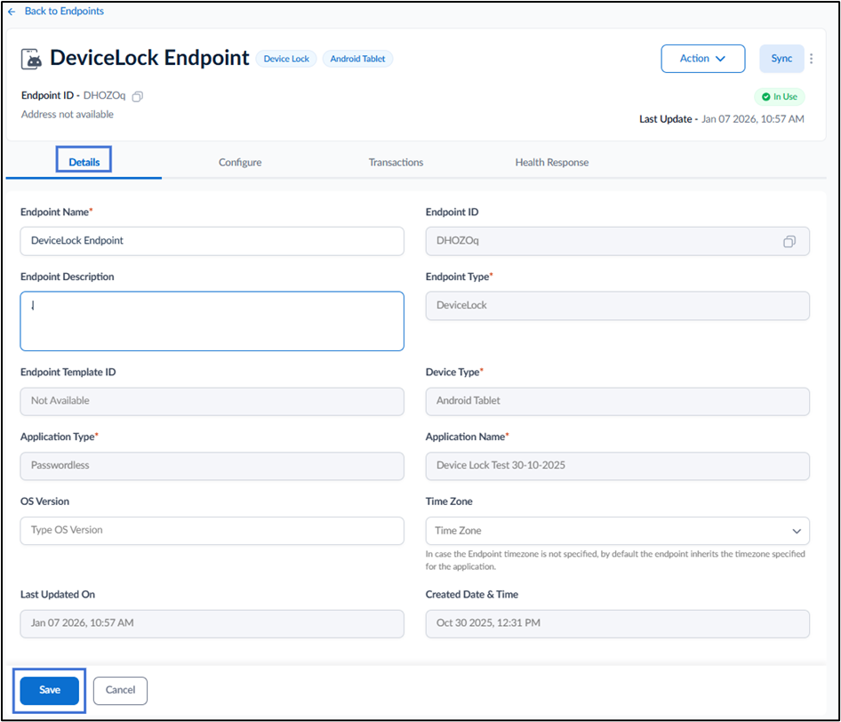

      The details tab is configured successfully.

### Design Configure Tab

Configure the following:

- [Endpoint Settings](/platforms/ios/time-clock/oloid-connect/oloid-connect-how-to-configure-endpoint-in-the-tenant-admin-portal)
- [Groups](/platforms/ios/time-clock/oloid-connect/oloid-connect-how-to-configure-endpoint-in-the-tenant-admin-portal)
- [Integration](/platforms/ios/time-clock/oloid-connect/oloid-connect-how-to-configure-endpoint-in-the-tenant-admin-portal)
- [Health Setup](/platforms/ios/time-clock/oloid-connect/oloid-connect-how-to-configure-endpoint-in-the-tenant-admin-portal)

### Endpoint Settings

1. Click on Endpoint Settings and do the following:
   1. Enable **Use Endpoint in Admin Mode Only** toggleto restrict the endpoint device to Admin mode.
   2. Enable **Capture Location** toggleto activate location capture on the endpoint for each transaction.

      <Note>
        **Note:** The **Location Permission** of the device must be enabled to make the feature functional.
      </Note>

   3. Enable **Generate Debug Logs** toggleto activate log generation for the endpoint until disabled.
   4. Click **Save** to apply the configuration.

      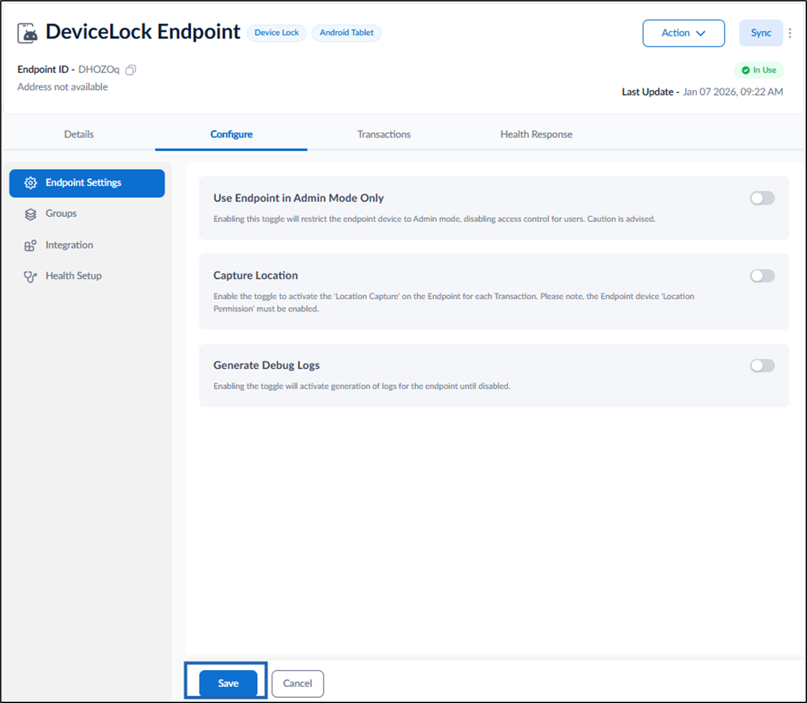

      The endpoint settings tab is configured successfully.

### Groups Tab

1. Click **Groups**.
   The group page is displayed.

   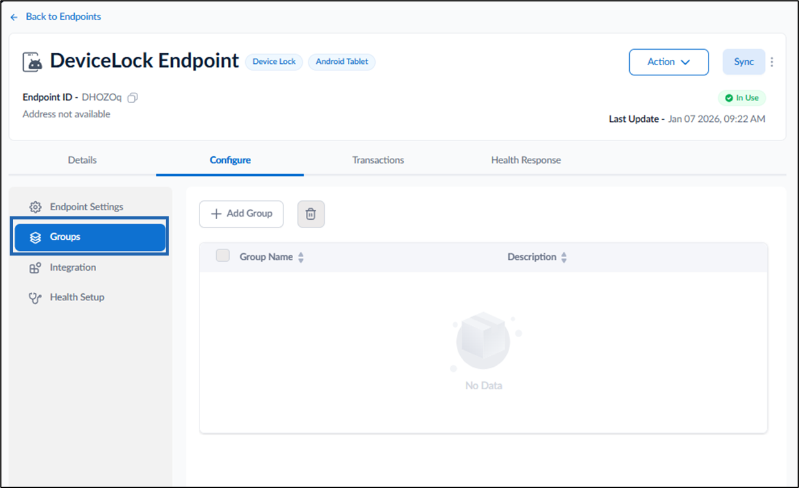

2. Click **+ Add Group** and do the following:
   1. Select group(s) in **Add Group** field.
   2. Click **Save**.

      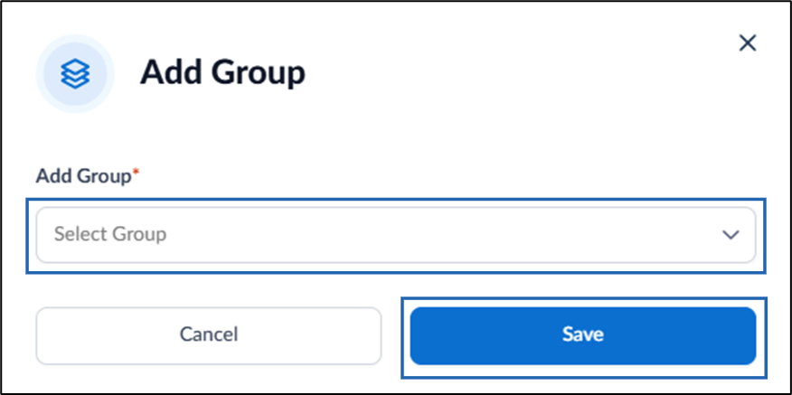

      The group is added successfully.

### Integration Tab

1. Click **Integration**.
   The Integration tab is displayed.
2. Enable the applicable integration by clicking on the toggle button.

   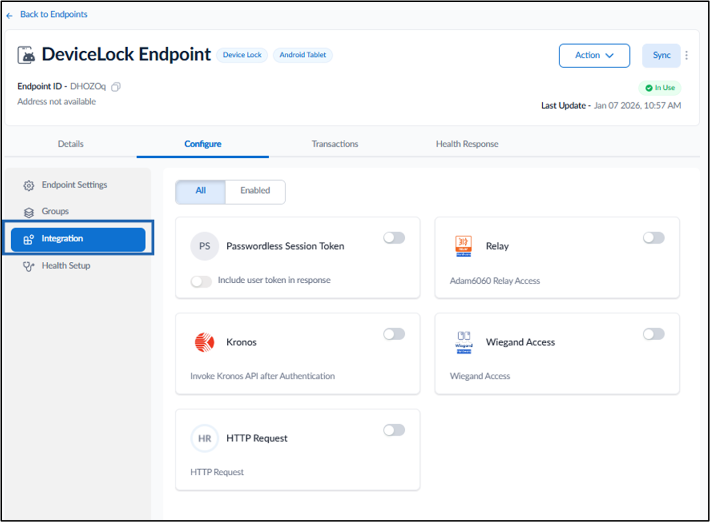

   The integration tab is configured successfully.

### Health Setup Tab

This tab is used to add and monitor the server URLs.

1. Click Health Setup and do the following:
   1. Enter **Server Name**.
   2. Enter URL of the server in **Add URL that needs to be monitored** field.
   3. Click **Add**.
      The added server appears in the list with the corresponding **Server Name** and **URL**.

      <Note>
        **Note:** Configure settings only when required. Consult your Oloid representative before making any changes.
      </Note>

      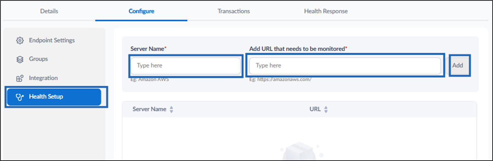

      The Server is added successfully.

### Configure Transactions Tab

The Transactions tab allows you to view detailed user transactions. You can monitor transaction statuses and filter results based on success or failure.

1. Click **Transactions** tab.
   The Transaction tab is displayed, and you can see the list of transactions.

   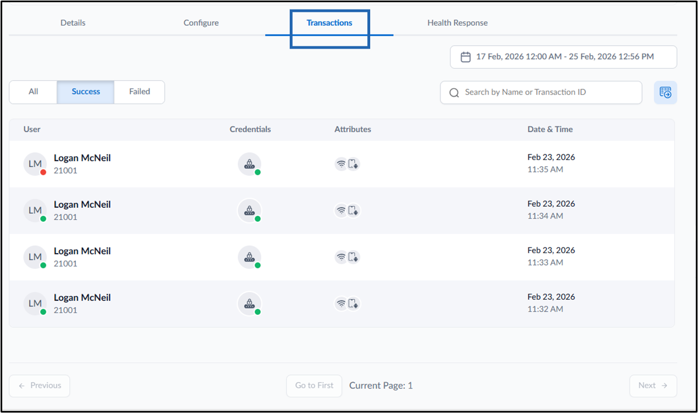

### Configure Health Response Tab

**Health Response** tab is used to check the endpoint health status and manage health-related actions. In this section, you can see the endpoint status, check health of the endpoint and configure health alert.

1. Click **Health Response** and do the following:
   1. Enable **Share Endpoint Logs** to share logs.
   2. Click **Check Health** to initiate a health check.

      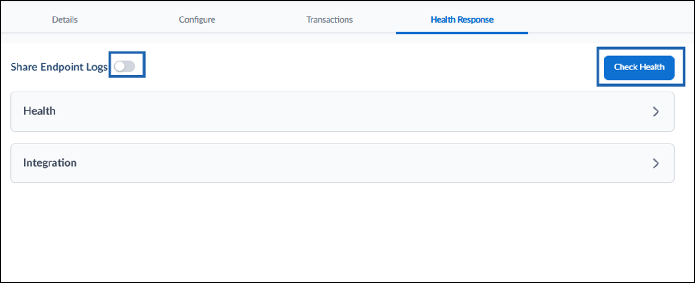

2. For more information on health alert, refer **[How to configure health alert for an endpoint](/platform/tenant-admin-portal/how-to-add-health-alerts-in-the-endpoint)**.
