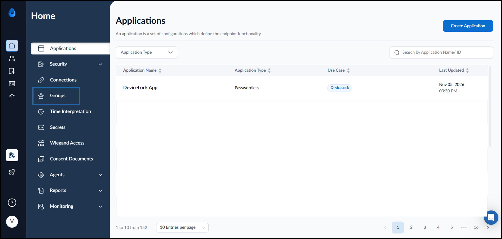
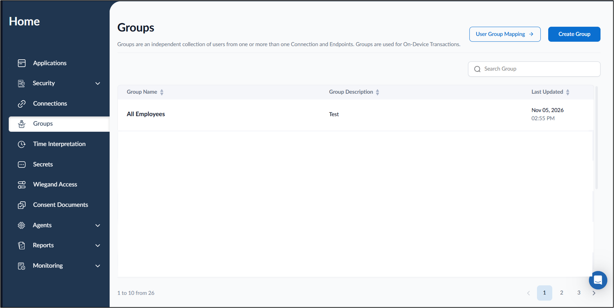
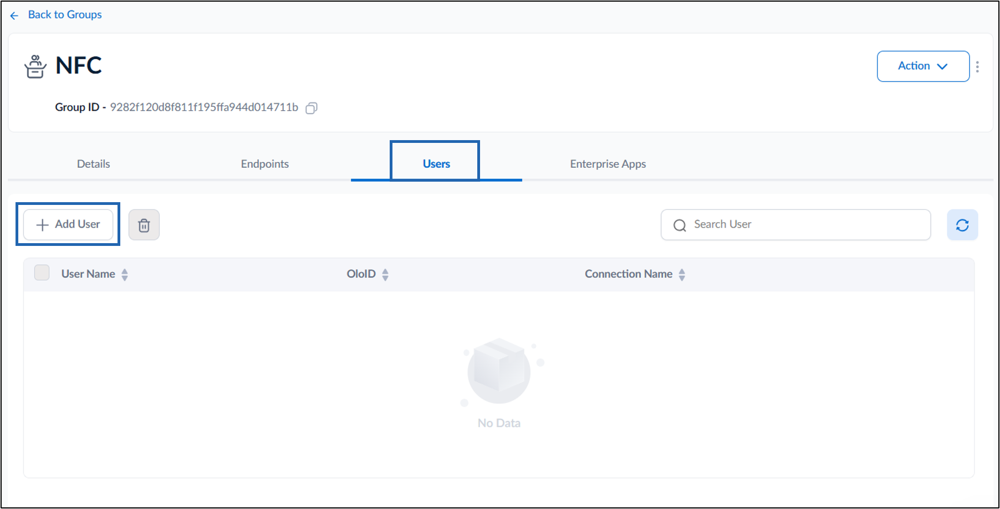
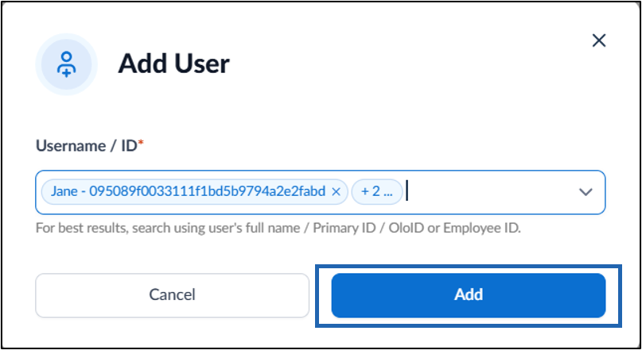
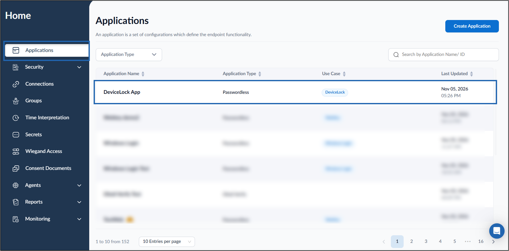
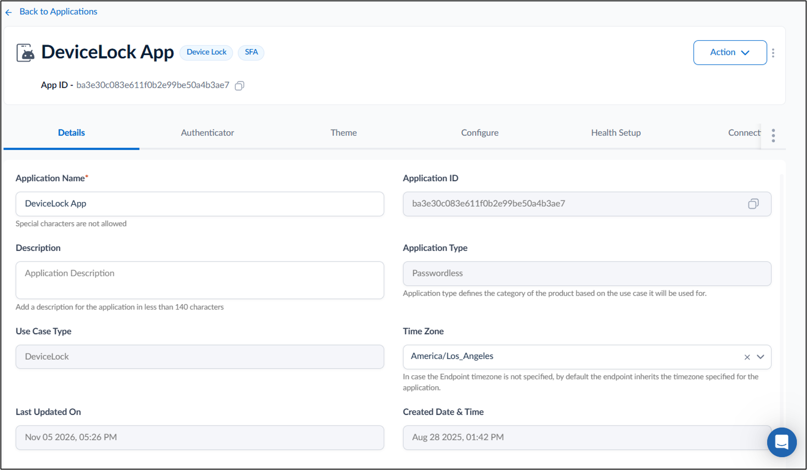
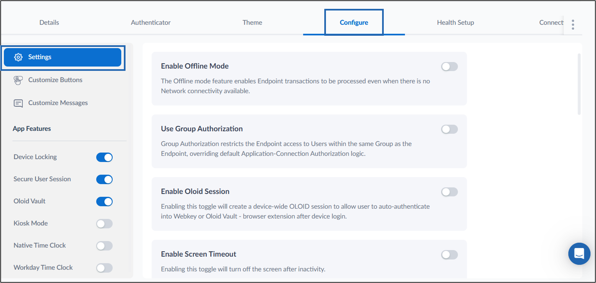
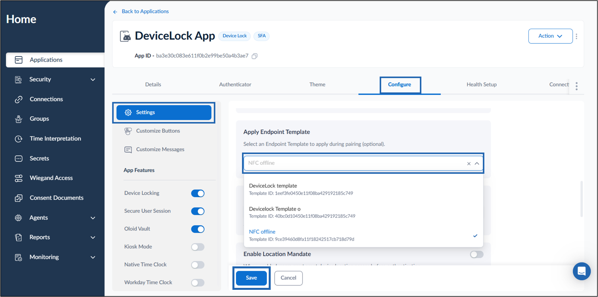
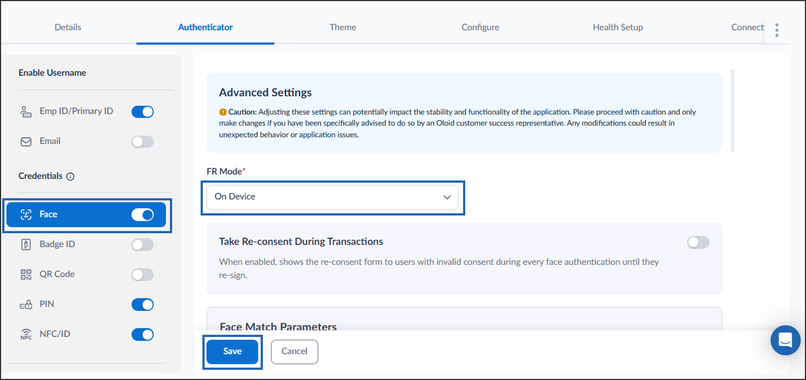

{/* Source: Intercom article 18242235 - https://oloid.help/en/articles/18242235-devicelock-app-how-to-configure-offline-nfc-for-devicelock-app-in-the-tenant-admin-portal */}
{/* Generated by intercom_to_mintlify.py - re-running overwrites this file. */}

## Introduction

This document provides instructions to configure offline NFC sign-in for Oloid DeviceLock in the Tenant Admin Portal.

Offline NFC allows users to sign in to a DeviceLock device using their NFC tag, even when the device has a slow internet connection or no connection at all. The device verifies the user's NFC tag on the device itself, so users at remote locations, warehouses and field sites can sign in and continue working without depending on the cloud.

## Prerequisites

- You must have admin access to the Tenant Admin Portal.
- The DeviceLock app must be installed on the Android device.
- The DeviceLock application must be created in the Tenant Admin Portal and paired with the endpoint (Android device).
- Each user must have an NFC tag registered to them.
- An NFC reader must be available.

  <Note>
    **Note:** Devices with built-in NFC, such as Zebra devices, use their own reader.
  </Note>

## Steps to Configure Offline NFC

1. [Method 1: Assign a Group to the Endpoint](#method-1-assign-a-group-to-the-endpoint)
2. [Method 2: Use an Endpoint Template](#method-2-use-an-endpoint-template)

   <Note>
     **Note:** For Honeywell devices, also complete the [Set Up NFC on Honeywell Devices](#set-up-nfc-on-honeywell-devices) section.
   </Note>

### Method 1: Assign a Group to the Endpoint

Use this method to give offline sign-in access to specific users. You add the users to a group and then link that group to the endpoint that the DeviceLock device is paired with.

Do the following:

1. [Add Users to a Group](#add-users-to-a-group)
2. [Link the Group to the Endpoint](#link-the-group-to-the-endpoint)
3. Complete the [Set Face Recognition to On-Device in DeviceLock](#set-face-recognition-to-on-device-in-devicelock).

   <Note>
     **Note:** For Honeywell devices, also complete the [Set Up NFC on Honeywell Devices](#set-up-nfc-on-honeywell-devices) section.
   </Note>

#### Add Users to a Group

This section helps you add the users who need offline sign-in access to a group.

1. Log in to the **Tenant Admin Portal**.
2. Click **Groups** on the left menu panel.

   

   The **Groups** page is displayed.
3. Do the following:
   1. Select an existing group.

      <Note>
        **Note:** If a group doesn’t exist for the users who need offline sign-in access, create a new group. For more information, refer to [Tenant Admin Portal - How to Create Group](/platform/tenant-admin-portal/tenant-admin-portal-how-to-create-group).
      </Note>

      

      The Group detail page is displayed.
   2. Click **Users** > **Add User**.

      

      The **Add User** pop-up box is displayed.
   3. Enter the **Username/ID**.

      <Note>
        **Note:** You can add multiple users to a Group.
      </Note>

   4. Click **Add**.

      

      The user(s) is(are) added successfully.

      

#### Link the Group to the Endpoint

This section helps you link the group to the endpoint that the DeviceLock device is paired with. You can link them from either the endpoint or the group.

Do one of the following:

1. **Add the group to the endpoint:** For more information, refer to [Tenant Admin Portal - How to Add a Group to an Endpoint](/platform/tenant-admin-portal/tenant-admin-portal-how-to-add-a-group-to-an-endpoint).
   **OR**
2. **Add the endpoint to the group:** For more information, refer to [Tenant Admin Portal - How to Add an Endpoint to a Group](/platform/tenant-admin-portal/tenant-admin-portal-how-to-add-an-endpoint-to-a-group).

### Method 2: Use an Endpoint Template

This section helps you apply the same offline NFC setup to several endpoints at once by applying an endpoint template to the DeviceLock application.

Do the following:

1. [Use an Endpoint Template](#use-an-endpoint-template)
2. Complete the [Set Face Recognition to On-Device in DeviceLock](#set-face-recognition-to-on-device-in-devicelock).

   <Note>
     **Note:** For Honeywell devices, also complete the [Set Up NFC on Honeywell Devices](#set-up-nfc-on-honeywell-devices) section.
   </Note>

   <Note>
     **Note:** Ensure that an endpoint template is created and configured. For more information, refer to [DeviceLock App - How to Create and Configure DeviceLock Endpoint Template in Tenant Admin Portal](/platforms/android/devicelock/devicelock-app-how-to-create-and-configure-devicelock-endpoint).
   </Note>

#### Use an Endpoint Template

1. In the Tenant Admin Portal, go to **Applications** and click the DeviceLock application.

   

   The DeviceLock application details page is displayed.

   

2. Go to **Configure** > **Settings**.
   The **Settings** page is displayed.

   

   The Settings section is displayed.
3. Select the required endpoint template from the **Apply Endpoint Template** drop-down list.
4. Click **Save**.

   

   The endpoint template is applied to the DeviceLock application successfully.

### Set Face Recognition to On-Device in DeviceLock

This section helps you configure DeviceLock to verify users on the device itself instead of through the cloud, so that users can sign in even without a network connection.

1. In the Tenant Admin Portal, go to **Applications** and click the DeviceLock application.
   The DeviceLock application details page is displayed.

   

2. Go to **Authenticator** > **Credentials** > **Face** and do the following:
   1. Set the **Face Recognition (FR)** mode to **On-Device**.
   2. Click **Save**.

      

      Face Recognition is set to On-Device successfully.

      

<Note>
  **Note:**

  - Only users who belong to a group assigned to the endpoint, either directly or through an endpoint template, can sign in offline on the device. To give another user offline access, add them to the group.
  - Keep the device connected to the network after you save these changes, so that it can receive the users in the group. Users added to the group later become available on the device the next time it connects.
</Note>

## Additional Information

### Set Up NFC on Honeywell Devices

This section helps you activate NFC on Honeywell devices.

To activate NFC on a Honeywell device, follow the instructions in the attached [Honeywell setup guide](#honeywell-setup-guide).

---

#### Related Documents

[Tenant Admin Portal - How to Create Group](/platform/tenant-admin-portal/tenant-admin-portal-how-to-create-group)

[Tenant Admin Portal - How to Add a Group to an Endpoint](/platform/tenant-admin-portal/tenant-admin-portal-how-to-add-a-group-to-an-endpoint)

[Tenant Admin Portal - How to Add an Endpoint to a Group](/platform/tenant-admin-portal/tenant-admin-portal-how-to-add-an-endpoint-to-a-group)

[DeviceLock App - How to Create and Configure DeviceLock Endpoint Template in Tenant Admin Portal](/platforms/android/devicelock/devicelock-app-how-to-create-and-configure-devicelock-endpoint)

[DeviceLock App - How to Log In with an NFC Tag using Offline NFC](/platforms/android/devicelock/devicelock-app-how-to-log-in-with-an-nfc-tag-using-offline-nfc)

##### Honeywell setup guide.
