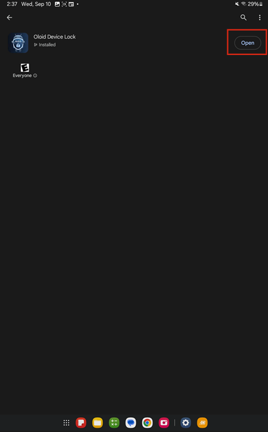
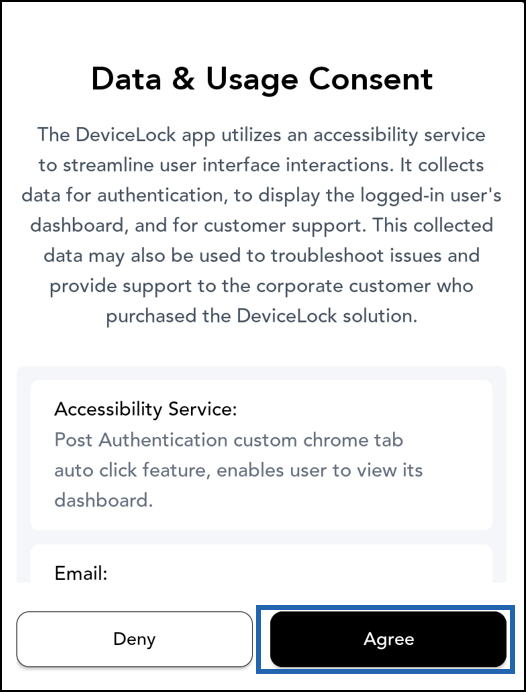
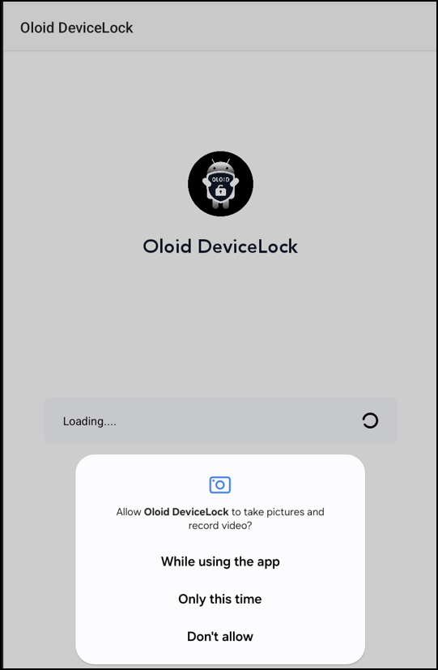
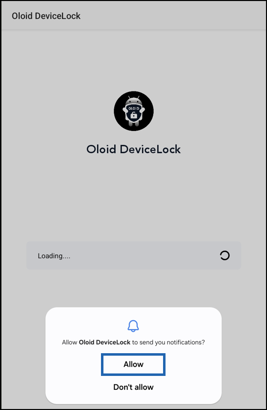
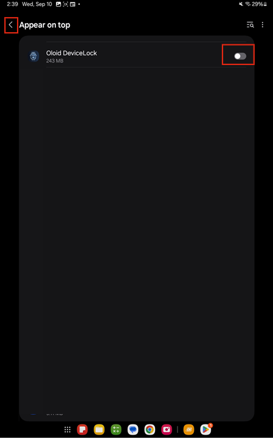
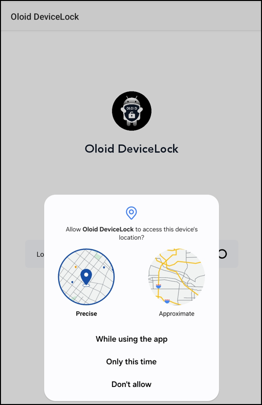
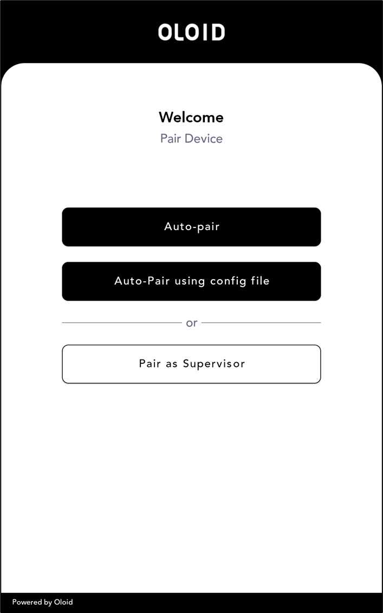

{/* Source: Intercom article 12380644 - https://oloid.help/en/articles/12380644-devicelock-app-how-to-configure-oloid-devicelock-app-after-installation */}
{/* Generated by intercom_to_mintlify.py - re-running overwrites this file. */}

## Introduction

This document explains how to perform the initial configuration of the Oloid DeviceLock app after installation. The setup includes granting required permissions to enable core functionality and ensure secure operation of the application.

<Note>
  **Note:** Screenshots in this document were captured on a Samsung Galaxy Tab A11 device.
</Note>

## Prerequisite

You must install the Oloid DeviceLock app. To install refer [How to install Oloid DeviceLock App](/platforms/android/devicelock/devicelock-app-how-to-install-oloid-devicelock-app).

## Steps to configure Oloid Device Lock Application

1. Tap **Open** to launch the app.

   

   The **Data & Usage Consent** screen is displayed.
2. Tap **Agree**.

   

   The grant **Camera** and **Recording** permissions pop-up box is displayed.
3. On the pop-up box, tap one of the following:
   - **While using the app** – The app can use the permission only when it is active.
   - **Only this time** – The app can use the permission once, temporarily.
   - **Don’t allow** – The app will not be allowed to use the permission.

     

     The Oloid DeviceLock to send you notifications popup box is displayed.
4. Tap **Allow**.

   

   The **Appear on Top** screen is displayed.
5. Turn on **Oloid DeviceLock** toggle to allow the app to appear above other apps > tap **Back**.

   

   The Location access popup-box is displayed.
6. Select one of the following.
   1. **While using the app** – The app can use the permission only when it is active.
   2. **Only this time** – The app can use the permission once.
   3. **Don’t allow** – The app will not be allowed to use the permission.

      

      The Oloid DeviceLock is installed, and initial configuration is done successfully.

      
